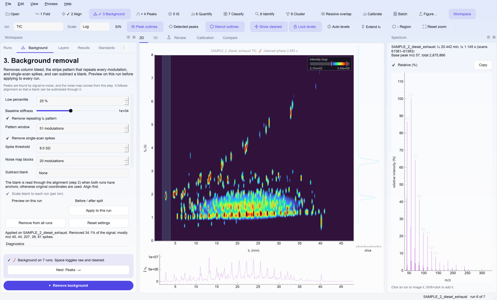
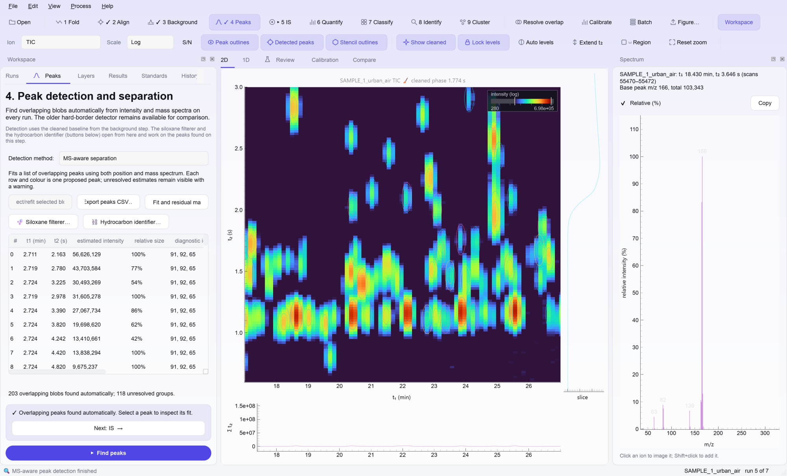
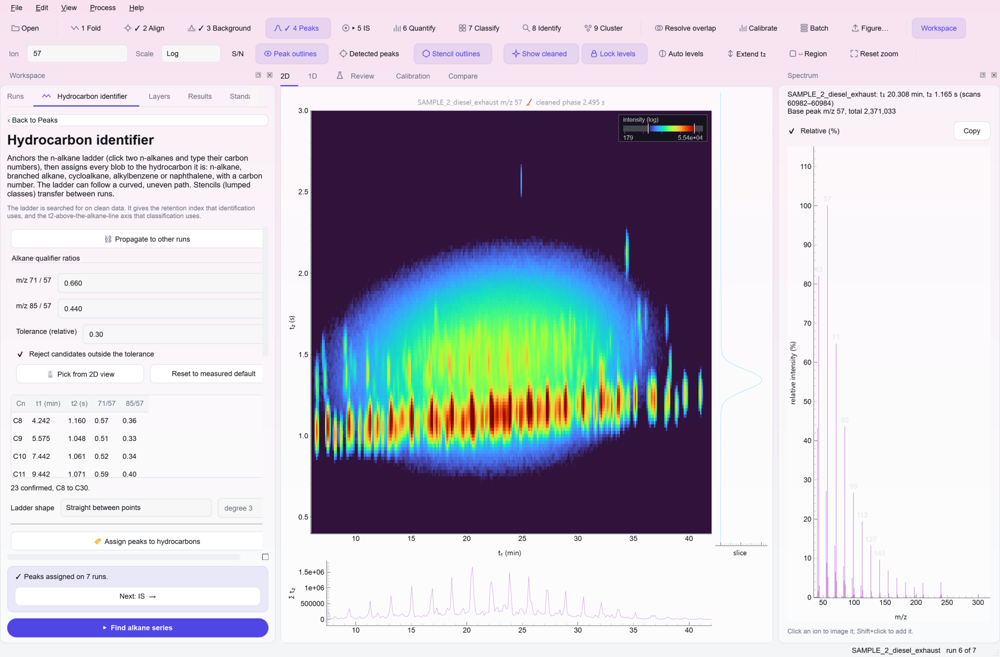
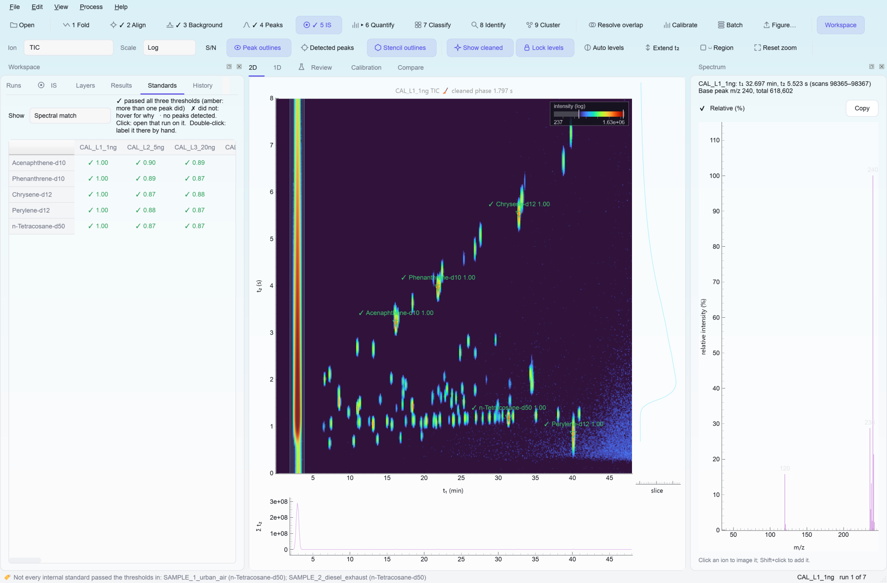
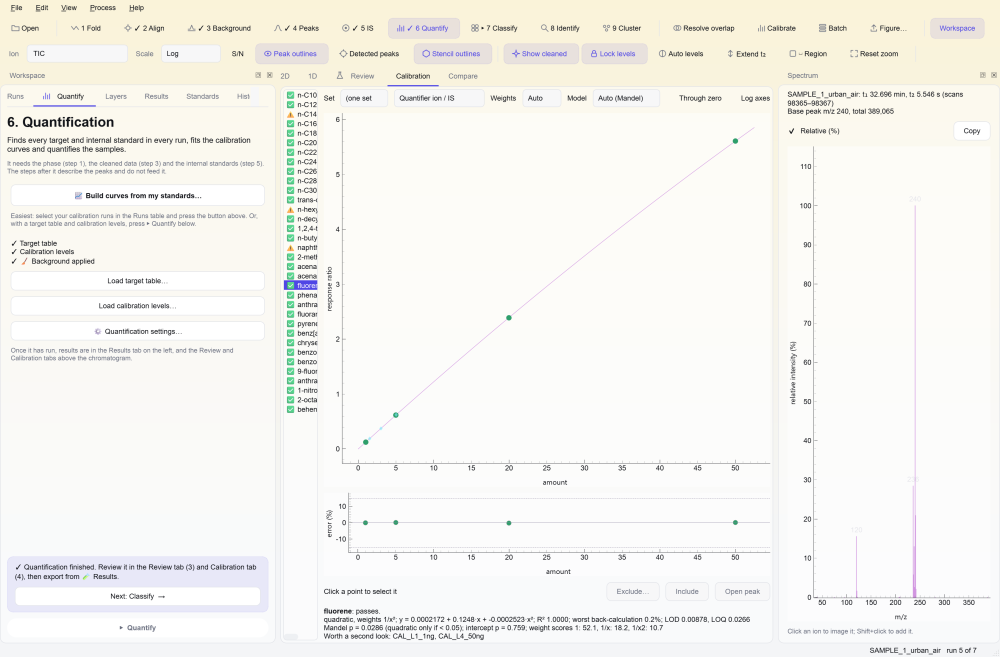
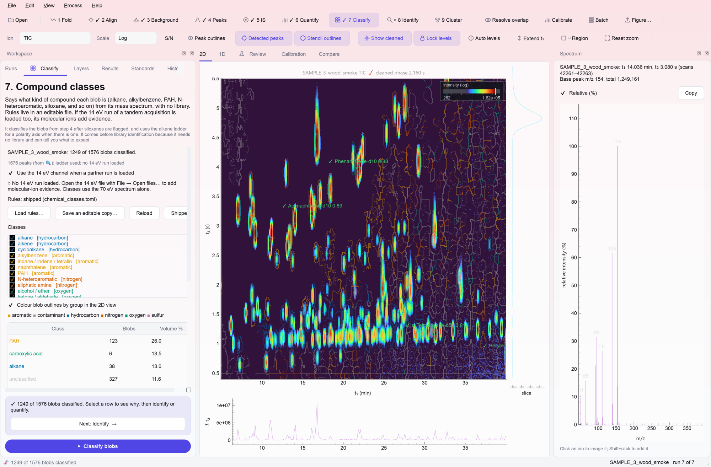
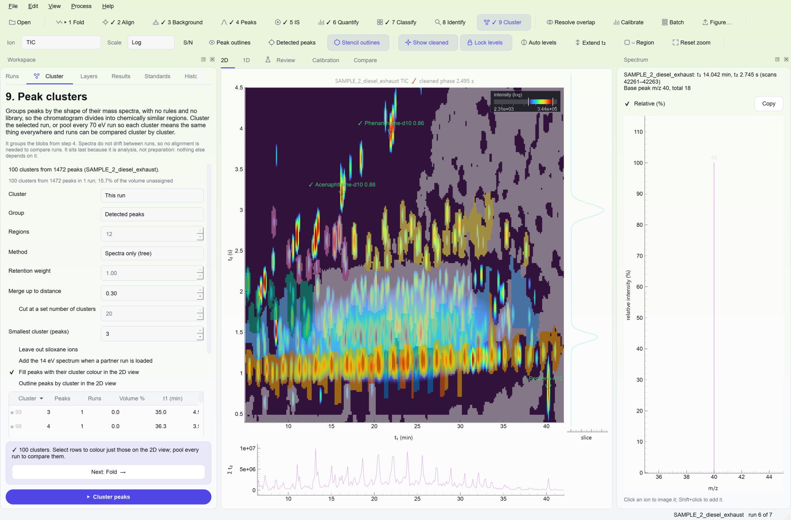
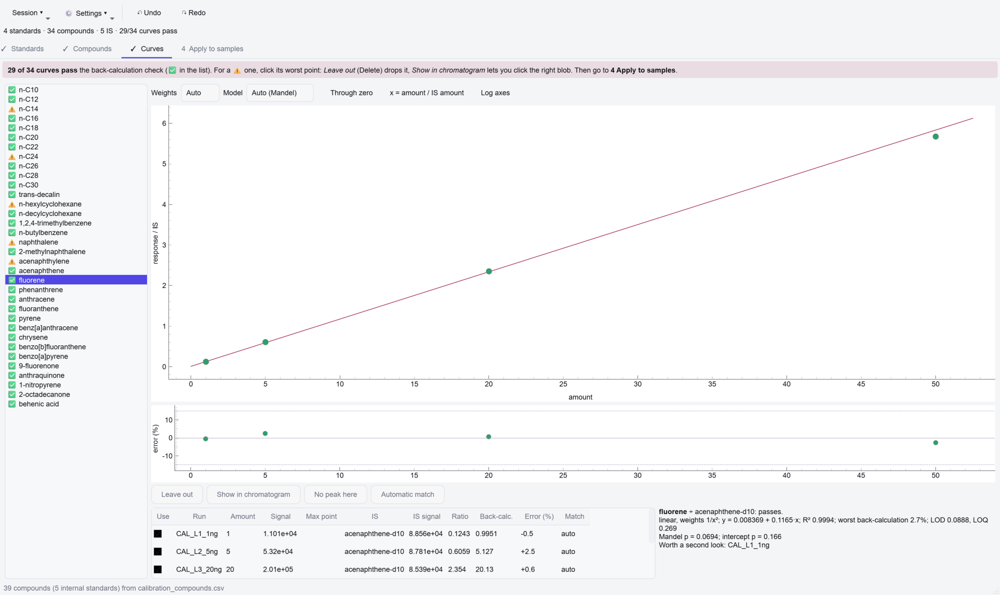
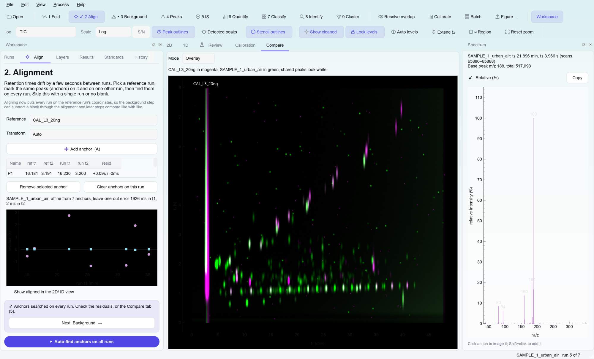
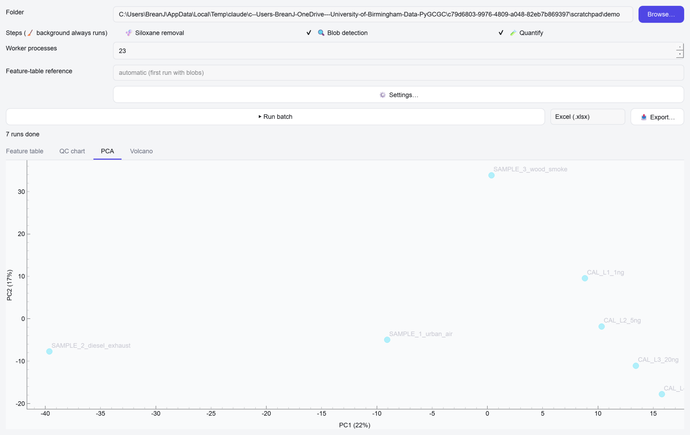

# PyGCGC

A desktop app and Python package for comprehensive two-dimensional gas chromatography with
electron-ionisation time-of-flight mass spectrometry (GC×GC-EI-ToF-MS). It reads native Markes
FT04/SD04 `.lsc` files (including tandem 70/14 eV acquisitions) and ANDI (AIA) `.cdf` exports.



| | | |
|---|---|---|
|  MS-aware peaks |  n-alkane ladder |  internal standards |
|  calibration curves |  compound classes |  spectral clusters |
|  📈 calibration builder |  alignment overlay |  batch PCA |

Screenshots use the synthetic [demonstration data](examples/demo_data/README.md) and smaller
workflow test fixtures. Each view is described in the [user guide](docs/user-guide.md).

## Status

Current guidance, updated 19 October 2026. The methods below have synthetic tests with
known answers. Real-data evidence comes from several dated acquisitions and does not
establish chemical identity or absolute mass accuracy. The [documentation index](docs/README.md)
maps the reports and their limits; remaining work is in [ROADMAP.md](ROADMAP.md).
The latest [code audit](docs/validation/code-audit-2026-10-19.md) passed 850 tests with
31 optional-data skips. Re-run Quantify after updating to include its calibration precision fix.

| Step | What | On real data |
|---|---|---|
| Read | native `.lsc` (70 eV, 14 eV, vendor DBC) and ANDI | Decodes every scan of the supplied files in 1 to 3 s each; vendor comparison of spectra and times still pending |
| 1 Load | native or ANDI data; automatic period and phase, with manual checks under Load | Period found unaided on four runs (8.0000 s, as set in the method); anchor-free phase within 0.2 s of the hand-set value |
| 2 📍 Align | guided anchor collection across runs, local-maximum refinement, shift/affine/smooth transforms, compare modes | Not yet checked on real drift; bounded refinement checked on four native calibration runs |
| 3 🧹 Background | bleed, stripes, spikes, noise map, blank subtraction | Used on every real run; blank subtraction unchecked |
| 4 🔍 Peaks | MS-aware overlapping tilted Gaussian components (default) or legacy blobs | Independent widths and tilt; eight methods compared on 32 real windows, plus known-area recovery in measured backgrounds. See the [fitting check](docs/validation/peak-fitting-2026-10-18.md) |
| 4a 🫧 Siloxane filterer (in Peaks) | score blobs against bleed and cyclic references; block their siloxane ions, or fit per pixel | Defaults chosen on two runs: every siloxane-like blob caught, none of the hydrocarbon signal removed |
| ⛓️ Hydrocarbon assignment (under Assign) | n-alkane ladder (straight, smooth or polynomial), peak assignment, stencils, homologous series | Ladder from two clicks reaches C9–C30 on four runs; one or two carbons wrong per run. Assignment and ladder shapes not yet checked on real data |
| 5 🏷️ IS | label internal standards, find them on every run, write them to the target table | September spectral matches used five provisional identities; three August calibration IS names match the supplied inventory. Isomer identities and spike amounts still need confirmation |
| 6 Assign | target tables, hydrocarbon assignment, compound classes, spectral library search and clustering | Class and cluster methods checked on one earlier run; no independent spectral library check yet |
| 7 🧪 Quantify | targets, internal standards, weighted calibration, bracketing | Planted standards in real matrix: within a few % on selective ions, 15–60% off on busy ones |
| 8 Export | all available tables, assignments, project snapshot and provenance in one folder | Freshness flags and fit warnings are preserved; raw files remain at their source paths |
| 📈 Calibrate | separate window: standard runs, compounds from a table or clicks, IS-normalised peaks, curves edited point by point | Four filename-labelled levels: 59 calibrant and four IS candidates suggested, phases lined up and response bending observed; actual amounts and identities remain unconfirmed |
| 🗂️ Batch, 📤 Reports | cached parallel pipeline, feature table, QC, PCA, volcano, Excel/HTML/PDF | Ran end to end on nine real-matrix runs |

## Install

Python 3.11 or newer. From the repository folder, in PowerShell with your environment active:

```powershell
uv pip install -e ".[gui,test]"
```

This installs two commands, `pygcgc-gui` and `pygcgc`. The core alone (`uv pip install -e .`)
needs numpy, scipy, scikit-image, netCDF4 and threadpoolctl; the extras are `plot` (matplotlib),
`report` (openpyxl), `cluster` (scikit-learn), `gui` and `test`.

## Quick start

```powershell
pygcgc-gui "C:\path\to\folder\of\runs"
```

Work along the numbered toolbar: open a step, set it on the left, press **▶ Go**, then follow the
banner to the next step: **Load → Align (optional) → Background → Peaks → Standards → Assign → Quantify → Export**.
Period and phase are estimated on import; check them under Load. Set each run's
type and calibration level in the Runs table (or with a `sequence.csv`). The project saves itself
beside the runs (`project.pygcgc.json`) and offers to resume next time; background layers and
peak detections are cached on local disk, so reopening does not recompute them. The
[user guide](docs/user-guide.md) covers every step.

**Align collects one anchor across the sequence at a time.** Press **Pick anchors across
runs**, click the peak on the reference and then on each chromatogram as the view advances.
After the last run, it returns to the reference for the next point. The shared table keeps
the clicks visible; skip missing peaks or finish with Esc. **Refine anchors to local maxima**
then adjusts the saved points on their original ion or TIC, including the reference, in one
undoable action. Search limits (default ±1 modulation and ±0.150 s in t2) and transform
diagnostics are under **More alignment options**.
Visible **Add points**, **Delete selected points** and **Start alignment over** buttons
let you extend, edit or restart alignment. Deletion and restarting are undoable; restarting
keeps the reference and returns to P1.

**Peaks uses tilted Gaussian fitting by default**, including automatic selection of the number
of overlapping components. Click **▶ How it works** in the Peaks panel or the manual refit
dialog for a 16-second animation showing narrow detector-time pulses (250 ms in this example),
a highlighted modulation cycle enlarged beside its 2D column, and the fitted contributions.
Pause, seek and replay are available.
The previous automatic default upgrades when old projects are loaded. Rerun **Find peaks**
for new automatic fits; accepted manual fits remain overrides where their regions still match.
Explicit alternative models remain available. Component intensities
are estimates; calibrated amounts still come from Quantify.

**The workflow now guides the remaining decisions.** Quantify → **Set up calibration and
units…** connects named targets, internal standards, run types, levels and known amounts in
four pages. Filename concentrations are suggestions; ambiguous names such as `025ng` and
unknown internal-standard amounts stay blank. Enter the actual amounts and confirm one
unit before applying. Guided inputs travel inside the project and export.
Setup and readiness respect the current curve requirements, including the three-level
default, excluded points and zero-level policy. This route assumes constant IS additions;
the advanced builder supports an amount-ratio workflow for varying additions.

Use **Review missing or uncertain matches…** in Standards for an exceptions queue with
candidate spectra and local fitted-profile comparisons. Choices are per sample and retain
fit warnings. **Preview fitting…** in Peaks tries a selected region, visible interval or
current run without replacing accepted peaks; inspect the fitted sum and residual before
**Use settings and fit all runs**. The workflow explains blocked actions, offers a link to
the prerequisite and clears completion when dependent results become stale.

For native files, confirm the modulation period under Load → Check modulation period and phase (it is not stored in the file);
folder opening picks untreated 70 eV, and **Open files…** loads 14 eV or DBC channels.

## Demonstration data

Seven synthetic runs (four calibration standards, three samples) with about 150 compounds,
impurities, artefacts and the true answer for every number:

```powershell
python examples/demo_data/generate_demo_data.py demo_gcxgc
pygcgc-gui demo_gcxgc
```

[examples/demo_data/README.md](examples/demo_data/README.md) lists what is in the pack and gives
a tour of every step, including the 📈 calibration builder. The tutorials in
`examples/tutorials/` run on the same pack.

## Supporting files

All optional for viewing and cleaning; picked up when they sit in the folder you open.
Quantification needs a target table, a sequence and calibration levels.

Target-only tables can be imported before adding internal standards; quantification
requires those standards before it can run. Invalid imports leave working inputs
unchanged. Ion masses must be positive whole numbers, with finite retention times
and positive search windows. Promoting a library hit preserves the existing CSV's
column order and extra columns, and rejects duplicate compound names.

**`method.json`**: `{"modulation_period_s": 8.0}`.

**`sequence.csv`**: what each run is, in running order (or set it in the Runs table and save it from there).

```
file,type,level,cal_set,volume_m3
CAL_L1_mon.cdf,calibration,L1,monday,
SAMPLE_A.cdf,sample,,,1.2
TUBE_BLANK.cdf,tube blank,,,
```

A type containing "cal" plus a `level` is a calibration run; a type containing "blank" is offered
as a blank. `cal_set` groups calibration runs; a sample between two sets is read against both,
blended by position (turn this off in the quantification settings). `volume_m3` turns amounts into
concentrations.

**`target_table.csv`**: the compounds in your standards; `role` = `istd` marks internal standards,
which also anchor the phase. The 🏷️ IS step can write these rows for you.

```
compound,role,quant_ion,qual_ions,qual_ratios,t1_expected_s,t1_window_s,t2_expected_s,t2_window_s,istd
phenanthrene-d10,istd,188,184;160,,2708,12,4.60,0.25,
phenanthrene,target,178,176;152,,2715,12,4.55,0.25,phenanthrene-d10
```

`t1_expected_s` is the absolute first-dimension time; `t2_expected_s` the true second-dimension
time, which may exceed the period for a compound that wraps. Positions are refined from the
calibration runs, so rough values do. Leave `qual_ratios` blank to learn them from the
calibration runs. Leave `istd` blank to use the nearest internal standard.

**`calibration_levels.csv`**: the amount of every compound at every level, in the unit you want
results in.

```
level,phenanthrene
L1,0.1
L2,0.25
L3,1.0
```

This example supplies the default minimum of three distinct levels for the example
target above. Add a column for each further target. See [input tables](docs/input-tables.md)
for all columns, units, validation rules and the locally generated starter tables.

## Command line

```
pygcgc info  RUN [RUN ...]
pygcgc phase RUN [...] [--period 8] [--targets CSV]
pygcgc fold  RUN [--period 8] [--phase 2.77 | --targets CSV] [--mz 57] [--extend 1.15] [--png out.png]
pygcgc clean RUN [...] [--period 8] [--outdir cleaned]
pygcgc crop  RUN --start 10 --end 14 [--mz-min 35 --mz-max 300] [-o small.cdf]
pygcgc quant FOLDER [--outdir results] [--xlsx] [--no-interpolate]
pygcgc batch FOLDER [--siloxane] [--no-blobs] [--no-quant] [--cluster] [--regions N] [--report all]
pygcgc gui   [FOLDER | PROJECT.json]
```

Without `--period` (and no `method.json`) the period is estimated from the runs and printed.
`quant` writes targets, calibrations, all-signals and internal-standard tables plus
`provenance.json`. `batch` runs the same pipeline across a process pool with a disk cache, adds a
feature table, and optionally clusters and reports. Alignment, the alkane ladder, overlap and
identification are interactive and have no command.

## Python

```python
from pathlib import Path
import pygcgc as g

run = g.read_run("real_data/sample_70eV.lsc")
f = g.fold(run, 8.0, 2.77)
clean = g.remove_background(run, f)
blobs = g.find_blobs(clean.run, f)
ladder = g.find_alkane_series(clean.run, f, [(15, 1953.0, 1.13), (16, 2188.0, 1.12)])
print(ladder.carbon_of(2500.0))          # retention as a carbon number
```

Every module in `pygcgc.core` opens with a plain-English account of its method. The tutorials in
`examples/tutorials/` walk through a whole sequence on the demonstration data pack: reading and
folding, background, quantification, alignment, peaks, siloxanes and the calibration builder.

## Tests

```powershell
$env:QT_QPA_PLATFORM = "offscreen"; python -m pytest tests -q -p no:cacheprovider
```

Allow several minutes, longer during concurrent fitting or with cold caches. Optional
tests need the synthetic dummy pack (`dummy_gcxgc/` beside the repository, or
`PYGCGC_DUMMY_DATA`), native acquisitions/audit files (`PYGCGC_REAL_DATA`) or a saved
manually labelled calibration reference (`PYGCGC_CALIBRATION_DATA`). They skip when
those inputs are not configured. The latest audit records the actual pass/skip totals.

## Documentation

| File | What it holds |
|---|---|
| [docs/README.md](docs/README.md) | documentation map, current evidence and historical reports |
| [docs/user-guide.md](docs/user-guide.md) | every step and panel, and how the methods work |
| [docs/input-tables.md](docs/input-tables.md) | target, sequence and calibration CSV formats, units and starter-table scope |
| [examples/demo_data/](examples/demo_data/README.md) | synthetic demonstration pack, generator and tour; `docs/images/make_screenshots.py` generates the main screenshot set |
| [ROADMAP.md](ROADMAP.md) | known limits, recommended changes and suggested features, in priority order |
| [CHANGELOG.md](CHANGELOG.md) | dated record of what changed and what real-data checks found |
| [docs/architecture.md](docs/architecture.md) | code layout, rules, design decisions, gotchas |
| [docs/validation/](docs/validation/) | method reports and audits, including the [19 October code audit](docs/validation/code-audit-2026-10-19.md) |
| [benchmarks/](benchmarks/README.md) | scripts that reproduce every benchmark and real-data number |
| [CLAUDE.md](CLAUDE.md) | notes for coding agents working on the repository |
| [docs/history/](docs/history/) | superseded plans, specs and handovers, kept for reference |
