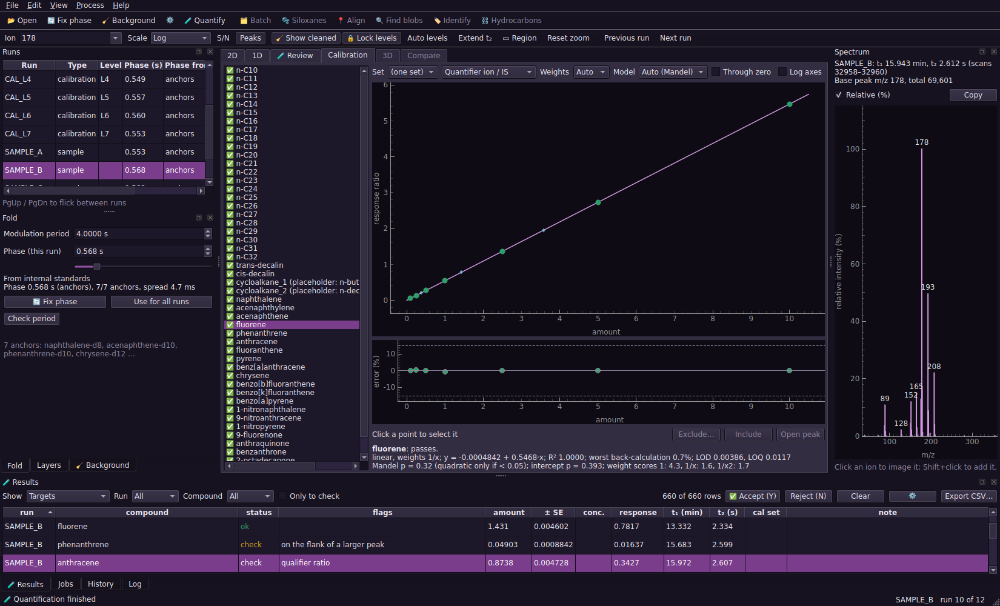
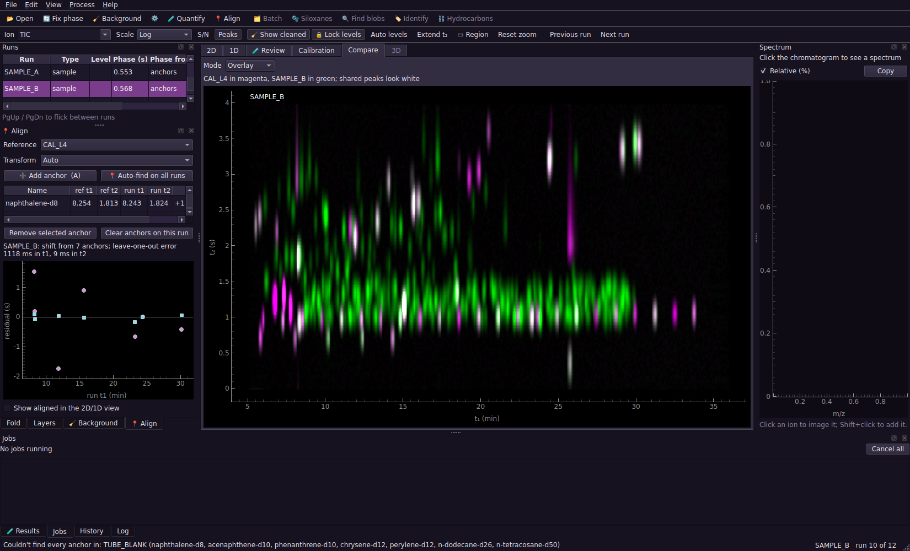

# PyGCGC

A desktop app and Python package for processing comprehensive two-dimensional gas chromatography data with 70 eV electron-ionisation time-of-flight mass spectrometry (GC×GC-EI-ToF-MS). It reads native Markes FT04/SD04 `.lsc` files and ANDI (AIA) `.cdf` exports.


## Contents

1. [Status](#status)
2. [Install](#install)
3. [Quick start](#quick-start)
4. [Getting data out of ChromSpace](#getting-data-out-of-chromspace)
5. [Supporting files](#supporting-files)
6. [Using the app](#using-the-app)
7. [How it works](#how-it-works)
8. [Command line](#command-line)
9. [Python](#python)
10. [Projects](#projects)
11. [Tests and the dummy data pack](#tests-and-the-dummy-data-pack)
12. [Code layout](#code-layout)
13. [Known limitations](#known-limitations)
14. [Roadmap](#roadmap)

## Status

| Milestone | What | State |
|---|---|---|
| 1 | Reading, timing checks, folding, 🔄 phase, period check | Done |
| 2 | App shell: 2D and 1D views, spectra, run list, fold panel, jobs, undo, projects | Done |
| 3 | 🧹 Background removal, despiking, noise map, blank subtraction, S/N view | Done |
| 4 | 🧪 Targeted quantification, calibration sets and interpolation, internal standards, all-signal ratios, review (v1 candidate) | Done |
| 5 | 📍 Alignment (anchors, shift/affine/smooth) and compare modes (blink, grid, difference, overlay) | Done |
| 6 | 🔍 Blob detection (ion-summed S/N, co-elution flag, editing) and per-peak blank scaling | Done |
| 7 | 🫧 Siloxane flagging and per-pixel removal | Done |
| 8 | ✂️ Overlap toolkit (unique-ion map, geometric splits, peak-shape fit, MCR-ALS, cross-run PARAFAC) and a 3D surface view | Done |
| 9 | Retention index (reused from ⛓️) and 🏷️ MS identifier: MSP import, weighted dot-product search, target-decoy confidence, promote to target | Done |
| 10 | ⛓️ Hydrocarbon and isomer mapper, stencils | Done |
| 11 | 🗂️ Cached, parallel batch pipeline, feature table, QC charts, PCA and volcano plots | Done |
| 12 | 📤 Provenance, Excel/HTML/PDF reports, publication figures, PyInstaller spec | Done |

All 12 milestones are done. Milestones 8, 10, 11 and 12 were built ahead of 9 while James looked into a NIST23 licence for the MS identifier; 9 was finally built too, tested against small synthetic libraries with a known answer -- **a real library (NIST or otherwise) hasn't been plugged in yet.**

Native Markes FT04/SD04 `.lsc` import is now implemented and checked against all
three supplied real instrument files. Vendor-spectrum equivalence and the true
retention-time/modulation settings still need independent validation; scientific
defaults remain provisional. See [HANDOVER.md](HANDOVER.md).

## Install

PyGCGC needs Python 3.11 or newer. **There is no `main.py` to run** — this is a proper installable Python package (that's what `pyproject.toml` does), which is more setup than a single script but pays off as two plain commands, `pygcgc` and `pygcgc-gui`, that work from anywhere once installed.

**One-time setup**, in PowerShell (not Git Bash, not Command Prompt — your uv environment lives there), from the repository folder:

```powershell
uv pip install -e ".[gui,test]"
```

No admin rights are needed. This installs:
- `numpy`, `scipy`, `scikit-image` and `netCDF4` for the core
- `PySide6`, `pyqtgraph` and `PyOpenGL` (for ✂️'s 3D view) for the app
- `matplotlib`, `openpyxl`, `pytest` and `pytest-qt` for charts, spreadsheet export and tests

That's it — you only ever need to run this again if the environment gets rebuilt from scratch, or `pyproject.toml`'s dependencies change. (If you only want the core, no GUI, for scripts or a server: `uv pip install -e .` instead. The `plot` extra alone gets you matplotlib for `pygcgc fold --png` and the 📤 report charts without the full GUI; `report` alone gets you openpyxl for Excel export.)

## Quick start

**Every time** you want to use the app, open PowerShell and type:

```powershell
pygcgc-gui
```

That's the whole command — no `python`, no file path, no `cd` into the repository first. It opens an empty window. To open it straight into a folder of runs instead:

```powershell
pygcgc-gui "C:\path\to\your\data\folder"
```

(Quote the path if it has spaces in it, as this one does.) If you haven't got real data to hand yet, unzip the dummy data pack and point it at that folder instead.

Once it's open:
1. Wait a moment: the runs load and every phase is estimated in the background.
2. Work along the toolbar: open a step, press ▶ Go on the left, and follow the banner to the next step. For a first look, 1 🔄 Fold then 3 🧹 Background is enough.
3. Open step 8 🧪 Quantify and press ▶ Go. Every target and internal standard is found in every run, the calibration curves are fitted, and the samples are quantified.
4. Work through the 🧪 Review tab (Y accepts, N rejects) and check the Calibration tab.
5. Export the results from the 🧪 Results panel.

## Getting data out of ChromSpace

**Direct instrument import:** open your output folder with `pygcgc-gui real_data`,
or pass an individual `.lsc` file to the GUI or CLI (`pygcgc info FILE.lsc`). No
CDF conversion or DAT/HDR sidecars are required for the supported FT04/SD04 variant.
Folder discovery selects untreated 70 eV when it can unambiguously group the native
files. Use **Open files…** to select 14 eV or vendor DBC explicitly; `sequence.csv`
also takes precedence over the default. The run list labels channel and processing
state. Project files retain source hashes and reject changed source contents.

Native times retain the channel offset and use the whole acquisition-clock second
as their common origin. The exact offset from the vendor retention-time display is
unvalidated. Confirm the modulation period in the Fold panel or `method.json`;
the initial 4 s setting is not inferred from LSC. Until confirmed, native runs are
labelled **Check modulation period**. The DBC file is already background corrected;
applying Background adds another correction. Blank subtraction still uses original
coordinates, not alignment transforms. Mixed-energy quantification is rejected,
and the GUI's current 70 eV library workflow disables identification for 14 eV.

Original centroid spectra remain available through the context-managed
`pygcgc.core.io.markes_lsc.LSCFile.spectrum(scan)` API. The app uses rounded unit-mass
bins with duplicate bins summed. See [the format report](real_data/NATIVE_LSC_REPORT.md)
for byte-layout evidence and unresolved vendor semantics, and the
[implementation validation notes](docs/NATIVE_IMPORT_VALIDATION.md) for checks and limitations.

PyGCGC reads ANDI/AIA netCDF (`.cdf`), which ChromSpace can export. Export the raw, unfolded detector stream with all masses (centroided is fine). Put the files for one sequence in one folder, ideally inside a `data/` subfolder, with the supporting files below alongside.

Nothing about the phase or modulation period is taken from the file, because ANDI has no place for it. The period comes from `method.json` or the Fold panel. If neither sets it, both the period and the phase are estimated from the runs when they open (see **Fold** below).

## Supporting files

All four are optional for viewing and cleaning, and are picked up automatically when they sit in the folder you open. Quantification needs the target table and the calibration levels.

**`method.json`** gives the modulation period in seconds:

```json
{"modulation_period_s": 4.0}
```

**`sequence.csv`** says what each run is, in running order. The columns:
- `type` is free text. A type containing "cal" plus a `level` marks a calibration run; any type containing "blank" is offered first as a blank for subtraction.
- `level` names a row of the calibration levels file.
- `cal_set` (optional) groups calibration runs into sets, for example one set at the start of a week and another at the end. Each set gets its own curves. A sample with its own `cal_set` uses that set exactly. Any other sample sits between two blocks in run order, and its amount is blended from both curves, weighted by how far along it sits (bracketing standards, the usual way to correct for drift between calibrations). A sample outside every block (before the first, or after the last) uses the nearest one alone and is flagged as extrapolated. Turn this off in the quantification settings to fall back to "own set, else the most recent one before it".
- `volume_m3` (optional) is the sampled air volume, used to turn amounts into concentrations.

```
file,type,level,cal_set,volume_m3
CAL_L1_mon.cdf,calibration,L1,monday,
CAL_L5_mon.cdf,calibration,L5,monday,
SAMPLE_A.cdf,sample,,,1.2
TUBE_BLANK.cdf,tube blank,,,
CAL_L1_fri.cdf,calibration,L1,friday,
```

**`target_table.csv`** lists the compounds in your known standards. Rows with `role` set to `istd` are the internal standards: they anchor the phase, are found in every run, and every other signal is divided by one of them.

```
compound,role,cls,quant_ion,qual_ions,qual_ratios,t1_expected_s,t1_window_s,t2_expected_s,t2_window_s,istd
naphthalene-d8,istd,IS,136,108;68,0.083;0.097,707.9,12,1.82,0.25,
naphthalene,target,PAH,128,126;64,0.121;0.090,709.0,12,1.85,0.25,naphthalene-d8
```

The columns mean:
- `quant_ion`: the quantifier ion. `qual_ions` and `qual_ratios` (semicolon-separated) are qualifier ions and their expected size relative to the quantifier; leave the ratios blank to learn them from the calibration runs.
- `t1_expected_s`: absolute first-dimension retention time in seconds, the time the compound's brightest pulse leaves the first column.
- `t2_expected_s`: the true second-dimension time. It may be longer than the modulation period for compounds that wrap around.
- `t1_window_s`, `t2_window_s`: half-widths of the search window. By default the positions are refined from the calibration runs, so rough values will do.
- `istd`: the internal standard this compound is divided by. Leave it blank to use the nearest one.

**`calibration_levels.csv`** (or `calibration_levels_ng.csv`) gives the amount of every compound at every level, in whatever unit you want results in (for example ng on tube):

```
level,naphthalene,fluorene,benzo[a]pyrene
L1,0.1,0.1,0.1
L2,0.25,0.25,0.25
```

## Using the app


### Layout

- **Left:** one panel, "Workspace", with three tabs. **Runs** is the run list, **Tool** shows the open step's settings and its Go button (its tab is named after the step), and **Layers** shows which runs are cleaned or aligned. Opening a step from the toolbar switches to the Tool tab.
- **Top toolbar:** 📂 Open, the eight numbered steps, then ✂️ Resolve overlap, 🗂️ Batch, 📤 Figure and the panel buttons.
- **Centre:** the 2D and 1D views, the 🧪 Review gallery and the Calibration curves.
- **Right:** the spectrum.
- **Bottom:** four tabs, 🧪 Results, Jobs, History (undo) and Log.

Every panel can be moved, floated onto a second screen or hidden. To bring one back, use the **Workspace** and **Spectrum** buttons at the right of the top toolbar, or **Panels ▾** (also View → Panels) for every panel, including the bottom tabs. **Reset layout** in the same menu restores the default arrangement.

**Colours.** The default theme uses the Financial Times palette: a salmon paper background, near-black text and claret highlights. View → Dark theme switches to the dark palette. The chromatogram colour map (turbo) is the same in both.

### Workflow panel

The eight numbered buttons on the top toolbar are the steps, in working order. The left-hand panel shows only the open step: its settings, then one Go button.

1. Press a step on the toolbar. Its settings appear on the left; nothing runs yet.
2. Set what you want.
3. Press **▶ Go** at the bottom of the left panel. It runs that step on every run.
4. A banner reports the result and offers **Next: …**. It never switches step by itself, so you can look at the result first.

| Step | Settings shown | Go does |
|---|---|---|
| 1 🔄 Fold | period, phase | estimates the phase of every run |
| 2 📍 Align | reference run, anchors | finds the anchors on every other run |
| 3 🧹 Background | 🧹 settings, aligned blank, preview, split view, diagnostics | removes background on every run |
| 4 🔍 Peaks | MS-aware regions or legacy blob table | runs the selected detection method on every run |
| 5 🫧 Siloxane | reference spectrum, certainty slider | blocks out (or fits) siloxane blobs on every run |
| 6 ⛓️ Hydrocarbons | qualifier ratios, stencils, series | starts the two-click alkane flow |
| 7 🏷️ Identify | notes | opens the identifier window |
| 8 🧪 Quantify | what is loaded, load buttons, settings | quantifies (disabled, with the reason, until a target table is loaded) |

**Why this order.** Each step's panel shows a "Why here" line, the toolbar tooltips repeat it, and Help → Workflow guide lists all eight. In short:

1. **Fold first.** Every later step works on the folded image, and a wrong phase splits peaks across its top and bottom edges.
2. **Align second.** Retention drifts between runs. Aligning early puts every run on the reference run's coordinates, so a blank can be subtracted through the alignment in step 3. With a single run, skip it.
3. **Background third.** It removes bleed, the repeating t₂ stripes and spikes, and builds the noise map that peak detection uses for signal-to-noise.
4. **Blobs fourth.** Detection needs the flat baseline from step 3. Steps 5 to 8 all start from these blobs.
5. **Siloxane fifth.** It blocks out whole blobs, so it needs step 4. It runs before the ladder and identification so contaminants do not enter them.
6. **Hydrocarbons sixth.** The n-alkane ladder gives the retention index that identification uses.
7. **Identify seventh.** It searches the blobs from step 4 and uses the retention index from step 6 when there is one.
8. **Quantify last.** It needs the phase and the cleaned data; everything before it makes its peaks clean and correctly placed.

The order is a recommendation. Nothing stops you running a step early or again after changing something upstream, but results from later steps are not rerun for you: rerun them.

On the toolbar a ✓ marks a finished step, ▸ marks the suggested next one and the open step is highlighted. Removing 🧹 or 🫧 clears its tick. The old menu items (Process menu) and the extra buttons inside each step (Apply to this run, Remove, Propagate, Reset) still work. ✂️ Resolve overlap, 🗂️ Batch and 📤 Figure are separate windows on the toolbar.

### 2D view

- The folded chromatogram runs t₁ across and t₂ up.
- The default colour map is turbo. A small colour key is pinned to the top-right corner of the image. The grey track is the range of the data and the coloured part is what the colour map is stretched over, with the lower and upper limits printed underneath. Drag either end to move that limit, drag the coloured part to slide both, and double-click the key to type exact limits, or press Reset to default to return to the automatic levels. On the log scale the key is a logarithmic axis: limits are shown and typed as intensities (for example 1e3 to 1e6), with a tick at each decade; on the √ scale they are in √ units. Right-click the key to change the colour map.
- A t₂ slice follows the cursor, and a reconstructed 1D trace underneath shares the t₁ axis.
- The status bar shows t₁, t₂ and the value under the cursor.
- **Click** any pixel to see its spectrum.
- **▭ Region (R)** gives a draggable box whose summed spectrum appears on the right.
- **Extend t₂ (E)** adds a band above the dashed period line so wrapped peaks appear whole. The band repeats the bottom of the next modulation.
- **Scale** can be log, square root or linear (L cycles through them). **Auto levels** (Ctrl+L) resets the colour range.
- **🔒 Lock levels** (on by default) keeps the colour range when you flick between runs, so differences stand out.
- **S/N** shows signal-to-noise. It needs 🧹 on that run, because the noise map comes from background removal.

### Ion box (M)

| Type | Shows |
|---|---|
| `TIC` | total ion signal |
| `178` | one ion |
| `178+202+228+252` | the sum of ions |
| `200:260` | every ion in a range |
| `57/71` | a ratio image, handy for telling compound classes apart; the colour scale switches to linear |
| `57+71/85` | the ratio of a sum to an ion |

In the spectrum, click an ion to image it; Shift+click adds it to the current sum.

### 1D view

- **Top:** the reconstructed 1D chromatogram, with a draggable band. The same band appears on the 2D view.
- **Bottom:** the raw detector stream for that band. Zoom in to a few minutes and the modulation boundaries appear, which is the quickest way to see how peaks are sliced and to spot wrap-around.
- Double-click either plot for the spectrum at that time.

### Runs

- Select a row, or use PgUp/PgDn, to change run. Zoom, ion and colour levels stay put.
- Neighbouring runs are prepared in the background, so flicking is instant.
- Right-click a run to remove it from the project.
- The Timing column warns about dropped scans or irregular timing.

### 🔄 Fold

- Set the modulation period, and the current run's phase, with the spin box or slider. The image refolds as you drag.
- **Go** (or the Process menu) re-estimates every run. With a target table it uses the internal standards; runs where they aren't found, such as tube blanks, borrow the phase of the others.
- **Use for all runs** copies the current phase to every run.
- **Check period** fits the period from this run's internal standards and offers to apply it if the correction is statistically significant.
- **Estimate period** replaces the period, even one set by hand or by `method.json`, with an estimate from the runs, then re-estimates every phase. It is undoable.

When runs open and no period has been set by hand or by `method.json`, the period is estimated from up to three evenly spaced runs and applied at once. The line under the period box says how it was found and whether to trust it. A period set by `method.json` or by hand is kept; the runs are only checked against it, and a message appears if they clearly disagree.

- The period is the frequency at which the total signal repeats, so it needs no anchors. A solvent front is detected and left out.
- **Confidence** says whether a period is established at all. If it is low, the period is left unchanged.
- **Drift** says how well it is pinned down: the standard error times the number of modulations, i.e. how far peaks at the end of the run could sit from where they should. Compounds alone constrain the period only to a few milliseconds; column bleed and other structure locked to the modulator do better. If the drift exceeds a quarter of a second the line turns amber, and the period should be checked with **Check period** against internal standards.
- Without anchors, the phase puts the cut just inside the far edge of the longest quiet stretch of the second dimension, so signal starts near the bottom of the image. This is a place to cut, not the modulator's true start. Its confidence is low when wrap-around leaves no quiet stretch. Internal standards, when found, give the true phase and take priority; a table with a single anchor is enough.
- On the command line, `pygcgc fold`, `phase`, `clean` and `quant` estimate the period when `--period` is omitted (and no `method.json`), print the estimate, and stop if none can be found reliably. `pygcgc batch` does the same and records `modulation_period_estimated` in `provenance.json`.

### 🧹 Background

- Step **3 🧹 Background** shows the settings; **Go** cleans every run with them (Process → 🧹 Background does the same).
- Tick **Preview on this run** to try settings live on the current run before applying.
- Tick **Before / after split** and drag the white line to compare.
- **Space** switches between raw and cleaned data everywhere: the image, the 1D view and spectra.
- The Layers tab shows which runs are cleaned.

The settings:

| Setting | Default | What it does |
|---|---|---|
| Low percentile | 20% | Low value taken down each modulation as the starting point for the background |
| Baseline stiffness | 1e4 | How closely the baseline may follow changes along t₁: about ten modulations on a 31-minute run. The setting is scaled with run length, so it means the same smoothness in minutes for shorter or longer runs. Soften it if bleed changes quickly, stiffen it if big tailing peaks get eaten |
| Remove repeating t₂ pattern | on, 51 modulations | Stripes that repeat every modulation. The window must be much wider than any peak |
| Remove single-scan spikes | on, 8 SD | Points far above all four neighbouring scans |
| Noise map blocks | 20 modulations | Length of each stretch of t₁ in the noise map |
| Subtract blank | none | A blank run, cleaned the same way and subtracted per ion, never going below zero |
| Scale blank to each run | on | Per-artefact scale from the median sample-to-blank ratio, worked out separately for each connected region of significant blank pixels on an ion, so two artefacts sharing an ion but varying independently between tubes don't share one compromise factor. Whatever significant signal isn't part of any of those regions still falls back to one scale for the ion as a whole |

The diagnostics show what's left of the background for one ion. A good correction looks like:
- a histogram centred on zero, with a spread matching the noise map (the blue curve)
- points lying along the line in the normal quantile plot

The panel also lists the ions that lost most signal.

Background layers are rebuilt automatically when a run's phase or the period changes. Applying and removing 🧹 are both undoable.

### 🧪 Quantification

![Review gallery: benz[a]anthracene across the sequence, flagged where it shares a peak with chrysene](docs/screenshot_review.png)

Step **8 🧪 Quantify** (Go) runs the whole thing in the background:
1. Every target and internal standard is found in the calibration runs on its own quantifier ion, and their average positions are learned from there. Each later search is also shifted by however far its internal standard has moved in that run.
2. Every run is measured with those positions. Several candidate peaks may sit inside a target's window; each is scored on its distance from the expected position, how well its qualifier ratios match, and how clearly it stands out of the noise. If the runner-up scores almost as well, the result is flagged as ambiguous.
3. Every other peak in every run (a TIC blob) is found as well.
4. For each target, its volume is divided by its internal standard's volume (the response ratio), and a calibration curve is fitted for every calibration set.
5. Samples are read back through their bracketing set(s) to give amounts with a standard error, then divided by the sampled volume.

It works on 🧹 cleaned data where that has been applied, and on raw data otherwise.

**Peak overlay.** On the 2D view every peak found is outlined. Targets are marked with circles (lilac, amber when flagged, red when rejected) and internal standards with teal squares. O shows or hides the overlay.

**🧪 Review tab (3).** One tile per peak, showing its quantifier-ion image, its outline, the amount and any flags. Show one compound across every run, or every compound in one run, and tick Only to check to skip the clean ones.
- Arrow keys move, Y accepts, N rejects, U clears the decision.
- Enter or double-click opens the peak in the 2D view with its spectrum.
- P picks a different peak: click the right one in the 2D view (Esc cancels), and that run is re-measured.

A tile is flagged amber when:
- a qualifier ratio is off
- the peak is saturated
- the choice was ambiguous
- two targets share one peak
- the peak is cut by the wrap boundary
- it sits on the flank of a larger peak
- it is off position



**Calibration tab (4).**
- **Plot:** each compound's curve with its points, the samples as diamonds, and a relative-error plot underneath with the acceptance limits dashed. Choose the calibration set, and whether to show the quantifier-ion curve or the whole-peak (TIC) curve used for nearby unknowns.
- **Weights, model and zero:** Auto picks the weights by relative error and uses Mandel's test for straight versus curved. You can override either, and force the curve through zero.
- **Points:** click a point to select it. Exclude… asks for a reason, which is saved; Include puts it back; Open peak shows it.
- **Statistics:** the text below lists the model, weights, R², worst back-calculation, LOD, LOQ, Mandel p and intercept p, plus any points with large studentised residuals or Cook's distance.

**🧪 Results panel.** Four views of the same results. Double-click any row to jump to the peak. Filter by run and compound, or tick Only to check. Export CSV… writes all four tables.

| View | Contents |
|---|---|
| Targets | every target in every run: status, flags, amount ± SE, concentration, response ratio, position, calibration set (e.g. `mon→fri (40%)` when blended) |
| All signals | every peak in every run: volume, the nearest internal standard, **volume ÷ that standard's volume**, the target it belongs to (if any), and a semi-quantitative amount |
| Internal standards | each standard in each run, its volume relative to its own median across the sequence, and a flag beyond the tolerance, with a trend chart above the table |
| Calibrations | one row per compound and set, with pass or fail and the statistics |

**How "nearest" works.** Distance is measured with 60 s along t₁ counting the same as 0.5 s along t₂ (both adjustable in the settings). The internal standard named in the target table always wins for that target; unknown peaks use the nearest one.

**Semi-quantitative amounts for nearby peaks.** An unknown peak within 3 distance units of a calibrated target is given an amount "as" that target. This uses the target's whole-peak (TIC) curve, so it assumes the unknown gives the same total signal per nanogram as its neighbour. That is roughly true within a compound class and can be badly wrong across classes, which is why these amounts are labelled with the target used and kept in their own table. Treat them as estimates.

**Settings** (⚙️ in the Results panel, or Process → Quantification settings). The main ones:

| Setting | Default | What it does |
|---|---|---|
| Qualifier tolerance | 20% | allowed relative deviation of each qualifier ratio |
| t₁ / t₂ tolerance | 4 s / 0.04 s | how far a peak may sit from its expected position before its score drops |
| Learn positions | on | take expected positions from the calibration runs |
| Move with internal standard | on | shift each target by its standard's shift in that run |
| Ambiguity | 0.8 | runner-up score, relative to the best, above which a result is flagged |
| Detector ceiling | from the data | intensity at which a point counts as saturated |
| IS tolerance | 50% | internal standard volumes further than this from their median are flagged |
| Interpolate calibration sets | on | blend the two bracketing sets by run position; off uses the nearest set before |
| Peak S/N | 10 (blobs), 5 (targets) | minimum signal-to-noise for a peak |
| Calibration limits | ±15%, ±20% lowest | back-calculation acceptance |

Changing settings marks the results out of date; the banner in the Results panel reruns them.

### 📍 Alignment and compare

Retention drifts a little from run to run: a few seconds in t1, a few hundredths of a second in t2. Alignment fits a map from one run's true coordinates onto a chosen reference run's, so images can be resampled onto the same grid and compared pixel for pixel.

**Picking a reference.** In the 📍 Align panel, choose the run everything else will be aligned to (a calibration run in the middle of the sequence is a reasonable default). The reference is always shown as itself, never resampled.

**Anchors, by hand.** ➕ Add anchor (A) starts a two-click flow: the view switches to the reference run for you to click a peak, then to the target run to click the same peak, and the pair is recorded. Add a few (spread across the run) and a transform is fitted automatically:
- **1 anchor:** a plain shift in t1 and t2.
- **3 or more:** a straight stretch and shift in t1, plus a t2 offset that can itself vary linearly with t1 (useful when the second dimension drifts differently early and late in the run). Both fits are Huber-weighted, so one bad click doesn't wreck the rest.
- **6 or more:** a smooth curve instead of a straight line — a monotone cubic through the t1 anchors and a smoothing spline for the t2 offset.

Auto (the default) picks the simplest tier that already fits the anchors well; you can force a tier with the Transform dropdown. If a run's anchors come out in a different order than the reference's, no honest time correction passes through them; the transform is flagged rather than trusted, and the panel explains why.

**Anchors, in bulk.** 📍 Auto-find on all runs searches every other loaded run for the anchors you've already named (by ion, within a window around the reference position, the same search phase estimation uses) and builds a transform for each. Missing ones are reported rather than silently skipped.

**How good is it?** The panel's residual plot and summary give leave-one-out error in seconds: each anchor is predicted from the others and compared to where it was actually clicked, which is a more honest number than how well the curve fits the points it was built from.

**Seeing it.** 📍 Show aligned (in the panel, or the toolbar) resamples the current run onto the reference's grid in the 2D and 1D views, so the ion box, colour scale and everything else keep working as normal, just on the reference's axes.

**Compare tab (5).** Once at least one run has a transform:
- **Blink** alternates the reference and the current run at a steady rate, so anything that moved (or didn't) jumps out.
- **Grid** tiles every aligned run (up to 12) on a shared colour scale with linked pan and zoom.
- **Difference** shows the reference minus the current run, scaled by the median ratio of their brightest shared pixels (a brightness match, not a concentration ratio), on a diverging colour scale.
- **Overlay** puts the reference in magenta and the current run in green, so shared peaks look white and differences show colour.

**Undo.** Every anchor added, removed or cleared, and every reference or transform-kind change, is undoable.



**Not built:** clicks don't yet snap to a peak's intensity-weighted centre (click precisely, or zoom in first); the batch search matches anchors independently rather than with a full Hungarian-plus-RANSAC pass across every blob; and there's no small-multiples gallery of one target across every run yet. These are candidates for the milestone 11 batch upgrade once real data show whether they're worth it.

### 🔍 Peak detection and separation

Step 4 offers two peer detection methods in a saved selector. **MS-aware separation** is the new route for crowded real data. **Legacy blob borders** keeps the old behaviour for comparison and for existing tools that still consume `BlobSet`. Both run across every loaded run from **Find peaks**.

**MS-aware separation** finds local peaks on individual mass channels, groups channels that independently agree on position, and requires a local peak in total signal as corroboration. It displays white centre crosses and cyan dashed analysis rectangles. These rectangles are work areas, not ownership borders: several fitted compounds may contribute to the same pixel. The table reports the number of candidate centres and supporting ions in each region. Select one and press **Resolve selected region…** to see overlapping coloured component contributions and their estimated amounts. Weak estimates are retained but labelled low confidence; a set containing one is described as an unresolved group.

**Legacy blob borders** combines ion evidence into one surface and uses watershed to assign every pixel to one blob. On the supplied busy real file, small positive residuals across hundreds of ions accumulate and make this route over-detect broad background and join peaks. It remains useful for compatibility and controlled comparison, but should not be treated as the preferred scientific representation of overlap.

In legacy mode, **🔍 Find peaks** detects blobs on every loaded run: the sum of every ion's own signal-to-noise image combined with plain total-ion S/N. A watershed grows each seed into a footprint, trimmed to 1% of its own apex.

In legacy mode, the table lists every blob on the current run: position, volume, S/N, width in t1 and t2, how many modulations it spans, a co-elution flag, and whether it looks like siloxane (see 🫧 below).

- **🔍 Blob outlines** (toolbar or View menu) draws every footprint in amber; clicking a peak in the 2D view selects the nearest one in the panel, and selecting a row in the panel bolds its outline in the view.
- **➕ Add** starts a one-click flow (like 📍 add anchor or 🧪 pick a peak): click a real peak that automatic detection missed (too faint on its own, or shadowed by a bigger neighbour), and its footprint is grown from that pixel.
- **Merge (G)** combines the blobs selected in the panel into one: volume, pixel count and the summed spectrum are exact sums (footprints never overlap), and the combined position and width come from each one's own position and width weighted by volume (the parallel-axis theorem). Co-elution isn't re-tested on a merged peak.
- **Delete** removes the selected blobs.
- Add, delete and merge are all undoable (Ctrl+Z), and are saved with the project as a small edit log, replayed on top of a fresh detection the same way 🧪's review decisions sit on top of a fresh quantification. The log is positional (which blob is "the third one" depends on `find_blobs` producing blobs in the same order), which holds up across a fold or 🧹 change but not across a change to the 🔍 settings, so a settings change clears it rather than risk applying it to the wrong blob. There's no settings dialog for 🔍 yet; the defaults apply.

**Not built:** the watershed/seeding pass is split into overlapping stretches of t1 and run across a thread pool for speed on long runs, but that hasn't been exercised against real, hours-long data yet. Co-elution clustering is a heuristic (single-linkage on each ion's own local apex position) that hasn't been checked against real co-eluting compounds either.

### ✂️ Resolve overlap

Open a selected MS-aware region directly from step 4, or inspect a legacy blob from the toolbar. The fitted result is currently read-only: candidate settings and the selected detection method are saved, while fitted components are not yet persisted or sent to quantification.

- **Region/blob picker.** MS-aware regions are listed when that method is active; otherwise every legacy blob is available, with co-elution flags first.
- **3D surface.** The picked blob's own footprint, as a rotatable height surface (pyqtgraph OpenGL, coloured with the same magma map as the 2D view) -- two peaks close in position and height are often easier to tell apart from an angle than looking straight down.
- **Unique ions / split.** Where each of the blob's own significant ions actually peaks, and which cluster they fall into (more than one means the ions don't agree on where the compound peaks -- probably more than one compound). "Split at each cluster's own apex" runs a fresh watershed seeded there and reports each region's volume.
- **Peak-shape fit.** A joint fit of k two-dimensional peak shapes (Gaussian, or an EMG along t1 for a tailing peak) times mass spectra, "Choose k automatically" picking whichever fit minimises BIC. Reports each component's position (with a standard error, from the fit's own Jacobian) and volume.
- **MCR-ALS.** A free-form alternating-least-squares decomposition into k non-negative concentration profiles and spectra, no peak shape assumed; reports each component's dominant ion and volume.

**Not built:** a way to draw a straight-line or valley-path split by hand in the 2D view (`core/overlap.split_by_line`/`split_by_valley` exist and are tested, just not wired to a drawing tool); PARAFAC across several runs at once (`core/overlap.parafac`, `core_consistency`, `split_half_stability`, `build_run_tensor` are all built and tested, but there's no button anywhere yet -- call them from Python); PARAFAC2 itself was never built (see Known limitations).

### 🫧 Siloxane removal

Column bleed and cyclic siloxane contaminants (Dn) fragment under EI onto a recognisable set of ions. Flagging and removal are independent of each other, and both fit against one **reference spectrum**.

**The reference spectrum** (🫧 Siloxane tab, left). The default is the column bleed measured in the supplied real run: m/z 207 is the base ion, followed by 281 (18%), 208 (17%), 209, 96, 191, 133 and 73 (only about 7%). It was taken as the slope of each ion against m/z 207 through the last 30 minutes of the run, which keeps what rises with the oven temperature and drops the constant background (39, 40, 44). Three ways to change it:
- **Presets:** *Column bleed (measured)*, *Cyclic siloxane peak (measured)* (a discrete Dn peak at 29.3 min in the same run: 73, 147, 281, 282, 283) and *Generic Dn (old default)*.
- **Edit the table:** change an intensity, add an ion (＋ Ion) or drop one (－ Remove selected). The bar chart shows the reference as it will be used.
- **🖱 Pick from 2D view:** click a siloxane peak, and that point's spectrum (ions of at least 3% of the base peak above m/z 45, at most 20) becomes the reference. *Subtract local baseline* is on by default, which is right for a discrete peak; switch it off when you click plain column bleed, which the baseline subtraction would otherwise remove. Esc cancels.

The bleed reference leaves a discrete Dn peak alone (its ion ratios do not match), and the cyclic reference leaves the bleed alone; pick the one you want to remove. Changing the reference updates the 🔍 flags at once; layers already applied keep their old fit until you press 🫧 Apply again (the panel says how many).

**Flagging** happens automatically wherever 🔍 blobs are shown: every blob is scored (the fraction of its volume on the reference ions, times its cosine similarity to the reference) and the 🔍 Blobs panel's "🫧 siloxane?" column marks anything at or above the threshold. The threshold is still provisional (see Known limitations).

**Blocking out siloxane blobs (default method).** The slider in the 🫧 tab, *Siloxane certainty ≥*, sets how sure a 🔍 blob must be to count as siloxane. A blob's certainty is the score above as a percentage. Drag it and the blobs at or above it are outlined in dashed magenta in the 2D view (the 🔍 outlines switch on for you), the 🔍 table's 🫧 column shows each blob's percentage, marked *yes* at or above the slider, and the panel counts how many blobs on the current run qualify. **🫧 Siloxanes** then zeroes every scan inside those blobs' footprints, on every ion (untick *Block every ion in the blob* to zero only the siloxane ions). Nothing is fitted.
- 🫧 finds the 🔍 blobs first if a run has none, or if they are out of date. Blobs are always found on the layer beneath 🫧 (🧹 if applied, otherwise raw), so a blocked-out blob is still listed and outlined, and the slider keeps working after 🫧 is applied.
- Delete a blob in the 🔍 panel to keep it out of the removal, or use ➕ Add to include a peak the detector missed.
- A blob's footprint stops at 1% of its apex, so a faint edge tail (about 0.4% of the signal in the synthetic test) remains.
- Pressing 🫧 again replaces the previous layer using the current slider and reference; it does not stack on it. Ctrl+Z undoes it, and Process → Remove 🫧 from all runs takes it off.
- The *Method* box in the 🫧 tab switches back to the older per-pixel fit, described next.

**Per-pixel method.** Fits and subtracts the siloxane component from every loaded run, pixel by pixel, on top of 🧹 where that's been applied. Every siloxane ion at every pixel is fit against the reference pattern by non-negative least squares (a single reference reduces this to a clipped projection), and only the fitted component is subtracted, never a whole ion outright: a real analyte that happens to share one siloxane ion (behenic acid on m/z 73) doesn't bring the others up in the matching ratio, so little or nothing is removed there, while column bleed and Dn peaks, which do show that ratio across several ions at once, are subtracted almost entirely.

- Shown under the same raw/🧹-cleaned toggle as background removal (Space); the Layers panel reports how many runs it's been applied to.
- Undoable (Ctrl+Z), and its settings are saved with the project; the result itself is rebuilt on reopening, the same way as 🧹 and 🔍.
- "Remove 🫧 from all runs" is in the Process menu.

**Not built:** a per-homologue set of references (one reference is fitted at a time); automatic re-fitting when 🧹 or the fold changes underneath an applied 🫧 layer (it's cleared instead, so a stale fit is never shown silently); wiring into 🧪's own measurement, which still reads the 🧹 layer directly.

### ⛓️ Hydrocarbon and isomer mapper

A hydrocarbon chromatogram is usually a big diagonal smudge: every homologous series (n-alkanes, branched alkanes, cycloalkanes, ...) climbs across the plot together, because adding a CH2 group moves a compound almost the same distance in t1 whichever series it belongs to. This tool names the one series you can be confident about (the n-alkanes) and describes everything else relative to it, which is also what makes a stencil drawn on the alkane standard transfer straight onto a sample: it's recorded against the standard's own ladder, and reads back out against the sample's.

**➕ Find alkane series** starts a two-click flow: click an n-alkane peak (on m/z 57 by default) and type its carbon number, then do the same for a second one further along. The ladder then grows outward one carbon at a time. Each carbon is predicted from its two nearest confirmed neighbours and searched for on m/z 57 within a window in t1 (at most 45 s, and never more than 0.45 of the local spacing) and in t2 (0.25 s) around the predicted alkane line; the tallest pulse whose qualifier ratios match is taken. The t2 restriction matters: on the real hydrocarbon run a brighter m/z 57 pulse from a branched or cyclic compound at another t2 is nearly always close by, and a time-only search locks onto it. The 🔍 Blobs panel doesn't need to have found anything first; this searches the raw ion directly, the same way 📍 add anchor and 🧪 pick a peak do.

**Alkane qualifier ratios** (top of the ⛓️ panel). Each candidate's m/z 71 and 85 are compared with the quantifier (57). The defaults, 71/57 = 0.66 and 85/57 = 0.44 with a 30% relative tolerance, are the medians over C13 to C28 in the real run. A candidate outside the tolerance is rejected (untick the gate to fall back to the tallest pulse, flagged). Three ways to change them: type new ratios, press **🖱 Pick from 2D view** and click an n-alkane (its baseline-subtracted ratios become the expected ones), or **Reset to measured default**. The ladder table shows each hit's measured ratios, shaded where they are outside the tolerance. The ratios fall for light alkanes (C12 0.54/0.32, C11 0.48/0.25), so the default gate stops the ladder at C12; the seeds you click are trusted regardless.

**⛓️ Propagate to other runs** searches every other loaded run for the same confirmed carbons, centred on where they are in the reference run (retention drifts a little run to run, not by a whole modulation — the same assumption 📍 batch alignment makes for internal standards).

**Stencils** are group-type polygons, drawn once and lifted onto any run with its own alkane series:
- **✏️ Draw stencil** drops an editable polygon onto the 2D view (drag its corners, or add more via pyqtgraph's usual ROI controls) positioned over the group you want to lump, using whichever run's alkane series is current.
- **💾 Save** (with a name and a response factor) records it — not in absolute t1/t2, but as carbon number and offset from the alkane line, so it means the same thing on any run.
- Every stencil is shown lifted onto the current run automatically (⛓️ Stencil outlines, toolbar or View menu), and the ⛓️ Hydrocarbons panel lists each one's summed TIC volume, blob count and amount (volume × response factor) for the current run, needs 🔍 blobs to have been found on it first.
- Add, delete and reweight are all undoable (Ctrl+Z), and the stencils (not the alkane series, which is rebuilt like 🔍's blobs and 🧪's report) are saved with the project.

**Markers** (pristane, phytane) are looked up automatically at a measured carbon-equivalent offset from their neighbouring n-alkane (+0.01 C from n-C17 and +0.08 C from n-C18, measured on the real run) and shown at the bottom of the panel. At a 10 s modulation they share a column with their alkane, so the nearest blob is often the alkane's own; the m/z 183 and 113 excess is what tells them apart.

**Not built:** a homologous-series finder is in `core/hydrocarbons.find_homologous_series` (used from Python; not yet wired into the panel) rather than a GUI tool of its own. It works in carbon-equivalent space with one member per carbon, and its diagnostic ion pairs (91/105, 82/83, 142/156, 58/59) are not validated: the real run gave no series for any of them, although the (57, 71) pair recovers the alkane ladder as a positive control. There's no way to edit a saved stencil's shape after the fact (delete and redraw instead). Only the qualifier ratios, tolerance and gate of `HydrocarbonSettings` have controls.

### 🏷️ Identify

Search every 🔍 blob on the current run against an MSP library (toolbar, or Process menu). Opens on whichever run is open when it's shown; reopening it is how it picks up a run switch, but the loaded library stays put since it isn't tied to any one run. Read-only in the sense that nothing here is saved or undoable, the same as ✂️ and 🗂️ -- but "Promote to target…" and "Add to in-house library…" do write files.

- **Load library (MSP)…** reads any plain-text MSP file (NIST via `lib2nist`, MoNA, MassBank, or one built here). "Generate decoys automatically" (on by default) adds a shuffled decoy per real entry, so a target-decoy q-value can be estimated even from a library that doesn't carry its own decoys already.
- **🏷️ Identify blobs** searches every blob's own apex spectrum (cleaner than the whole-footprint sum, which can pick up a co-eluting neighbour), using the retention index from ⛓️'s own alkane ladder if one's been found on this run (search still works without it, on the spectrum alone). The results table gives each blob's best hit, its score, the query and library retention indices, a simplified confidence tier (2a/2b/3, see Known limitations), and a target-decoy q-value.
- **Promote to target…** writes the selected hit as a row in a target table CSV (appending to the one already loaded, or starting a new file), with quantifier and qualifier ions read from the library entry's own strongest peaks, at the position the compound was actually found on this run. Reload the target table to use it.
- **Add to in-house library…** writes the selected blob's own apex spectrum as a new MSP entry (typing a name, since a blob without a confident hit has none of its own), building a real, reusable library from standards run on this instrument over time.

**Not built:** a settings dialog (defaults apply: `IdentifySettings`'s RI window, score weights and thresholds); a way to browse or edit a loaded library's own entries; genuine Schymanski level 1 (needs a co-injected reference standard) or level 4 (needs an exact-mass molecular formula) confidence -- only 2a/2b/3 are reachable from a unit-mass EI spectrum plus RI. See Known limitations for what else is provisional.

### 🗂️ Batch

A one-shot, whole-folder analysis (toolbar, or Process menu), separate from the per-run project the rest of the app is built around: pick a folder, choose which steps to run, and go.

**The pipeline** reads the sequence the same way `pygcgc quant` does (`sequence.csv`, `target_table.csv`, calibration levels, `method.json`), then runs 🧹 (always), 🫧 and 🔍 (optional) on every run **in a process pool** -- real multiprocessing, not the thread pool used elsewhere in the app for responsiveness, because the GIL means a thread pool doesn't actually parallelise this kind of work. Every step's result is cached to disk keyed by a hash of its inputs and settings, in `<folder>/.pygcgc_cache`; re-running the same folder with the same settings loads straight from the cache instead of recomputing, which is also how an interrupted batch resumes -- just run it again. 🧪 quantification (optional) runs once, in the main process, on the results of that parallel prep, the same `quantify_prepared` the CLI and the GUI already use.

**Feature table.** With 🔍 on, every blob in one reference run becomes a "feature"; every other run's own blobs are matched onto them (the Hungarian algorithm, the same scaled 2D distance `BlobSet.nearest` uses), and a run with no match for a feature is gap-filled instead of left blank -- a small box integrated directly at the expected position in that run's own cleaned image. Double-click a cell to jump to that run and position (if the folder is the one currently open).

**QC chart.** Pick an internal standard; its volume across the sequence is plotted with mean ± 2/3 SD lines, and flagged against the standard multi-rule scheme (Westgard et al., 1981: 1-2s, 1-3s, 2-2s, R-4s, 4-1s, 10x).

**PCA.** Log-transformed, autoscaled, plain SVD (no new dependency) -- click a point to jump to that run.

**Volcano.** Pick two groups of runs; each feature gets a Welch's t-test (unequal variance) between them, log2 fold change, and a Benjamini-Hochberg FDR-corrected q-value. Click a point to jump to that feature on the reference run.

**Not built:** a settings dialog beyond the three step checkboxes and a worker count (`core.batch.BatchSettings`/`HydrocarbonSettings`/`PeakSettings` etc. all have their usual defaults); editing which run is the feature-table reference from the dialog (set it in a saved pipeline JSON, `BatchConfig.reference`, instead); a progress bar beyond the status line.

### 📤 Report export

A "📤 Export…" button and a format dropdown sit next to "▶ Run batch", enabled once a run finishes. Whichever format you pick writes exactly what the tabs are currently showing: the QC compound selected in its dropdown, and the volcano groups selected (if two or more runs are picked in each list) -- so the exported file matches what's on screen, not some fixed default.

- **Excel (`report.xlsx`)** -- one sheet per table (targets, calibrations, all signals, internal standards, feature table), a light orange fill on any row that needs a look (a target flagged or not "ok", a calibration that didn't pass, an internal standard out of tolerance) and a light blue fill on a feature table cell that was gap-filled rather than measured, plus a Provenance sheet.
- **HTML (`report.html`)** -- the same tables (with the same flagged/filled row highlighting, as CSS classes) as one self-contained page, with the QC, PCA and volcano charts (whichever have data) embedded as plain PNGs. Nothing else needs to load for it to open, now or later.
- **PDF (`report.pdf`)** -- a short, print-ready document: one cover page with the provenance and headline counts, then one page per chart that had data to draw.

Every format also records **provenance**: the PyGCGC version, the modulation period, `method.json`'s own contents, the settings the batch ran with, and a manual-edit log -- which is always empty for anything 🗂️ produces, since the batch dialog is deliberately a one-shot, whole-folder tool with no interactive review of its own to report (see "Not built" above, and the Architecture section). `pygcgc quant --xlsx` and `pygcgc batch --report {xlsx,html,pdf,all}` write the same files from the command line, and both always write a small standalone `provenance.json` regardless of `--report`/`--xlsx`.

**Not built:** a way to feed a real edit log into these reports from the GUI (🔍's edit log, 🧪's review decisions, ⛓️'s stencils) -- `core.report.build_provenance` accepts all three and is tested against synthetic ones, but nothing in the shipped batch dialog or CLI has that state to pass, by the same design choice that keeps 🗂️ out of the per-run Project; a future "generate a report for the run open right now" action on the main window would be the natural place to wire it in. Figure export (`core.report.save_figure`, SVG/PNG sized to a single- or double-column width) exists and is tested, but has no button anywhere yet -- call it from Python for now. A PyInstaller spec (`packaging/pygcgc.spec`) is written but **not built or run anywhere** -- there was no environment available to try it in during this milestone; see the Known limitations entry before relying on it.

### Working order, settings and figures

**Toolbar order** follows the workflow: 📂 Open | the eight numbered steps (1 🔄 Fold, 2 📍 Align, 3 🧹 Background, 4 🔍 Peaks, 5 🫧 Siloxane, 6 ⛓️ Hydrocarbons, 7 🏷️ Identify, 8 🧪 Quantify) | ✂️ Resolve overlap, 🗂️ Batch, 📤 Figure. The step buttons only open that step's settings on the left; see [Workflow panel](#workflow-panel). 🧹 with a blank reads the blank through both runs' alignment to the reference, which is why 📍 comes first (an applied blank subtraction is not redone when an alignment changes; the status bar says so). Give the blank and every non-reference run anchors; a run with no transform counts as the reference.

**Settings.** Every settings object has a form: Process → 🔍 Peak detection settings… edits whichever method is selected, ⛓️ Hydrocarbon settings… (or ⚙️ in the ⛓️ panel), ⚙️ in the 🏷️ dialog, ⚙️ Settings… in 🗂️ Batch (every step, plus the feature-table reference run), the 🫧 tab, and 🧪 Quantification settings. Restore defaults is in each. Changing legacy settings clears hand edits to the blob list.

**Figures.** 📤 Figure… (File menu too) saves the 2D view as it is: window, colour levels, scale and ion, at 89 mm or 183 mm wide, 300 dpi, PNG or TIFF, boxed axes with inward ticks and a short horizontal colour bar, no title, plus a sibling `.txt` caption to finish (site, sampling, instrument, levels).

**2D and 1D.** The 1D tab shows the raw chromatogram (reconstructed trace above, the unfolded detector stream below). D toggles between it and the 2D image.

**Hand-drawn integration.** In the 🧪 Review gallery press I on a peak (Process → 🧪 Re-integrate peak…). An orange polygon appears, initially the bounding box of the automatic footprint. Drag its corners and press Ctrl+Enter: the target is re-measured inside the polygon (rim baseline still subtracted), flagged "integrated by hand", saved with the project and undoable. Esc cancels; Process → ↺ Automatic footprint removes it.

**Saturated targets (optional).** Quantification settings → *Saturated target: quantify on a qualifier* (off by default). A target whose quantifier ion is saturated is quantified from the first unsaturated qualifier ion: its volume divided by its expected ratio from the target table. To use an M+1 ion, list it as a qualifier with its ratio. The hit is flagged "saturated (quantified on m/z N)".

**🔗 Homologous series** (⛓️ panel, bottom). Pick or type a diagnostic pair (major/minor ions), press Find series; the members (carbon-equivalent, t1, t2, blob) are listed, double-click goes to one. Needs 🔍 blobs and an alkane series on the run. Only the (57, 71) pair is validated.

**✎ Stencil shapes.** Select a stencil in the ⛓️ panel, ✎ Edit shape, drag its corners, 💾 Save under the same name.

**🏷️ Library browser.** Browse library… in the 🏷️ dialog: filter, edit name, RI, formula and CAS in place, delete entries, view a spectrum, save as MSP.

**✂️ Peak models.** The ✂️ dialog offers gaussian, emg (t1 tail), emg_t2 (t2 tail), emg2, tilt, emg_t2_tilt, cell and emg_t2_cell. On real alkane peaks none beat gaussian by more than about 3% (see ROADMAP.md section 5).

### Undo

- Phase, period, 🧹, 🫧, 🧪 review decisions (accept, reject, exclude, curve overrides, peaks picked by hand), 🔍 blob edits (delete, merge, add) and ⛓️ stencils (add, delete, reweight) can be undone (Ctrl+Z) and redone (Ctrl+Shift+Z).
- Dragging a slider counts as one step.
- The History tab lists every step.
- Zoom, ion and colour settings are view choices, so they aren't on the undo stack.

### Jobs

- Reading, phase estimation, background removal and image building all run in a thread pool, so the window never freezes.
- The Jobs tab shows progress, with cancel buttons.
- Failures are written in full to the Log tab.

### Keyboard

| Key | Action |
|---|---|
| PgUp / PgDn | previous / next run |
| M | ion box |
| L | cycle colour scale |
| E | extend t₂ |
| R | region box |
| Space | raw / cleaned |
| O | 🧪 peak overlay |
| 3 / 4 / 5 | 🧪 Review / Calibration / 📍 Compare |
| A | 📍 add anchor (click reference, then the target run) |
| B | jump to Compare in blink mode |
| G | 🔍 merge the selected blobs |
| Y / N / U | accept / reject / clear (Review and Results) |
| P | pick another peak (Review) |
| Esc | cancel picking |
| Home | reset zoom |
| 1 / 2 | 2D / 1D view |
| Ctrl+L | auto levels |
| Ctrl+O | open a folder |
| Ctrl+Shift+O | open a project |
| Ctrl+S | save the project |
| Ctrl+Z / Ctrl+Shift+Z | undo / redo |
| F1 | list of shortcuts |

## How it works

Every core module opens with a plain-English explanation; these are summaries.

**Folding** (`core/fold.py`). The detector records one long stream, and every modulation the modulator releases a new slice of the first-column effluent. Folding cuts the stream at each modulation boundary and stacks the pieces side by side. Scans are placed by their time, and each scan's intensity is shared between the two nearest rows. This keeps peaks level even when the period isn't a whole number of scans, and conserves intensity exactly.

**Phase** (`core/phase.py`). The modulator's cycle rarely starts when the acquisition does.
- The *anchor method* finds each internal standard's brightest pulse in the raw stream and works out which phase puts it at its known t₂. The anchors are combined with a circular mean, because t₂ wraps round like a clock face.
- The *void method* finds the quietest band in the average t₂ profile and cuts there. It is used only when no run has usable anchors.

**Period** (`core/period.py`). If the period is slightly wrong, each anchor's phase estimate drifts in proportion to its modulation number. A straight-line fit gives the true period with a standard error. The period is not estimated from the chromatogram alone, because a genuine drift of t₂ through a run looks exactly like a period error.

**Timing** (`core/timing.py`). Scans are placed on an evenly spaced grid, fitted over progressively longer stretches so that small errors can't accumulate. This reveals the true scan rate, the jitter and any dropped scans.

**Background** (`core/background.py`). For each ion that carries background:
1. Take a low percentile down t₂ in every modulation, corrected upwards so it sits in the middle of the noise.
2. Smooth it along t₁ with arPLS, an asymmetric smoother that ignores peaks. The stiffness is scaled with run length.
3. Remove any stripe that repeats every modulation, using a low rolling percentile across many complete modulations.
4. Subtract the result from every stored point, keeping small negative values so noise stays unbiased.

Before this, single-scan spikes are removed. Afterwards, an optional cleaned blank is subtracted, and the noise map records each ion's leftover spread for every stretch of t₁. Ions that are mostly below the instrument's storage threshold have no measurable background; their noise is set to a third of that threshold.

**Peaks** (`core/peaks.py`). Blobs are found on the pixel-wise maximum of the smoothed total-ion S/N and the sum of every ion's own S/N image (which catches a compound spread thinly but consistently across many ions that the total-ion signal alone wouldn't flag), and local maxima well above the noise become seeds. A watershed grows each seed downhill until it meets a neighbour or the noise, and each footprint is trimmed to 1% of its own total-ion apex; a long run is split into overlapping stretches of t1 for this step, run across a thread pool, one peak processed by whichever stretch owns its seed. Every stored point is assigned to the footprint it falls in, which gives each peak a spectrum, a volume, a width in each dimension and a co-elution flag (its ions' own local apexes clustered into more than one group). Targets are measured the same way on their own quantifier ion, with a local baseline taken from the footprint's rim. Wrapped peaks are handled by working on an image extended by half a second. Blobs can also be deleted, merged (an exact combination: volume and spectrum sum, position and width via the parallel-axis theorem) or added by hand from a clicked pixel.

**Candidates and overlap** (`core/candidates.py`, `core/overlap.py`). The MS-aware candidate path finds local maxima ion by ion, groups agreeing ions, requires local TIC prominence and builds padded analysis regions without assigning quantitative hard borders. It is a saved first-class choice in workflow step 4, with a region table, centre/rectangle overlay and direct route into the overlap dialog. `blob_cube` retains the legacy blob route. `unique_ion_apexes` clusters where each ion peaks. Geometric tools can cut a footprint for inspection. `fit_overlap` jointly fits k analytic shapes times spectra by weighted variable projection. `fit_template_overlap` instead shifts copies of a measured real peak shape. Both can fit signed local background while keeping compound spectra non-negative; BIC counts the fitted spectra. `component_maps` retains overlapping per-component contributions, and `assess_components` keeps weak estimates but marks components below the provisional 30%-of-largest recovery boundary as low confidence. `mcr_als` recovers free-form profiles and spectra, while `mcr_restarts` measures residual, explained variance, convergence and matched-spectrum stability across starts. Known-area software-copy tests using n-C16 pass all nine signal-only cases and 6 of 9 cases in the chosen real background. Every 10%-minor case fails, so components are not yet used for production quantification.

The planned end state is one durable result per overlapping component—shape, spectrum,
intensity and confidence—with analysis rectangles hidden as an implementation detail. The
data model, automatic separation pipeline, visual design, persistence and downstream
migration are specified in
[`docs/MS_AWARE_COMPONENT_IMPLEMENTATION_PLAN.md`](docs/MS_AWARE_COMPONENT_IMPLEMENTATION_PLAN.md).

**Siloxane** (`core/siloxane.py`). Every blob is scored: the fraction of its volume on a set of ions common to siloxane fragmentation, times its cosine similarity to the reference pattern. By default, every blob scoring at or above the threshold is blocked out (`remove_siloxane_blobs`: each scan inside its footprint is zeroed). The older method is per pixel: every siloxane ion's image is fit against the same reference pattern by non-negative least squares (one reference reduces this to a clipped projection), and only the fitted component, capped at what's actually there, is subtracted, so a real analyte sharing one ion without the others rising in the matching ratio is barely touched.

**Hydrocarbons** (`core/hydrocarbons.py`). The n-alkane ladder is found from two confirmed points: the spacing between them predicts every other carbon number's position, each is searched for with the same brightest-pulse-in-a-window method phase estimation uses on internal standards, and the fit refines over a couple more passes. A group-type stencil is recorded not in absolute t1/t2 but as carbon number and t2 offset from the alkane line, so it transfers onto any other run through that run's own ladder rather than the run it was drawn on. Other homologous series are found the cheap way: candidate blobs carrying a strong share of a diagnostic ion pair, fit to an evenly-spaced sequence whose step size is borrowed from the alkane ladder (every CH2-adding series climbs t1 at close to the same rate).

**Identify** (`core/identify.py`). Retention index is one line: 100 x the Van den Dool carbon-number equivalent ⛓️'s `AlkaneSeries.carbon_of` already computes. `load_msp` parses the common NIST/MoNA/MassBank text format into `LibraryEntry` objects; `build_library` packs every entry's spectrum into one sparse (entries, unit mass) matrix and precomputes each entry's own top ions, so `search` only needs a cheap RI-window-and-shared-top-ion prefilter before scoring the handful of candidates left: a forward and reverse weighted dot product (Stein and Scott, 1994 intensity/mass weighting -- reverse ignores mass channels the library entry has nothing on, useful when the query carries a co-eluting neighbour's peaks too), a peak-overlap ratio, and a retention-index penalty. `assign_qvalues` is target-decoy competition (every query's best hit, real library entries competing against `generate_decoys`' shuffled ones, ranked together) and `classify` gives a simplified confidence tier -- only Schymanski and colleagues' (2014) levels 2a/2b/3 are reachable from a unit-mass EI spectrum plus RI, not level 1 (needs a co-injected standard) or level 4 (needs an exact-mass formula). `promote_to_target` turns a hit into a `Target` row at the position it was actually found, with quantifier/qualifier ions read from the library entry's own strongest peaks; `build_inhouse_entry` does the reverse, turning an accepted standard's own apex spectrum into a new library entry.

**Batch** (`core/batch.py`). Each run is prepped independently (background, then optionally siloxane removal, then blob finding), so a folder of runs is split across a process pool rather than run one at a time. Every step's output is cached to disk under a hash of its inputs and settings, so re-running after tweaking one setting only recomputes from that step onward, and an interrupted batch resumes for free by re-reading what's already cached. Quantification is not reimplemented here: prepped runs are handed to the same `quantify_prepared` used by the interactive 🧪 workflow. A feature table matches every run's blobs onto a chosen reference run's blobs by the Hungarian algorithm (`scipy.optimize.linear_sum_assignment`) on scaled t1/t2 distance, and any blob a run is missing within the match radius is gap-filled by directly integrating a small window of its own TIC at the reference position, rather than being left as a zero. QC uses the standard Westgard multi-rule scheme (1-2s, 1-3s, 2-2s, R-4s, 4-1s, 10x) on a chosen feature's values across the batch. PCA is plain SVD on the log-transformed, autoscaled feature table, no new dependency needed. The volcano plot is a per-feature Welch's t-test between two chosen groups of runs, with Benjamini-Hochberg FDR correction across all tested features.

**Reports** (`core/report.py`). `Provenance` is a small, plain record of what made an output: version, modulation period, `method.json`'s contents, the settings used, and a manual-edit summary built by `build_provenance` from whatever's given (🔍's edit log, 🧪's decisions, ⛓️'s stencils) -- none, for a batch run, since 🗂️ has no interactive state of its own to hand over. `write_excel` (openpyxl) puts one table per sheet with a fill colour on any row worth a second look. `write_html_report` builds one self-contained page (tables as plain HTML, charts as embedded base64 PNGs); `write_pdf_report` builds a short cover-page-plus-charts PDF with `matplotlib.backends.backend_pdf.PdfPages`. The three chart functions (`plot_qc_chart`, `plot_pca`, `plot_volcano`) are matplotlib, not pyqtgraph, deliberately: core stays Qt-free, so a script or the CLI can produce the exact same chart the GUI shows, headless, sized in real millimetres for a publication figure (`save_figure`) rather than pixels for a screen.

**Calibration** (`core/calibration.py`). Weighted least squares, with weights of 1, 1/x or 1/x² chosen by the smallest summed relative error of the back-calculated amounts (Almeida and colleagues, 2002). A quadratic is used only when Mandel's test says the curvature is real. The intercept is tested against zero. R² is reported but never used to decide anything. LOD and LOQ are 3.3 and 10 times the scatter at the lowest level divided by the slope, and every amount carries a standard error from inverse prediction.

**Quantification and calibration sets** (`core/quant.py`). See the 🧪 section above for how targets are found and reported; the module docstring gives the details. `bracket_cal_sets` places a sample between the two nearest calibration sets by run order (the mean position of each set's own runs), and `blended_amount` reads its response ratio against both curves, mixing the two amounts by how far along it sits. This is the standard bracketing-standard method for correcting instrument drift between calibrations, and assumes the drift is roughly linear in run order between them.

**Alignment** (`core/align.py`). See the 📍 section above for the workflow; the module docstring gives the details. Fitting is Huber-weighted (one bad anchor can't dominate), `fit_alignment(..., kind="auto")` picks the simplest tier whose in-sample fit is already good rather than always reaching for the most flexible one, and `cross_validate` gives an honest leave-one-out error rather than the always-optimistic in-sample residual. Resampling (`resample_to_reference`) reads each reference pixel from wherever the inverse transform says it came from in the run, by bilinear interpolation (`scipy.ndimage.map_coordinates`); pixels with no counterpart in the run come back as 0.

## Command line

```
pygcgc info  RUN.cdf [RUN.cdf ...]
pygcgc phase RUN.cdf [...] --period 4 [--targets target_table.csv]
pygcgc fold  RUN.cdf --period 4 [--phase 0.55 | --targets CSV] [--mz 178 202] [--extend 1.15] [--png out.png] [--npz out.npz]
pygcgc clean RUN.cdf [...] --period 4 [--phase 0.55 | --targets CSV] [--stiffness 1e4] [--percentile 20] [--outdir cleaned] [--workers 4]
pygcgc crop  RUN.cdf --start 10 --end 14 [--mz-min 35 --mz-max 300] [-o small.cdf]
pygcgc quant FOLDER [--period 4] [--targets CSV] [--sequence CSV] [--levels CSV] [--outdir results] [--workers 4] [--no-interpolate] [--xlsx]
pygcgc batch FOLDER [--period 4] [--cache-dir DIR] [--workers N] [--outdir out] [--siloxane] [--no-blobs] [--no-quant] [--reference RUN] [--config pipeline.json] [--save-config pipeline.json] [--report {xlsx,html,pdf,all}]
pygcgc gui   [FOLDER | PROJECT.json]

# alignment (📍), the ⛓️ hydrocarbon mapper, ✂️ overlap and 🏷️ identify are interactive (clicking peaks, drawing stencils, picking a blob, loading a library), so they have no CLI command yet.
```

What each command does:
- `info` summarises files and checks scan timing.
- `phase` estimates the phase for a sequence and checks the period on every run.
- `fold` writes a figure or a NumPy archive.
- `clean` writes background-corrected `.cdf` files.
- `crop` cuts out a small window, which is handy for test files and bug reports.
- `quant` cleans, calibrates and quantifies a whole folder (runs, `sequence.csv`, `target_table.csv`, calibration levels, `method.json`) and writes the four result tables. With more than one `cal_set`, samples between blocks are interpolated by default; `--no-interpolate` uses the nearest block before each sample instead. Always writes `provenance.json`; `--xlsx` also writes `report.xlsx` with flagged rows highlighted.
- `batch` runs the same pipeline as `quant`, plus optionally 🫧 and 🔍, across a process pool with disk caching (so re-running the same folder resumes instead of recomputing), and writes a `feature_table.csv` (with a `gap_filled` column) alongside the usual result tables when 🔍 is on. `--config` loads a saved pipeline (`BatchConfig.save`/`.load`) instead of the flags above; `--save-config` writes one out from whatever flags were given, for reuse. Always writes `provenance.json`; `--report` also writes `report.xlsx`/`.html`/`.pdf` (or all three), with a volcano plot if the loaded config's `group_a`/`group_b` each name two or more runs.

PowerShell doesn't expand `*.cdf`, so list the files or use Python.

## Python

```python
from pathlib import Path

import pygcgc as g

runs = g.read_many(sorted(Path("data").glob("*.cdf")))
anchors = g.load_anchors("target_table.csv")
phases = g.phase_for_sequence(runs, 4.0, anchors)

run, phase = runs[0], phases[0].phase
print(g.check_timing(run.times).summary())
print(g.period_from_anchors(run, anchors, 4.0).summary())

f = g.fold(run, 4.0, phase)
tic = f.tic_image(run)                              # (rows, modulations)
pah = g.parse_ion_expr("178+202+228+252").image(run, f)

res = g.remove_background(run, f)                   # BackgroundResult
print(res.summary())
clean = res.run                                     # a Run, usable anywhere a Run is
snr = f.ion_image(clean, 73) / res.noise.at(73, f.t1)[None, :]
g.write_andi(clean, "clean.cdf")

# 🧪 a whole sequence, read in sequence order
import csv

rows = list(csv.DictReader(open("sequence.csv", newline="")))
runs = g.read_many([Path("data") / r["file"] for r in rows])
phases = g.phase_for_sequence(runs, 4.0, anchors)
targets = g.load_targets("target_table.csv")
levels = g.load_levels("calibration_levels.csv")
extras = g.read_sequence_extras("sequence.csv")      # cal_set and volume_m3
prepared, info = [], []
for run, est, row in zip(runs, phases, rows):
    f = g.fold(run, 4.0, est.phase)
    bg = g.remove_background(run, f)
    prepared.append((run, bg.run, f, bg.noise))
    ex = extras.get(run.name, {})
    info.append(g.SequenceRun(run.name, row["type"], row["level"], ex.get("cal_set", ""), ex.get("volume")))
report = g.quantify_prepared(prepared, info, targets, levels)
report.write("results")          # targets, calibrations, all_signals, internal_standards

# 📍 aligning one run onto another
anchors_2d = [g.AnchorPoint("naphthalene-d8", ref_t1=1182.0, ref_t2=1.85, run_t1=1186.4, run_t2=1.86),
             g.AnchorPoint("chrysene-d12", ref_t1=2468.0, ref_t2=3.23, run_t1=2470.1, run_t2=3.24)]
tf = g.fit_alignment(anchors_2d)             # kind="auto": a shift here (only 2 anchors)
print(tf.summary())
ref_fold = g.fold(runs[0], 4.0, phases[0].phase)
aligned_tic = g.resample_to_reference(f.tic_image(clean), f, ref_fold, tf)
```

## Projects

A project is a small JSON file holding:
- run paths (relative to the project file where possible)
- the period
- every run's phase and how it was set
- the 🧹 settings, the chosen blank, and which runs were cleaned
- the calibration levels file, 🧪 settings and every review decision (with exclusion reasons)
- view settings

Reopening restores all of it. Saved phases are kept exactly as saved; cleaned layers and 🧪 results are rebuilt from their settings, with the saved decisions applied.

## Tests and the dummy data pack

```
pytest
```

269 tests always run:
- the core, on synthetic runs where every number is known
- 67 GUI tests that drive the app headless
- the command line

If the GUI tests complain about a display, set `QT_QPA_PLATFORM=offscreen`.

A further 25 tests use the dummy data pack: 12 synthetic GC×GC-ToF-MS runs (internal standard blank, seven calibration levels, a tube blank and three samples) with full ground truth and deliberate problems to solve. The tests look for a `dummy_gcxgc` folder beside or inside the repository; otherwise set its location:

```
$env:PYGCGC_DUMMY_DATA = "C:\path\to\dummy_gcxgc"
pytest
```

Among other things, the dummy-data tests check that:
- phases are recovered to within 20 ms
- injected clock errors are caught
- bleed ions are centred on zero after cleaning
- isolated peak areas are unchanged by cleaning
- quantifier ions sitting on bleed are brought back close to the truth: D4 on m/z 281 to within 1%, and behenic acid on m/z 73 to within 5% (it starts almost three times too high at the lowest level)
- the 86 injected spikes are found, apart from the odd one that lands on a peak
- blank subtraction removes most Tenax artefacts without touching the PAHs
- every calibration curve passes, isolated target areas match the truth, and sample amounts come back close to the truth
- saturation, shared peaks (BbF/BkF) and the planted anthracene interferent are all flagged
- the planted siloxanes (D4, D5, D6) score higher for 🫧 than any real target does
- 🏷️ library search finds the right compound for at least 90% of the confirmed targets whose names also appear in `synthetic_library.msp` (skipped rather than guessing if too few names line up -- see HANDOVER.md)

## Code layout

```
src/pygcgc/
  core/                 all the science; never imports Qt
    run.py              Run: times, m/z axis, sparse data, TIC, XICs, spectra
    io/andi.py          ANDI reader and writer, cropping
    io/__init__.py      reader registry, threaded read_many
    timing.py           scan timing check and gap filling
    fold.py             FoldSpec, Fold, images, cube, extended view
    circstats.py        circular mean, spread, difference, median
    phase.py            anchors, void method, sequence phase
    period.py           period and phase fit from anchors or clicked points
    background.py       despiking, arPLS, pattern removal, blank subtraction, noise map
    ionexpr.py          ion expressions
    peaks.py            TIC blobs (ion-summed S/N, co-elution flag, editing) and quantifier-ion peaks, wrap-aware
    overlap.py          ✂️ unique-ion map, geometric splits, peak-shape fit, MCR-ALS, cross-run PARAFAC
    siloxane.py         🫧 flagging (score) and per-pixel NNLS-style removal
    calibration.py      weighted calibration fits, Mandel's test, LOD/LOQ, inverse prediction
    quant.py            targets across a sequence, calibration sets and bracketing, all-signal ratios, IS table
    targets.py          target table loading
    align.py            anchor fitting (shift/affine/smooth), cross-validation, propagation, resampling
    hydrocarbons.py     ⛓️ n-alkane ladder, homologous series, group-type stencils
    identify.py         🏷️ MSP import/export, weighted dot-product search, target-decoy confidence
    batch.py            🗂️ cached process-pool pipeline, feature table, QC, PCA, volcano
    report.py           📤 provenance, Excel/HTML/PDF reports, publication figures
  gui/
    app.py              start-up
    mainwindow.py       window, docks, toolbars, shortcuts, wiring
    workflow.py         left-hand workflow panel: open step's settings, Go, next-step banner
    project.py          runs, sequence, targets, phases, layers, save/open
    render.py           background image building, cache, preloading
    jobs.py             thread-pool jobs with progress and cancel; Jobs panel
    commands.py         undoable edits
    quantstate.py       🧪 state, background measuring, decisions
    align_state.py      📍 reference, anchors, transforms, batch search
    blob_state.py       🔍 per-run blobs, background job, hand-edit log
    hydrocarbon_state.py ⛓️ per-run alkane series, stencil frame
    overlap_dialog.py   ✂️ pick a blob, 3D surface, unique-ion map/split, peak-shape fit, MCR-ALS
    identify_dialog.py  🏷️ load a library, search blobs, promote to target, add to in-house library
    batch_dialog.py     🗂️ folder pipeline dialog: run, feature table, QC, PCA, volcano, 📤 export
    dialogs.py          🧪 settings dialog
    theme.py            dark and light themes
    constants.py        small constants shared across GUI modules
    views/              2D view, 1D view, spectrum, 🧪 review gallery, 📍 compare, ✂️ 3D surface
    panels/             run list, fold, layers, background, calibration, results, 📍 align, 🔍 blobs, ⛓️ hydrocarbons
  cli.py                command line
tests/                  pytest suite
examples/               top-to-bottom walkthrough scripts
docs/                   screenshots
packaging/              PyInstaller spec and entry point (not yet built)
HANDOVER.md             notes for the next developer (or Claude Code)
ROADMAP.md              consolidated caveats, missing features and open questions
```

## Known limitations

- Only tested on synthetic data so far. The ANDI reader's assumptions (time units, mass encoding, storage threshold, whether ChromSpace exports the unfolded stream) need checking against real files.
- Unit mass only. High-resolution masses are rounded, with a warning.
- Blank subtraction scales each ion's artefacts separately now (milestone 6), but still assumes the blank and the run line up pixel for pixel: it runs before alignment (it's part of 🧹, and 📍 alignment is a separate, later step over cleaned data), so retention shifts leave small residues, and two artefacts that overlap on the same ion still share one scale.
- Alignment anchor clicks don't snap to a peak's intensity-weighted centre yet; click precisely, or zoom in first. Batch anchor-finding matches each named anchor independently rather than with a full assignment-plus-RANSAC pass across every blob, and there's no small-multiples gallery of one target across every run.
- Semi-quantitative amounts assume an unknown responds like its nearest calibrated neighbour. Use them as estimates.
- Co-eluting targets that share a peak (benz[a]anthracene/chrysene, BbF/BkF in the dummy data) are flagged, but 🧪 quantification doesn't call the ✂️ overlap toolkit automatically to separate them -- it's a manual tool a person runs on a blob they've noticed, not (yet) part of the quantification pipeline itself.
- Very steep changes in background (a big temperature jump) need a softer baseline stiffness than the default.
- 🔍 blob edits (delete, merge, add) are tracked by position in `find_blobs`'s own output, which is stable across a fold or 🧹 change but not across a 🔍 settings change (there's no settings dialog for them yet, either); changing settings after hand-editing clears the edit log rather than risk replaying it against the wrong blob. Co-elution clustering is a heuristic (single-linkage on each ion's own local apex, with fixed distance and share thresholds), not validated against real data yet.
- 🫧's default reference is the column bleed measured on one real acquisition (one column, one temperature programme; pick your own from a peak if yours differs), but its `score_threshold` is still a provisional guess, not yet chosen from a ROC curve (no labelled siloxane blobs exist yet, and with the bleed reference most blobs in the bleed-dominated last 20 minutes of that run score above it). A single-template fit can also, in principle, be fooled by a real coincidence that happens to resemble the reference pattern closely enough in ratio, not just in which ions are present; no such case has come up in testing. It isn't wired into 🧪's own measurement (which still reads the 🧹 layer directly), only into the 2D/1D view and 🔍 blob detection, and doesn't yet invalidate itself when 🧹 or the fold changes underneath it (it's simply cleared instead, so a stale fit is never shown; re-apply 🫧 after either).
- ⛓️'s alkane series isn't saved with the project (rebuilt like 🔍's blobs and 🧪's report: find or propagate again after reopening), and doesn't invalidate itself when 🧹 or the fold changes either. `find_homologous_series` (for series other than the alkanes) exists in `core/hydrocarbons.py` but isn't wired into the panel yet, and its diagnostic ion pairs are unvalidated (see `real_data/HYDROCARBON_VALIDATION.md`). The alkane search and qualifier defaults were checked on one real acquisition only, and propagating a ladder to a second real run is untested. Pristane and phytane share a modulation column with n-C17 and n-C18 at a 10 s period, so their measured offsets are limited to about 0.05 C. There's no way to edit a saved stencil's shape after the fact.
- 🗂️ batch has no settings dialog beyond the run/siloxane/blobs/quant checkboxes and a worker count: everything else uses its module's defaults. There's no GUI way to choose the reference run for the feature table (it defaults to the first run with blobs); the CLI accepts `--reference` but the dialog doesn't yet. Progress reporting is a single job message, not a per-run progress bar. The feature-matching radius and gap-fill window are fixed constants, not exposed anywhere.
- 📤 reports never carry a real manual-edit log: `build_provenance` accepts one (🔍's edits, 🧪's decisions, ⛓️'s stencils) and is tested against synthetic examples, but neither the batch dialog nor the CLI has that state to pass, since 🗂️ is deliberately outside the per-run Project (see HANDOVER.md section 5). A project-level "report this run" action, wired to the Project's own edit logs, would need building separately. Figure export (`save_figure`) has no button in the GUI yet -- Python only. The PyInstaller spec (`packaging/pygcgc.spec`) is untested: it has never been built, on any platform, in any environment available during this milestone.
- ✂️ overlap has now been exercised on one crowded real region, but it is not a known mixture, so chemical identity remains unvalidated. BIC, ion apexes and restart-stable MCR support two mathematical factors; a third is unstable. Ideal bell-shaped software-copy tests in real background recover both areas within 10% in 4 of 9 conditions. The movable n-C16 measured-template model passes 9 of 9 without real background and 6 of 9 in the chosen real-background window; every 10%-minor case fails. A representative 30%-minor case passes in quiet candidate-free windows at t2 5–9 s but fails at t2 3 s, so unsuitable backgrounds need an explicit rejection rule. MCR-ALS's unimodality constraint is still a cheap capping-toward-the-peak approximation. PARAFAC2 is not built. The MS-aware candidate/region path is available in the main GUI, but fitted components remain read-only and are not persisted or consumed by siloxane removal, identification or quantification. Held-out known peaks and stronger rejection rules are required before fitted factors feed quantification.
- 🏷️ identification has never seen a real library (no NIST licence yet, in James's own words "I'll add the NIST library later") -- every number in the search, scoring and confidence code is tuned against small, hand-built synthetic libraries with a known right answer, not chosen from a real ROC-style analysis the way the milestone always intended (the same honest caveat 🫧's `score_threshold` carries). The confidence tiers are a simplified reading of Schymanski and colleagues (2014): only 2a/2b/3 are reachable from a unit-mass EI spectrum plus RI, and the score thresholds that separate them (`IdentifySettings.confident_score`/`ambiguity`) are provisional guesses, not measured. `search`'s weight terms (forward/reverse/ratio/RI-penalty balance) are likewise reasonable defaults, not tuned against anything real. There's no settings dialog; no way to browse or edit a loaded library's own entries; and MSP parsing has only been checked against a few hand-written files, not a real NIST/MoNA/MassBank export (quoted per-peak comments and unusual encodings, in particular, aren't handled).

## Roadmap

All 12 planned milestones are built. The full design (statistics, interaction and threading for every module) is in the design breakdown document, and HANDOVER.md keeps a detailed record of what was built against each milestone's own spec, including the deliberate simplifications along the way. What's left is exactly what's flagged in Known limitations above: checking everything against real data, starting with the ANDI reader's own assumptions, and -- for 🏷️ specifically -- plugging in a real library once a NIST licence (or another source) is in hand.

**[ROADMAP.md](ROADMAP.md)** pulls every caveat, provisional threshold and missing GUI wire-up from across this file and HANDOVER.md into one prioritised list, with a suggested order for picking them up once real data arrives.
