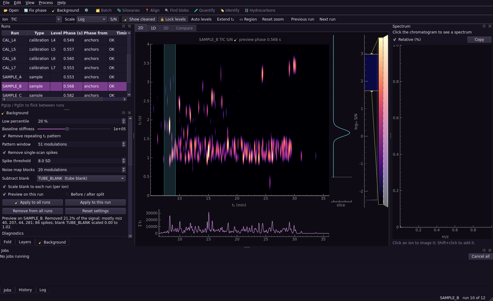

# PyGCGC

A desktop app and Python package for processing comprehensive two-dimensional gas chromatography data with 70 eV electron-ionisation time-of-flight mass spectrometry (GC×GC-EI-ToF-MS). It reads native Markes FT04/SD04 `.lsc` files and ANDI (AIA) `.cdf` exports.



## Contents

1. [Status](#status)
2. [Install](#install)
3. [Quick start](#quick-start)
4. [Getting data out of ChromSpace](#getting-data-out-of-chromspace)
5. [Supporting files](#supporting-files)
6. [Command line](#command-line)
7. [Python](#python)
8. [Projects](#projects)
9. [Tests and the dummy data pack](#tests-and-the-dummy-data-pack)
10. [Documentation map](#documentation-map)

## Status

| Milestone | What | State |
|---|---|---|
| 1 | Reading, timing checks, folding, 🔄 phase, period check | Done |
| 2 | App shell: 2D and 1D views, spectra, run list, fold panel, jobs, undo, projects | Done |
| 3 | 🧹 Background removal, despiking, noise map, blank subtraction, S/N view | Done |
| 4 | 🧪 Targeted quantification, calibration sets and interpolation, internal standards, all-signal ratios, review (v1 candidate) | Done |
| 5 | 📍 Alignment (anchors, shift/affine/smooth) and compare modes (blink, grid, difference, overlay) | Done |
| 6 | 🔍 Blob detection (ion-summed S/N, co-elution flag, editing) and per-peak blank scaling | Done |
| 7 | 🫧 Siloxane flagging and per-pixel removal | Done |
| 8 | ✂️ Overlap toolkit (unique-ion map, geometric splits, peak-shape fit, MCR-ALS, cross-run PARAFAC) and a 3D surface view | Done |
| 9 | Retention index (reused from ⛓️) and 🏷️ MS identifier: MSP import, weighted dot-product search, target-decoy confidence, promote to target | Done |
| 10 | ⛓️ Hydrocarbon and isomer mapper, stencils | Done |
| 11 | 🗂️ Cached, parallel batch pipeline, feature table, QC charts, PCA and volcano plots | Done |
| 12 | 📤 Provenance, Excel/HTML/PDF reports, publication figures, PyInstaller spec | Done |
| 13 | 🧩 Unsupervised clustering: peaks grouped by mass spectrum (tree or density), pixel regions with no peak detection, cross-run cluster tables, PERMANOVA, coloured chromatograms | Built; checked on one real 70 eV run and on synthetic multi-run data, not yet on a real multi-sample set |
| 14 | 🧬 Compound classes: readable TOML rules (17 shipped classes), spectrum, ladder and 14 eV evidence, a per-blob reason, editable in a text file | Built; checked on one real run (the alkane ladder and hand-checked compounds), not against a labelled class library |

All 12 milestones are done. Milestones 8, 10, 11 and 12 were built ahead of 9 while James looked into a NIST23 licence for the MS identifier; 9 was finally built too, tested against small synthetic libraries with a known answer -- **a real library (NIST or otherwise) hasn't been plugged in yet.**

Native Markes FT04/SD04 `.lsc` import is now implemented and checked against all
three supplied real instrument files. Vendor-spectrum equivalence and the true
retention-time/modulation settings still need independent validation; scientific
defaults remain provisional. See [HANDOVER.md](HANDOVER.md).

Peak detection now offers **MS-aware separation** beside legacy hard-edged blobs.
The MS-aware route fits a list of overlapping peak components, each with its own
position, mass spectrum and estimated intensity. The app saves them, draws their
overlapping contours, identifies their fitted spectra and exports their estimates
with confidence warnings. The supplied crowded real segment still fails the current
quality gates, so these amounts remain review estimates and do not feed production
quantification. See the [implementation plan](docs/MS_AWARE_COMPONENT_IMPLEMENTATION_PLAN.md).

**Find peaks** now fits overlapping components across the run by default. It screens
plausible component counts using a few diagnostic mass channels, then estimates each
selected component's spectrum and intensity from a wider set. Opening a group allows a
slower repeated-start refit; accepting it replaces the automatic result. Optional rapid
proposals remain in the settings. On the supplied 215,015-scan 70 eV acquisition, file
reading, background correction and MS-aware separation took about 154 seconds combined
with four worker processes on the development machine, down from 344 seconds before the
performance pass. One-worker runs took 191 to 224 seconds. Weak or
poorly reconstructed groups remain flagged for review.

The number of peaks in each local fit is chosen from the mass spectra and held-out data,
not from the number of candidate apexes, so a shoulder with a different spectrum can be
found and a broad single peak is not split. On planted peaks in real background this
raised exact-count accuracy for equal pairs from 0.28 to 0.70 and cut false splits of
broad peaks from 95% to 10%. Close, unequal pairs and tailing peaks remain poor. A 📊
signal-accounting report shows how much of the total signal the fitted peaks explain
(37% on the supplied file). Classify and Cluster now use the fitted peaks. See
[docs/CLAUDE_CODE_HANDOVER.md](docs/CLAUDE_CODE_HANDOVER.md).

## Install

PyGCGC needs Python 3.11 or newer. **There is no `main.py` to run** — this is a proper installable Python package (that's what `pyproject.toml` does), which is more setup than a single script but pays off as two plain commands, `pygcgc` and `pygcgc-gui`, that work from anywhere once installed.

**One-time setup**, in PowerShell (not Git Bash, not Command Prompt — your uv environment lives there), from the repository folder:

```powershell
uv pip install -e ".[gui,test]"
```

No admin rights are needed. This installs:
- `numpy`, `scipy`, `scikit-image` and `netCDF4` for the core
- `PySide6`, `pyqtgraph` and `PyOpenGL` (for ✂️'s 3D view) for the app
- `matplotlib`, `openpyxl`, `pytest` and `pytest-qt` for charts, spreadsheet export and tests

That's it — you only ever need to run this again if the environment gets rebuilt from scratch, or `pyproject.toml`'s dependencies change. (If you only want the core, no GUI, for scripts or a server: `uv pip install -e .` instead. The `plot` extra alone gets you matplotlib for `pygcgc fold --png` and the 📤 report charts without the full GUI; `report` alone gets you openpyxl for Excel export; `cluster` alone gets you scikit-learn, which 🧩's retention-aware method (HDBSCAN) and pixel regions need. The `gui` and `test` extras include it, and peak clustering by spectrum alone needs only scipy.)

## Quick start

**Every time** you want to use the app, open PowerShell and type:

```powershell
pygcgc-gui
```

That's the whole command — no `python`, no file path, no `cd` into the repository first. It opens an empty window. To open it straight into a folder of runs instead:

```powershell
pygcgc-gui "C:\path\to\your\data\folder"
```

(Quote the path if it has spaces in it, as this one does.) If you haven't got real data to hand yet, unzip the dummy data pack and point it at that folder instead.

Once it's open:
1. Wait a moment: the runs load and every phase is estimated in the background.
2. Work along the toolbar: open a step, press ▶ Go on the left, and follow the banner to the next step. For a first look, 1 🔄 Fold then 3 🧹 Background is enough.
3. Open step 8 🧪 Quantify and press ▶ Go. Every target and internal standard is found in every run, the calibration curves are fitted, and the samples are quantified.
4. Work through the 🧪 Review tab (Y accepts, N rejects) and check the Calibration tab.
5. Export the results from the 🧪 Results panel.

## Getting data out of ChromSpace

**Direct instrument import:** open your output folder with `pygcgc-gui real_data`,
or pass an individual `.lsc` file to the GUI or CLI (`pygcgc info FILE.lsc`). No
CDF conversion or DAT/HDR sidecars are required for the supported FT04/SD04 variant.
Folder discovery selects untreated 70 eV when it can unambiguously group the native
files. Use **Open files…** to select 14 eV or vendor DBC explicitly; `sequence.csv`
also takes precedence over the default. The run list labels channel and processing
state. Project files retain source hashes and reject changed source contents.

Native times retain the channel offset and use the whole acquisition-clock second
as their common origin. The exact offset from the vendor retention-time display is
unvalidated. Confirm the modulation period in the Fold panel or `method.json`;
the initial 4 s setting is not inferred from LSC. Until confirmed, native runs are
labelled **Check modulation period**. The DBC file is already background corrected;
applying Background adds another correction. Blank subtraction still uses original
coordinates, not alignment transforms. Mixed-energy quantification is rejected,
and the GUI's current 70 eV library workflow disables identification for 14 eV.

Original centroid spectra remain available through the context-managed
`pygcgc.core.io.markes_lsc.LSCFile.spectrum(scan)` API. The app uses rounded unit-mass
bins with duplicate bins summed. See [the format report](real_data/NATIVE_LSC_REPORT.md)
for byte-layout evidence and unresolved vendor semantics, and the
[implementation validation notes](docs/NATIVE_IMPORT_VALIDATION.md) for checks and limitations.

PyGCGC reads ANDI/AIA netCDF (`.cdf`), which ChromSpace can export. Export the raw, unfolded detector stream with all masses (centroided is fine). Put the files for one sequence in one folder, ideally inside a `data/` subfolder, with the supporting files below alongside.

Nothing about the phase or modulation period is taken from the file, because ANDI has no place for it. The period comes from `method.json` or the Fold panel. If neither sets it, both the period and the phase are estimated from the runs when they open (see **Fold** below).

## Supporting files

All four are optional for viewing and cleaning, and are picked up automatically when they sit in the folder you open. Quantification needs the target table and the calibration levels.

**`method.json`** gives the modulation period in seconds:

```json
{"modulation_period_s": 4.0}
```

**`sequence.csv`** says what each run is, in running order. The columns:
- `type` is free text. A type containing "cal" plus a `level` marks a calibration run; any type containing "blank" is offered first as a blank for subtraction.
- `level` names a row of the calibration levels file.
- `cal_set` (optional) groups calibration runs into sets, for example one set at the start of a week and another at the end. Each set gets its own curves. A sample with its own `cal_set` uses that set exactly. Any other sample sits between two blocks in run order, and its amount is blended from both curves, weighted by how far along it sits (bracketing standards, the usual way to correct for drift between calibrations). A sample outside every block (before the first, or after the last) uses the nearest one alone and is flagged as extrapolated. Turn this off in the quantification settings to fall back to "own set, else the most recent one before it".
- `volume_m3` (optional) is the sampled air volume, used to turn amounts into concentrations.

```
file,type,level,cal_set,volume_m3
CAL_L1_mon.cdf,calibration,L1,monday,
CAL_L5_mon.cdf,calibration,L5,monday,
SAMPLE_A.cdf,sample,,,1.2
TUBE_BLANK.cdf,tube blank,,,
CAL_L1_fri.cdf,calibration,L1,friday,
```

**`target_table.csv`** lists the compounds in your known standards. Rows with `role` set to `istd` are the internal standards: they anchor the phase, are found in every run, and every other signal is divided by one of them.

```
compound,role,cls,quant_ion,qual_ions,qual_ratios,t1_expected_s,t1_window_s,t2_expected_s,t2_window_s,istd
naphthalene-d8,istd,IS,136,108;68,0.083;0.097,707.9,12,1.82,0.25,
naphthalene,target,PAH,128,126;64,0.121;0.090,709.0,12,1.85,0.25,naphthalene-d8
```

The columns mean:
- `quant_ion`: the quantifier ion. `qual_ions` and `qual_ratios` (semicolon-separated) are qualifier ions and their expected size relative to the quantifier; leave the ratios blank to learn them from the calibration runs.
- `t1_expected_s`: absolute first-dimension retention time in seconds, the time the compound's brightest pulse leaves the first column.
- `t2_expected_s`: the true second-dimension time. It may be longer than the modulation period for compounds that wrap around.
- `t1_window_s`, `t2_window_s`: half-widths of the search window. By default the positions are refined from the calibration runs, so rough values will do.
- `istd`: the internal standard this compound is divided by. Leave it blank to use the nearest one.

**`calibration_levels.csv`** (or `calibration_levels_ng.csv`) gives the amount of every compound at every level, in whatever unit you want results in (for example ng on tube):

```
level,naphthalene,fluorene,benzo[a]pyrene
L1,0.1,0.1,0.1
L2,0.25,0.25,0.25
```

## Command line

```
pygcgc info  RUN.cdf [RUN.cdf ...]
pygcgc phase RUN.cdf [...] --period 4 [--targets target_table.csv]
pygcgc fold  RUN.cdf --period 4 [--phase 0.55 | --targets CSV] [--mz 178 202] [--extend 1.15] [--png out.png] [--npz out.npz]
pygcgc clean RUN.cdf [...] --period 4 [--phase 0.55 | --targets CSV] [--stiffness 1e4] [--percentile 20] [--outdir cleaned] [--workers 4]
pygcgc crop  RUN.cdf --start 10 --end 14 [--mz-min 35 --mz-max 300] [-o small.cdf]
pygcgc quant FOLDER [--period 4] [--targets CSV] [--sequence CSV] [--levels CSV] [--outdir results] [--workers 4] [--no-interpolate] [--xlsx]
pygcgc batch FOLDER [--period 4] [--cache-dir DIR] [--workers N] [--outdir out] [--siloxane] [--no-blobs] [--no-quant] [--reference RUN] [--config pipeline.json] [--save-config pipeline.json] [--report {xlsx,html,pdf,all}] [--cluster] [--cluster-threshold 0.3] [--regions N]
pygcgc gui   [FOLDER | PROJECT.json]

# alignment (📍), the ⛓️ hydrocarbon mapper, ✂️ overlap and 🏷️ identify are interactive (clicking peaks, drawing stencils, picking a blob, loading a library), so they have no CLI command yet.
```

What each command does:
- `info` summarises files and checks scan timing.
- `phase` estimates the phase for a sequence and checks the period on every run.
- `fold` writes a figure or a NumPy archive.
- `clean` writes background-corrected `.cdf` files.
- `crop` cuts out a small window, which is handy for test files and bug reports.
- `quant` cleans, calibrates and quantifies a whole folder (runs, `sequence.csv`, `target_table.csv`, calibration levels, `method.json`) and writes the four result tables. With more than one `cal_set`, samples between blocks are interpolated by default; `--no-interpolate` uses the nearest block before each sample instead. Always writes `provenance.json`; `--xlsx` also writes `report.xlsx` with flagged rows highlighted.
- `batch` runs the same pipeline as `quant`, plus optionally 🫧 and 🔍, across a process pool with disk caching (so re-running the same folder resumes instead of recomputing), and writes a `feature_table.csv` (with a `gap_filled` column) alongside the usual result tables when 🔍 is on. `--config` loads a saved pipeline (`BatchConfig.save`/`.load`) instead of the flags above; `--save-config` writes one out from whatever flags were given, for reuse. Always writes `provenance.json`; `--report` also writes `report.xlsx`/`.html`/`.pdf` (or all three), with a volcano plot if the loaded config's `group_a`/`group_b` each name two or more runs. `--cluster` (needs 🔍) also pools every run's blobs and groups them by mass spectrum, writing `peak_clusters.csv` and `cluster_run_table.csv` (each cluster's percent share of each run's peak volume, plus a "Clusters" sheet with `--report xlsx`), and prints a PERMANOVA of the config's two run groups if it names any. `--regions N` divides every run into N pixel regions of similar spectrum with no peak detection and writes `region_run_table.csv` and one `region_labels_<run>.npy` per run.

PowerShell doesn't expand `*.cdf`, so list the files or use Python.

## Python

```python
from pathlib import Path

import pygcgc as g

runs = g.read_many(sorted(Path("data").glob("*.cdf")))
anchors = g.load_anchors("target_table.csv")
phases = g.phase_for_sequence(runs, 4.0, anchors)

run, phase = runs[0], phases[0].phase
print(g.check_timing(run.times).summary())
print(g.period_from_anchors(run, anchors, 4.0).summary())

f = g.fold(run, 4.0, phase)
tic = f.tic_image(run)                              # (rows, modulations)
pah = g.parse_ion_expr("178+202+228+252").image(run, f)

res = g.remove_background(run, f)                   # BackgroundResult
print(res.summary())
clean = res.run                                     # a Run, usable anywhere a Run is
snr = f.ion_image(clean, 73) / res.noise.at(73, f.t1)[None, :]
g.write_andi(clean, "clean.cdf")

# 🧪 a whole sequence, read in sequence order
import csv

rows = list(csv.DictReader(open("sequence.csv", newline="")))
runs = g.read_many([Path("data") / r["file"] for r in rows])
phases = g.phase_for_sequence(runs, 4.0, anchors)
targets = g.load_targets("target_table.csv")
levels = g.load_levels("calibration_levels.csv")
extras = g.read_sequence_extras("sequence.csv")      # cal_set and volume_m3
prepared, info = [], []
for run, est, row in zip(runs, phases, rows):
    f = g.fold(run, 4.0, est.phase)
    bg = g.remove_background(run, f)
    prepared.append((run, bg.run, f, bg.noise))
    ex = extras.get(run.name, {})
    info.append(g.SequenceRun(run.name, row["type"], row["level"], ex.get("cal_set", ""), ex.get("volume")))
report = g.quantify_prepared(prepared, info, targets, levels)
report.write("results")          # targets, calibrations, all_signals, internal_standards

# 📍 aligning one run onto another
anchors_2d = [g.AnchorPoint("naphthalene-d8", ref_t1=1182.0, ref_t2=1.85, run_t1=1186.4, run_t2=1.86),
             g.AnchorPoint("chrysene-d12", ref_t1=2468.0, ref_t2=3.23, run_t1=2470.1, run_t2=3.24)]
tf = g.fit_alignment(anchors_2d)             # kind="auto": a shift here (only 2 anchors)
print(tf.summary())
ref_fold = g.fold(runs[0], 4.0, phases[0].phase)
aligned_tic = g.resample_to_reference(f.tic_image(clean), f, ref_fold, tf)

# 🧩 group peaks by mass spectrum, pooled across runs (`result` is a BatchResult from g.run_batch)
tables = [g.PeakTable.from_blobs(p.blobs, name) for name, p in result.prepped.items()]
table = g.PeakTable.concat(tables)
clusters = g.cluster_peaks(table, g.ClusterSettings())          # tree; method="density" adds retention
names = list(result.prepped)
features = g.cluster_features(table, clusters, names, relative=True)   # one Feature per cluster: the run table
groups = ["control", "control", "exposed", "exposed"]               # one label per run in `names`
print(g.permanova(g.feature_table_matrix(features, names), groups))    # (pseudo-F, p)

# 🧩 or divide a run into pixel regions with no peak detection (needs scikit-learn)
model, labels = g.segment_pixels(clean, f, g.SegmentSettings(n_regions=12))   # labels: (rows, modulations), -1 = baseline
print(model.top_ions(0), g.region_shares(labels, clean, f, len(model)))
```

## Projects

A project is a small JSON file holding:
- run paths (relative to the project file where possible)
- the period
- every run's phase and how it was set
- the 🧹 settings, the chosen blank, and which runs were cleaned
- the calibration levels file, 🧪 settings and every review decision (with exclusion reasons)
- view settings

Reopening restores all of it. Saved phases are kept exactly as saved; cleaned layers and 🧪 results are rebuilt from their settings, with the saved decisions applied.

## Tests and the dummy data pack

```
pytest
```

388 tests always run (413 in total; counts as of 2026-09-20):
- the core, on synthetic runs where every number is known
- 94 GUI tests that drive the app headless
- the command line

If the GUI tests complain about a display, set `QT_QPA_PLATFORM=offscreen`.

A further 25 tests use the dummy data pack: 12 synthetic GC×GC-ToF-MS runs (internal standard blank, seven calibration levels, a tube blank and three samples) with full ground truth and deliberate problems to solve. The tests look for a `dummy_gcxgc` folder beside or inside the repository; otherwise set its location:

```
$env:PYGCGC_DUMMY_DATA = "C:\path\to\dummy_gcxgc"
pytest
```

Among other things, the dummy-data tests check that:
- phases are recovered to within 20 ms
- injected clock errors are caught
- bleed ions are centred on zero after cleaning
- isolated peak areas are unchanged by cleaning
- quantifier ions sitting on bleed are brought back close to the truth: D4 on m/z 281 to within 1%, and behenic acid on m/z 73 to within 5% (it starts almost three times too high at the lowest level)
- the 86 injected spikes are found, apart from the odd one that lands on a peak
- blank subtraction removes most Tenax artefacts without touching the PAHs
- every calibration curve passes, isolated target areas match the truth, and sample amounts come back close to the truth
- saturation, shared peaks (BbF/BkF) and the planted anthracene interferent are all flagged
- the planted siloxanes (D4, D5, D6) score higher for 🫧 than any real target does
- 🏷️ library search finds the right compound for at least 90% of the confirmed targets whose names also appear in `synthetic_library.msp` (skipped rather than guessing if too few names line up -- see HANDOVER.md)

## Documentation map

| File | What it holds |
|---|---|
| [docs/user-guide.md](docs/user-guide.md) | Using the app: every step and panel, and how the methods work |
| [docs/architecture.md](docs/architecture.md) | Code layout, rules, design decisions, gotchas, conventions |
| [docs/known-limitations.md](docs/known-limitations.md) | What has and has not been checked against real data |
| [ROADMAP.md](ROADMAP.md) | The prioritised list of what is left, shaky or missing |
| [CHANGELOG.md](CHANGELOG.md) | Dated record of what changed and what was found on real data |
| [HANDOVER.md](HANDOVER.md) | Start here for a new session: context, setup and first job |
| [docs/milestone-specs.md](docs/milestone-specs.md) | Original per-milestone specs and acceptance tests |
| [docs/](docs/) | Design plans and validation write-ups |
| [real_data/](real_data/) | Native-format and hydrocarbon validation reports |
