# PyGCGC user guide

Current reference, reconciled on 19 October 2026, for every step and panel of the app,
followed by how the methods work. The [documentation index](README.md) maps current
guidance and dated validation reports; [input tables](input-tables.md) defines the CSV formats.
Install and quick start are in the [README](../README.md).

## Using the app

Screenshots use the synthetic [demonstration data](../examples/demo_data/README.md)
or smaller workflow fixtures. `docs/images/make_screenshots.py` generates the main set;
later focused checks also supplied screenshots. Older images can show former toolbar
arrangements; current names and routes are given in the text.

### Layout

- **Left:** one panel, "Workspace", with tabs. **Runs** is the run list, **Tool** shows the open step's settings and its Go button (its tab is named after the step), **Layers** shows which runs are cleaned or aligned, **Results** holds the 🧪 tables, **Standards** the internal-standard grid, **History** the undo list and **Log** every message in full. Opening a step from the toolbar switches to the Tool tab. Running jobs, with their progress and cancel buttons, appear at the foot of this panel and hide themselves when idle.
- **Top toolbar:** Load, Align, Background, Peaks, Standards, Assign, Quantify, Export. The **Tools** menu (in the menu bar, beside Process) contains specialist tools and separate analysis windows, and Process has one submenu per numbered step. Below it, the view bar holds the ion box, colour scale, raw/cleaned, zoom and previous/next run; **Display options** holds S/N, overlays, levels, extend t₂ and region selection.
- **Centre:** the 2D and 1D views, the 🧪 Review gallery, the Calibration curves and Compare.
- **Right:** the spectrum.

Every panel can be moved, floated onto a second screen or hidden. To bring one back, use View → Panels. **Reset layout** in the same menu restores the default arrangement.

**Small screens and text size.** On a screen under 900 pixels high (a 1366 × 768 laptop, or 1080p scaled to 150 %) the text opens **compact**: 8 pt, tighter buttons, spacing and tabs. View → Text size chooses Compact, Standard or Large at any time; the choice is remembered in `%APPDATA%\PyGCGC\PyGCGC.ini`, applies at once and needs no restart. Windows never open larger than the screen they are on, the main window remembers its size and position, and the Review and Calibration pages no longer force the window wider than 1000 pixels. Menus are split by step so none is taller than a small screen, and the Tools menu is in the menu bar because a drop-down button in a crowded toolbar can slip into its overflow arrow, where it is awkward to open.

**Colours.** The light theme is white panels on a pale grey window with an indigo accent; View → Dark theme switches to near-black with a green accent. The top of the window takes a faint tint of the step that is open. The chromatogram colour map (turbo) is the same in both.

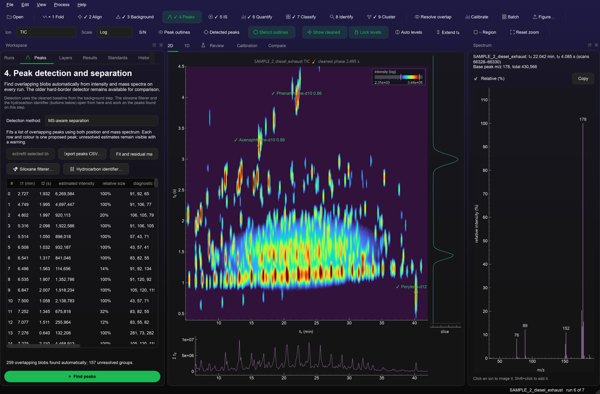

### Workflow panel

The eight numbered buttons on the top toolbar follow the main workflow. The left panel shows one step's settings and its primary action. Modulation checks open under Load, the siloxane filter opens from Peak tools, and the specialist assignment tools open under Assign. Each specialist step has a Back link to its parent.

1. Press a step on the toolbar. Its settings appear on the left; nothing runs yet.
2. Set what you want.
3. Press the primary button at the bottom of the left panel. Its label says what will run or open.
4. A banner reports the result and offers **Next: …**. It never switches step by itself, so you can look at the result first.

The panel also explains what is missing before an action can run and offers a direct link
to the relevant step or calibration setup. Alignment needs a reference and searchable anchors,
or it can be skipped. Standards needs fresh Peaks and a labelled reference. Quantify needs
named targets, internal standards and enough usable known amounts per target and calibration
set for the active curve settings (three distinct levels by default). Zero levels and excluded
points follow the curve's own policy. Native-data period confirmation and energy-channel checks
still apply. Peak fitting on raw data remains available, with a visible background warning.

Preparation and fitting changes clear completion for affected steps. Stale standard matches
need a new search, and obsolete review choices need a fresh review. Quantitative results whose
inputs change during a running job are not marked successful. Export explains partial or stale
results and records their status in its manifest; it remains available for exporting peaks and
inputs before quantification is complete.

| Step | Settings shown | Go does |
|---|---|---|
| 1 Load | folder, individual files or saved project; modulation checks | opens a data folder and estimates period and phase |
| 2 Align (optional) | reference run, guided anchor table, bounded refinement | starts **Pick anchors across runs**; **Skip alignment** continues without fitting a transform |
| 3 🧹 Background | 🧹 settings, aligned blank, preview, split view, diagnostics | removes background on every run |
| 4 🔍 Peaks | MS-aware regions or legacy blob table | runs the selected detection method on every run |
| 5 🏷️ IS | IS library, labelled peaks, thresholds on Δt₁, Δt₂ and spectral match | finds every labelled standard in every run; results grid in the Standards tab |
| 6 Assign | target table, library search, hydrocarbon assignment, classes and clusters | confirms that assignments have been reviewed and continues to Quantify |
| 7 Quantify | calibration builder, input tables, settings | measures targets, fits calibration curves and quantifies samples |
| 8 Export | all-results export or current figure | writes all available results, inputs and processing settings into one folder |

**Why this order.** Data preparation comes before peak detection, and assignments come before quantification. Each panel and Help → Workflow guide explain its role.

Check the modulation period and phase under Load before preparing the data. Alignment helps compare runs and subtract an aligned blank. Background removal supplies the cleaned signal and noise map. Label internal standards once, search every sample, and use **Use as target table** to make those references available to quantification. A strong spectral match on an unresolved or low-confidence peak fit is marked **Review**, as is a match with several passing candidates.

Under Assign, load known targets or review library and hydrocarbon suggestions. Opening a library window does not mean identification is finished. Loading assignments preserves the prepared phase. Quantitative amounts use the unit of the supplied calibration levels: enter nanograms for results in nanograms, or another consistent mass unit. An internal-standard amount is not inferred from a filename.

Export includes quantitative tables when available, one peak table per run, internal-standard matches, assignments, input tables, a project snapshot and provenance. The manifest records missing quantification and stale results. Raw instrument files stay at their original locations. Internal-standard search matches and the quantitative internal-standard table are separate CSVs.

The order is a recommendation. Nothing stops you running a step early or again after changing something upstream, but results from later steps are not rerun for you: rerun them.

On the toolbar a ✓ marks a finished step, ▸ marks the suggested next one and the open step is highlighted. Skipped alignment is labelled separately from completed alignment. Removing 🧹 or 🫧 clears its tick. Specialist tools remain available in **Tools** and the Process menu. **Peak tools** contains peak edits, fit diagnostics, CSV export and the siloxane filter. Figures can be exported from step 8. Older screenshots below show the earlier toolbar arrangement.

### 2D view

- The folded chromatogram runs t₁ across and t₂ up.
- The default colour map is turbo. A small colour key is pinned to the top-right corner of the image. The grey track is the range of the data and the coloured part is what the colour map is stretched over, with the lower and upper limits printed underneath. Drag either end to move that limit, drag the coloured part to slide both, and double-click the key to type exact limits, or press Reset to default to return to the automatic levels. On the log scale the key is a logarithmic axis: limits are shown and typed as intensities (for example 1e3 to 1e6), with a tick at each decade; on the √ scale they are in √ units. Right-click the key to change the colour map.
- A t₂ slice follows the cursor, and a reconstructed 1D trace underneath shares the t₁ axis.
- The status bar shows t₁, t₂ and the value under the cursor.
- **Click** any pixel to see its spectrum.
- **▭ Region (R)** gives a draggable box whose summed spectrum appears on the right.
- **Extend t₂ (E)** adds a band above the dashed period line so wrapped peaks appear whole. The band repeats the bottom of the next modulation.
- **Scale** can be log, square root or linear (L cycles through them). **Auto levels** (Ctrl+L) resets the colour range.
- **🔒 Lock levels** (on by default) keeps the colour range when you flick between runs, so differences stand out.
- **S/N** shows signal-to-noise. It needs 🧹 on that run, because the noise map comes from background removal.

### Ion box (M)

| Type | Shows |
|---|---|
| `TIC` | total ion signal |
| `178` | one ion |
| `178+202+228+252` | the sum of ions |
| `200:260` | every ion in a range |
| `57/71` | a ratio image, handy for telling compound classes apart; the colour scale switches to linear |
| `57+71/85` | the ratio of a sum to an ion |

In the spectrum, click an ion to image it; Shift+click adds it to the current sum.

### 1D view

- **Top:** the reconstructed 1D chromatogram, with a draggable band. The same band appears on the 2D view.
- **Bottom:** the raw detector stream for that band. Zoom in to a few minutes and the modulation boundaries appear, which is the quickest way to see how peaks are sliced and to spot wrap-around.
- Double-click either plot for the spectrum at that time.

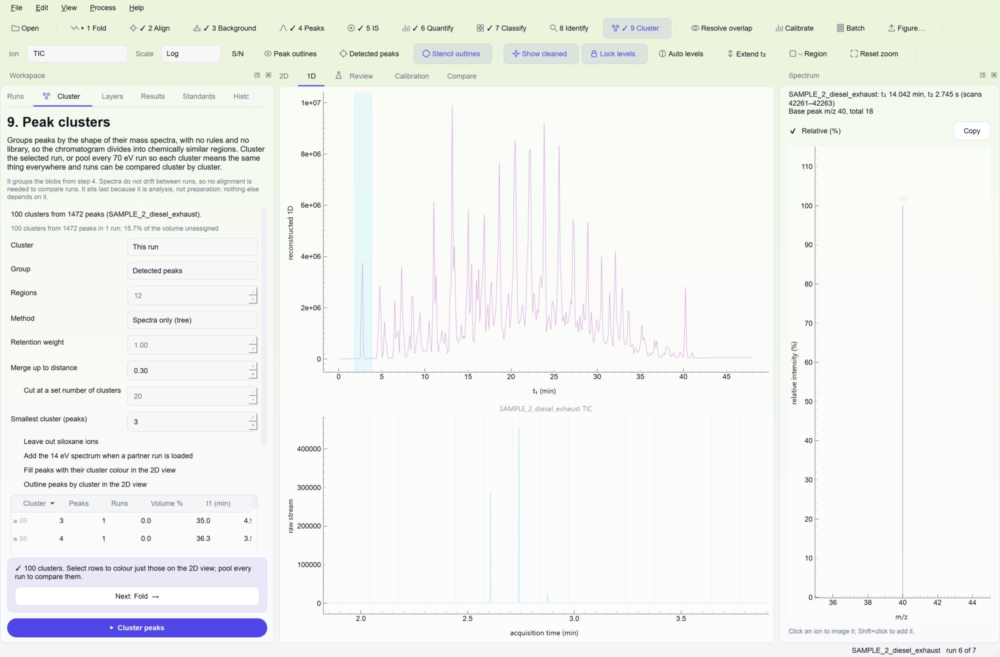

### Runs

- Select a row, or use PgUp/PgDn, to change run. Zoom, ion and colour levels stay put.
- Neighbouring runs are prepared in the background, so flicking is instant.
- **Type, Level, Cal set and Volume (m³)** can be typed straight into the table (double-click, or F2). Right-click several runs to set their type, level, calibration set or volume at once. A type containing "cal" plus a level makes a calibration run; a type containing "blank" is offered as a blank. These values are saved with the project and win over `sequence.csv`; **Save types and levels as sequence.csv…** (right-click, or File → Save sequence list…) writes them out.
- Right-click a run to remove it from the project.
- The Timing column warns about dropped scans or irregular timing.

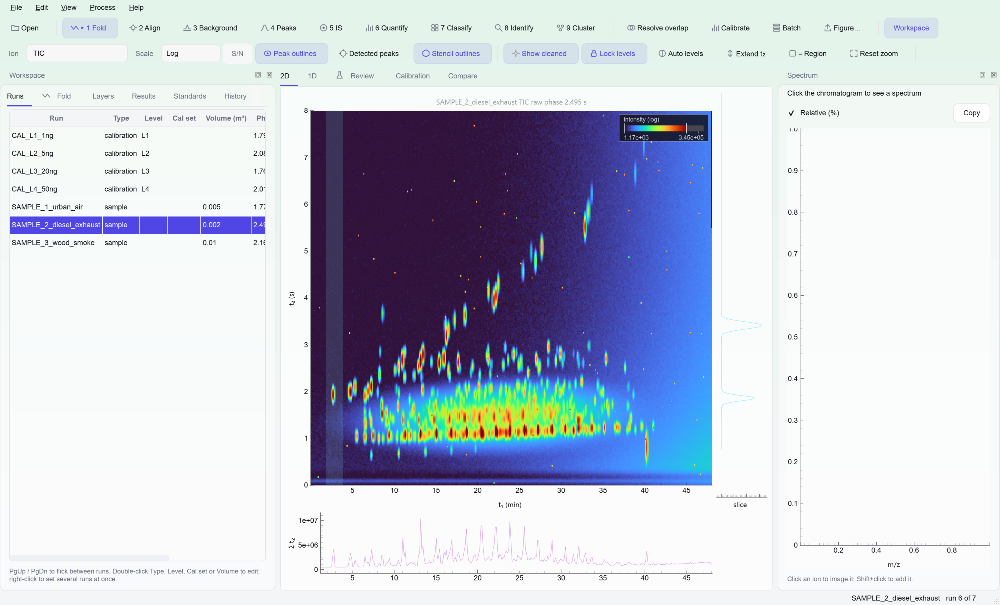

### 🔄 Fold

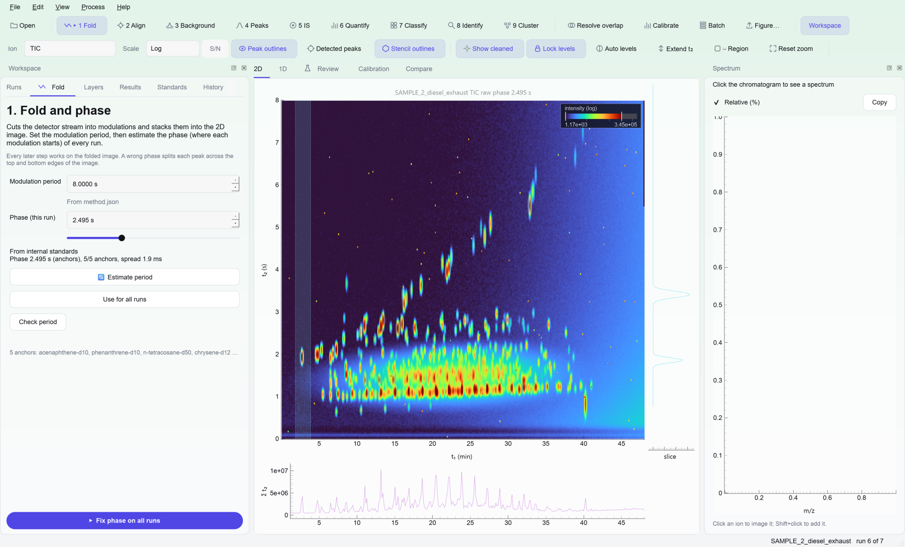

- Set the modulation period, and the current run's phase, with the spin box or slider. The image refolds as you drag.
- **Go** (or the Process menu) re-estimates every run. With a target table it uses the internal standards; runs where they aren't found, such as tube blanks, borrow the phase of the others.
- **Use for all runs** copies the current phase to every run.
- **Check period** fits the period from this run's internal standards and offers to apply it if the correction is statistically significant.
- **Estimate period** replaces the period, even one set by hand or by `method.json`, with an estimate from the runs, then re-estimates every phase. It is undoable.

When runs open and no period has been set by hand or by `method.json`, the period is estimated from up to three evenly spaced runs and applied at once. The line under the period box says how it was found and whether to trust it. A period set by `method.json` or by hand is kept; the runs are only checked against it, and a message appears if they clearly disagree.

- The period is the frequency at which the total signal repeats, so it needs no anchors. A solvent front is detected and left out.
- **Confidence** says whether a period is established at all. If it is low, the period is left unchanged.
- **Drift** says how well it is pinned down: the standard error times the number of modulations, i.e. how far peaks at the end of the run could sit from where they should. Compounds alone constrain the period only to a few milliseconds; column bleed and other structure locked to the modulator do better. If the drift exceeds a quarter of a second the line turns amber, and the period should be checked with **Check period** against internal standards.
- Without anchors, the phase puts the cut 0.2 s before the start of the column bleed. The bleed (the siloxanes) is released with every modulation and is present in every column, so a low percentile across columns, row by row, keeps it and discards the analytes. The cut goes just before that baseline leaves its floor, so the siloxanes sit at the bottom of the image. If a run has no such baseline, the cut goes just inside the far edge of the longest quiet stretch of the second dimension instead; its confidence is low when wrap-around leaves no quiet stretch. Either way this is a place to cut, not the modulator's proven start. Internal standards, when found, give the true phase and take priority; a table with a single anchor is enough.
- On the command line, `pygcgc fold`, `phase`, `clean` and `quant` estimate the period when `--period` is omitted (and no `method.json`), print the estimate, and stop if none can be found reliably. `pygcgc batch` does the same and records `modulation_period_estimated` in `provenance.json`.

### 🧹 Background

- Step **3 🧹 Background** shows the settings; **Go** cleans every run with them (Process → 🧹 Background does the same).
- Tick **Preview on this run** to try settings live on the current run before applying.
- Tick **Before / after split** and drag the white line to compare.
- **Space** switches between raw and cleaned data everywhere: the image, the 1D view and spectra.
- The Layers tab shows which runs are cleaned.

The settings:

| Setting | Default | What it does |
|---|---|---|
| Low percentile | 20% | Low value taken down each modulation as the starting point for the background |
| Baseline stiffness | 1e4 | How closely the baseline may follow changes along t₁: about ten modulations on a 31-minute run. The setting is scaled with run length, so it means the same smoothness in minutes for shorter or longer runs. Soften it if bleed changes quickly, stiffen it if big tailing peaks get eaten |
| Remove repeating t₂ pattern | on, 51 modulations | Stripes that repeat every modulation. The window must be much wider than any peak |
| Remove single-scan spikes | on, 8 SD | Points far above all four neighbouring scans |
| Noise map blocks | 20 modulations | Length of each stretch of t₁ in the noise map |
| Subtract blank | none | A cleaned blank subtracted per ion, capped at the positive signal available; signed baseline-noise residuals can remain |
| Scale blank to each run | on | Per-artefact scale from the median sample-to-blank ratio, worked out separately for each connected region of significant blank pixels on an ion, so two artefacts sharing an ion but varying independently between tubes don't share one compromise factor. Whatever significant signal isn't part of any of those regions still falls back to one scale for the ion as a whole |

The diagnostics show what's left of the background for one ion. A good correction looks like:
- a histogram centred on zero, with a spread matching the noise map (the blue curve)
- points lying along the line in the normal quantile plot

The panel also lists the ions that lost most signal.

Background layers are rebuilt automatically when a run's phase or the period changes. Applying and removing 🧹 are both undoable.

### 🧪 Quantification

**Guided setup.** Open **Set up calibration and units…** in Quantify. It has four pages:

1. Name compounds, choose target or internal-standard roles, set quantifier/qualifier ions
   and retention times, and assign each target's internal standard. Import an existing target
   CSV, add labelled standards, or add exactly one peak selected in Peaks. A blank IS name
   uses the nearest standard. A detected peak still needs a compound name supplied by you.
2. Mark calibration runs, give them level names and calibration sets, and enter sample air
   volumes where concentrations per m³ are wanted. Check any filename-based level suggestions.
3. Enter known amounts for every target at every used calibration level, plus the actual
   constant amount of each internal standard in every calibration and sample run. There is
   no assumed 1 ng spike. Filename suggestions only fill blank target cells when explicitly
   copied; ambiguous tokens such as `025ng` stay unknown. Amounts are amounts on tube, not
   stock concentrations. Choose one amount unit; switching between pg, ng, ug and mg converts
   entered numbers. Custom units retain numbers and require checking on the review page.
   Setup checks the actual curve minimum, zero-level policy and exclusions; it does not
   lower the three-level default to make an incomplete calibration appear ready.
4. Review the complete setup and confirm actual amounts, units and constant IS additions.
   **Apply setup** changes the project atomically and marks old quantitative results stale.
   Back and Cancel leave active inputs unchanged. Applying does not start quantification.

The table-driven route uses area ratios and assumes each IS addition is constant across the
sequence. Different standards may have different constant amounts. For varying IS additions,
use the advanced calibration builder's amount-ratio workflow. Guided setup inputs are embedded
in the project, including the declared output unit, so they survive reopening without writing
over target/sequence CSVs or raw files. Results headers and export metadata declare the unit;
concentration is amount unit/m³ when air volume is present. Legacy CSV workflows retain their
existing behaviour and show “calibration units” until a unit is declared through setup.

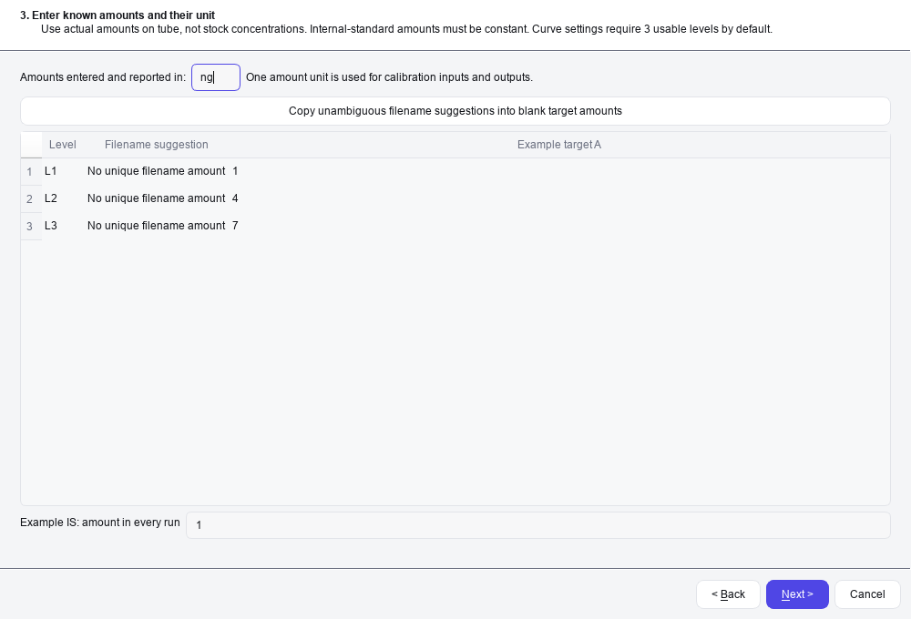

The main Go action explains missing prerequisites and offers **Set up calibration and units…**
when named targets, known amounts or sufficient calibration levels are absent. Existing CSV
loading, quantitative settings and the separate curve builder are under **Advanced calibration
tools**. Quantitative results still require reviewing fits, qualifiers and calibration coverage.

Target CSV imports validate the complete table before changing working inputs. A table
with targets but no internal standards can be loaded and saved; add the standards before
quantification. Ion masses must be positive whole numbers, retention values finite and
search windows positive. Each named internal-standard reference must point to an `istd`
row. Calibration level names must be unique and amounts finite and non-negative.

Calibration fitting is numerically scaled so changing between equivalent amount units
preserves the curve and recovered amounts. Re-run Quantify after updating from a version
before the 19 October numerical fix, especially for quadratic curves in very small units.

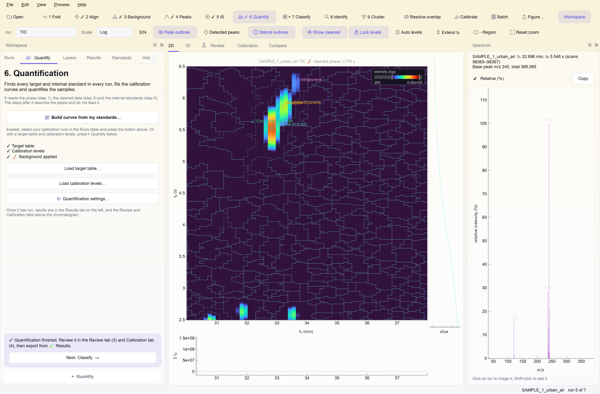

Step **7 🧪 Quantify** (Go) runs the whole thing in the background:
1. Every target and internal standard is found in the calibration runs on its own quantifier ion, and their average positions are learned from there, together with the qualifier ratios of any row that leaves them blank. Each later search is also shifted by however far its internal standard has moved in that run.
2. Every run is measured with those positions. Several candidate peaks may sit inside a target's window; each is scored on its distance from the expected position, how well its qualifier ratios match, and how clearly it stands out of the noise. If the runner-up scores almost as well, the result is flagged as ambiguous.
3. Every other peak in every run (a TIC blob) is found as well.
4. For each target, its volume is divided by its internal standard's volume (the response ratio), and a calibration curve is fitted for every calibration set.
5. Samples are read back through their bracketing set(s) to give amounts with a standard error, then divided by the sampled volume.

It works on 🧹 cleaned data where that has been applied, and on raw data otherwise. A compound whose true t₂ is longer than the period (give it that way in the table, for example 9.1 s at an 8 s period) is matched and reported on that side of the wrap.

**Choosing ions.** On a busy ion (m/z 57 among alkanes, m/z 105 among alkylbenzenes) the matrix adds to the peak: in a planted test on the real exhaust and diesel runs, targets on such ions were 15 to 60% off, and qualifier ratios only catch interferents with a different spectrum. A less common ion of the same compound is almost always the better quantifier. See [the September 2026 audit](validation/audit-2026-09-24.md).

![Review gallery: benz[a]anthracene across the sequence, flagged where it shares a peak with chrysene](images/screenshot_review.png)

**Peak overlay.** On the 2D view every peak found is outlined. Targets are marked with circles (lilac, amber when flagged, red when rejected) and internal standards with teal squares. O shows or hides the overlay.

**🧪 Review tab (3).** One tile per peak, showing its quantifier-ion image, its outline, the amount and any flags. Show one compound across every run, or every compound in one run, and tick Only to check to skip the clean ones.
- Arrow keys move, Y accepts, N rejects, U clears the decision.
- Enter or double-click opens the peak in the 2D view with its spectrum.
- P picks a different peak: click the right one in the 2D view (Esc cancels), and that run is re-measured.

A tile is flagged amber when:
- a qualifier ratio is off
- the peak is saturated
- the choice was ambiguous
- two targets share one peak
- the peak is cut by the wrap boundary
- it sits on the flank of a larger peak
- it is off position

**Calibration tab (4).**
- **Plot:** each compound's curve with its points, the samples as diamonds, and a relative-error plot underneath with the acceptance limits dashed. Choose the calibration set, and whether to show the quantifier-ion curve or the whole-peak (TIC) curve used for nearby unknowns.
- **Weights, model and zero:** Auto picks the weights by relative error and uses Mandel's test for straight versus curved. You can override either, and force the curve through zero.
- **Points:** click a point to select it. Exclude… asks for a reason, which is saved; Include puts it back; Open peak shows it.
- **Statistics:** the text below lists the model, weights, R², worst back-calculation, LOD, LOQ, Mandel p and intercept p, plus any points with large studentised residuals or Cook's distance.

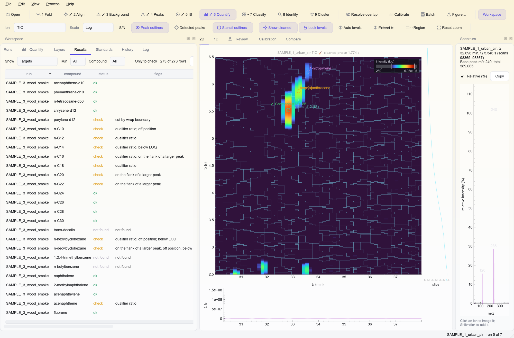

**🧪 Results tab** (in the Workspace). Four views of the same results. Double-click any row to jump to the peak. Filter by run and compound, or tick Only to check. Export CSV… writes all four tables.

| View | Contents |
|---|---|
| Targets | every target in every run: status, flags, amount ± SE, concentration, response ratio, position, calibration set (e.g. `mon→fri (40%)` when blended) |
| All signals | every peak in every run: volume, the nearest internal standard, **volume ÷ that standard's volume**, the target it belongs to (if any), and a semi-quantitative amount |
| Internal standards | each standard in each run, its volume relative to its own median across the sequence, and a flag beyond the tolerance, with a trend chart above the table |
| Calibrations | one row per compound and set, with pass or fail and the statistics |

**How "nearest" works.** Distance is measured with 60 s along t₁ counting the same as 0.5 s along t₂ (both adjustable in the settings). The internal standard named in the target table always wins for that target; unknown peaks use the nearest one.

**Semi-quantitative amounts for nearby peaks.** An unknown peak within 3 distance units of a calibrated target is given an amount "as" that target. This uses the target's whole-peak (TIC) curve, so it assumes the unknown gives the same total signal per nanogram as its neighbour. That is roughly true within a compound class and can be badly wrong across classes, which is why these amounts are labelled with the target used and kept in their own table. Treat them as estimates.

**Settings** (⚙️ in the Results tab, or Process → Quantification settings). The main ones:

| Setting | Default | What it does |
|---|---|---|
| Qualifier tolerance | 20% | allowed relative deviation of each qualifier ratio |
| t₁ / t₂ tolerance | 4 s / 0.04 s | how far a peak may sit from its expected position before its score drops |
| Learn positions | on | take expected positions from the calibration runs |
| Move with internal standard | on | shift each target by its standard's shift in that run |
| Ambiguity | 0.8 | runner-up score, relative to the best, above which a result is flagged |
| Detector ceiling | from the data | intensity at which a point counts as saturated |
| IS tolerance | 50% | internal standard volumes further than this from their median are flagged |
| Interpolate calibration sets | on | blend the two bracketing sets by run position; off uses the nearest set before |
| Peak S/N | 10 (blobs), 5 (targets) | minimum signal-to-noise for a peak |
| Calibration limits | ±15%, ±20% lowest | back-calculation acceptance |

Changing settings marks the results out of date; the banner in the Results tab reruns them.

### 📈 Calibrate (the calibration builder)

A separate window for building calibration curves from a set of standard runs, with or without a
compound list, and reading the curves off for samples. It keeps its own runs, fold and peaks, apart
from the main window's project, and never saves over it. The science is in `core/calbuilder.py`;
`examples/tutorials/07_calibration_builder.py` does the same without the window.

Select the standards in the Runs table (Ctrl+click), then open **Tools → 📈 Calibrate** (or
**Quantify → Advanced calibration tools → Build curves from my standards…**). The banner above each tab says what to do on it
next; a tab title is ticked when it is done.

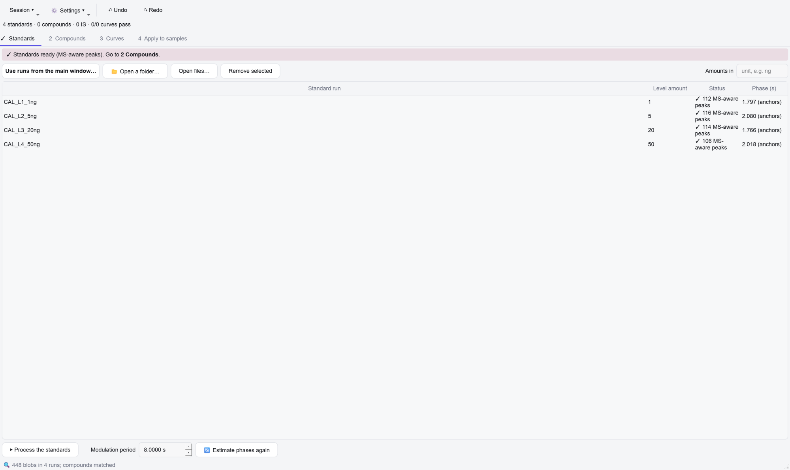

1. **Standards.** *Use the runs selected in the main window* (or open a folder or files). The runs
   are cleaned, their peaks found (MS-aware components, as in step 4, or legacy blobs from
   ⚙️ Settings ▾) and their phases lined up: a run whose second dimension sits apart from the others,
   judged from peaks with the same spectrum, is moved onto them. The level amount of each run is read
   from its name where it says (`L6_5ng` is 5; `025ng` is 0.25, as written on the vials); type it in
   the table otherwise.
2. **Compounds.** Three ways in: *🔎 Suggest from the standards…* finds peaks that grow with the
   level along a straight log-log line (calibrants) and peaks that stay constant (internal-standard
   candidates, named when their spectrum carries a shipped standard's signature), with no table at all;
   *📄 Load a compound table…* reads a CSV (`compound`, `t1_s` or `t1_min`, `t2_s`, `role`,
   `quant_ion`, `istd`, then one amount column per run, named after the run or after the part of its
   name that differs, such as `L3`; a `target_table.csv` also reads); or click peaks on the
   chromatogram: by default a click puts that peak's t₁ and t₂ into the selected compound (a new row
   when none is selected), and *A click on the chromatogram* switches to adding a compound or an
   internal standard, or to matching the selected compound to the clicked peak in the run shown only.
   Each compound is matched to the peak at its position in every run, its signal is the peak volume
   (or its quantifier ion's), and it is divided by its own or its nearest internal standard. Select a
   compound to see its peak outlined in bold and its spectrum; *No peak in this run* removes it from
   the run shown, *Automatic match* forgets a hand match.

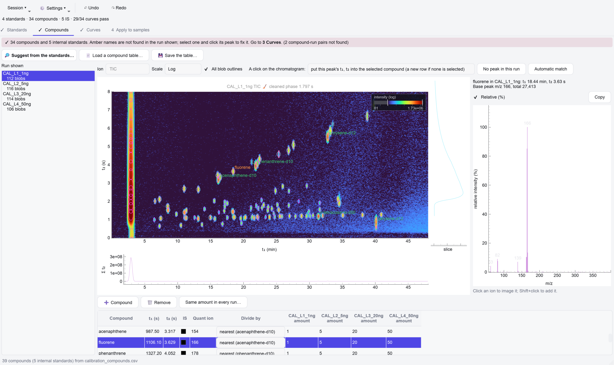

3. **Curves.** One curve per compound, IS-normalised response against amount, fitted by the same
   weighted least squares as 🧪 (weights by back-calculation error, straight or quadratic by Mandel's
   test). The list marks ✅ curves that pass and ⚠️ those that do not. Click a point to select it:
   *Leave out* (Delete) drops it with a reason, which is kept; retype its amount; *Show in
   chromatogram* and click the right peak to rematch it. Weights, model and zero can be overridden per
   compound, and the x axis can be the amount ratio to the internal standard when the standard was not
   spiked equally into every run. Every change refits at once and can be undone (Ctrl+Z).

4. **Apply to samples.** Tick the main window's other runs and press ▶ Quantify. Each is cleaned and
   searched like the standards; every compound is found by position (moved by the run's own t₂ offset
   from the standards) and spectrum, and read off its curve with a standard error. Amber cells say why a
   result is flagged: not found, its internal standard not found, no curve, a curve that fails its
   check, or an amount below the lowest or above the highest standard. Concentrations follow from each
   run's volume (m³). *📤 Export results* writes the table as CSV.

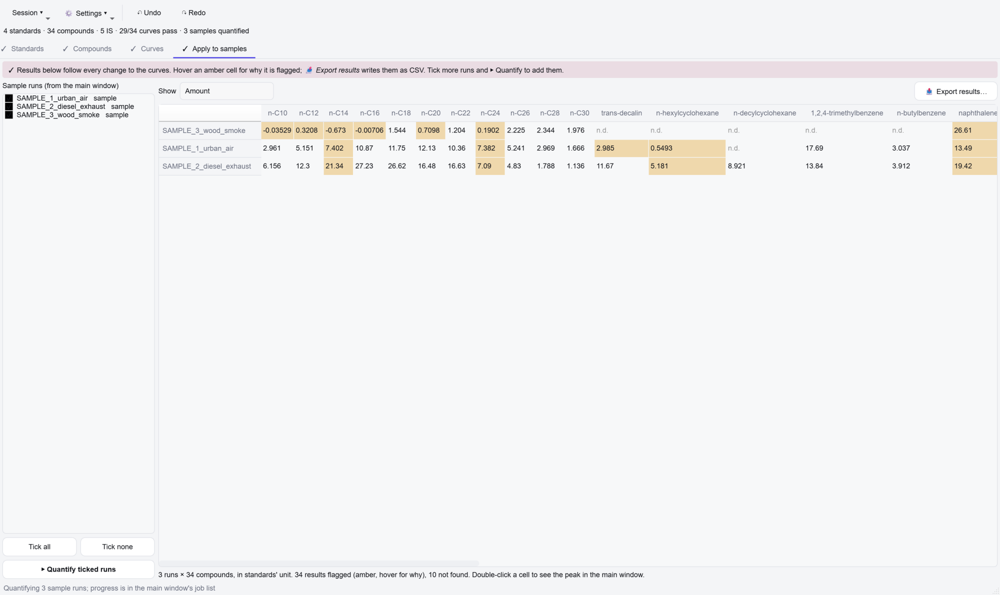

**Session ▾** saves and reopens a session (runs, fold, settings, compounds, hand matches, exclusions
and curve choices) as JSON, exports the curves, points, compounds and every normalised peak as CSV,
and saves the compound table. **⚙️ Settings ▾** holds background, peak, matching (search window,
nearest-IS distance scale, saturation flag) and curve rules.

On the August 2026 standards, run without a compound list, the builder suggested 59 calibrants and
recognised four internal standards ([report](validation/calibration-standards-2026-10-06.md)).

### 📍 Alignment and compare

Retention drifts a little from run to run: a few seconds in t1, a few hundredths of a second in t2. Alignment fits a map from one run's true coordinates onto a chosen reference run's, so images can be resampled onto the same grid and compared pixel for pixel.

**The anchoring window.** Press **Pick anchors across runs** (or **A**, or **Open the anchoring window…**) and a window opens with three pages.

1. **Phase check.** An anchor records where a peak sits inside its modulation, so a run's phase must be right before anchoring: change it afterwards and every peak in that run moves in the second dimension. The page lists each run with its phase, how it was found and a small picture of its folded TIC (a wrong phase cuts peaks across the top and bottom edges). Tick every run you are happy with, then **Continue**. A tick is removed whenever that run's phase or the period changes. **Open Fold and phase…** takes you to the fix.
2. **Pick anchors.** The header names the run being clicked ("Run 3 of 8: RUN_C") with a badge saying whether it is the reference or a sample, and a strip of chips shows which runs already have this anchor. A box states how many anchors are complete on every sample and what each transform needs (one for a shift, three for a stretch, six for a curve, and what automatic choice will consider with that many), and warns if the anchors sit in one third of the run or less. The image is the run's own: click a clear peak on the reference, then the same peak on each sample. On a sample the reference position is drawn as an orange cross inside a dashed box, the region a click snaps to the brightest nearby pixel. **Skip this peak in this run** passes over a missing peak; **Finish picking** or **Esc** keeps the clicks and stops. Use TIC or a single ion, and keep the same one for a round.
3. **Check the result.** Press **ANCHOR**. Until then clicks are only recorded, so nothing moves under your mouse and an applied blank subtraction is not invalidated. ANCHOR fits every run's transform and opens a page with the reference in magenta and the run in green **before** and **after**, and a table for each run: the transform used, the number of anchors, how far apart the anchors were before (t₁ s / t₂ ms), the leave-one-out error after, how alike the two images are before and after (correlation over their brightest pixels, 0 to 1) and a status. "Worse after alignment" means the transform made the images less alike (usually too few anchors or anchors in one part of the run); add anchors across the run and press ANCHOR again. **Back to anchors** keeps every click.

If a run's phase changes after it was anchored, the phase page marks it "anchored with a different phase" and the result table says "Phase changed since anchoring"; pick its anchors again or press ANCHOR to refit. Projects saved before this record how each run was anchored are not flagged.

**Picking a reference.** In the 📍 Align panel, choose the run everything else will be aligned to, or start picking to use the first loaded run. The reference is always shown as itself, never resampled.

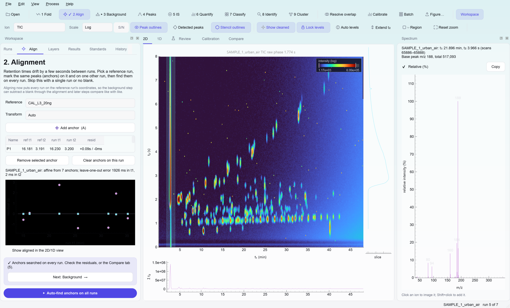

After the last run, the window returns to the reference and prompts for a new peak, P2. Repeat with points spread across retention time. The main window's 2D view follows along and still accepts clicks, but the window's own image is the place to click. The shared table in the Align panel keeps every recorded position visible, with the current run's rows in bold; labelled crosses mark saved clicks on the image.

**Add, delete or start again.** The visible **Add points (A)** button starts the same guided
picker; while picking, it becomes **Finish picking (Esc)**. Select one or more table rows
and press **Delete selected points** to remove them in a single undoable action. Deleting
a reference row also deletes its matching points across the runs. **Start alignment over**
clears all alignment points, transforms and transform overrides, keeps your chosen reference,
and returns to it ready to pick P1 again. It also clears the old completion banner.
**Ctrl+Z** restores the previous alignment. These controls are outside More alignment options.
Deleting, restarting, undoing, refining and auto-finding apply at once, as before: only the picking session waits for ANCHOR.

When you press ANCHOR, each run's transform is fitted from its clicks:

- **1 anchor:** a plain shift in t1 and t2.
- **3 or more:** a straight stretch and shift in t1, plus a t2 offset that can itself vary linearly with t1 (useful when the second dimension drifts differently early and late in the run). Both fits are Huber-weighted, so one bad click doesn't wreck the rest.
- **6 or more:** a smooth curve instead of a straight line — a monotone cubic through the t1 anchors and a smoothing spline for the t2 offset.

Auto (the default) picks the simplest tier that already fits the anchors well; you can force a tier with the Transform dropdown under **More alignment options**. If a run's anchors come out in a different order than the reference's, no honest time correction passes through them; the transform is flagged rather than trusted, and the panel explains why.

**Refine the clicks.** Finish picking, then press **Refine anchors to local maxima**. Every saved anchor, including its reference position, moves to the brightest finite positive pixel in a small neighbourhood on its saved ion (or TIC). The default search is ±1 modulation in t1 and ±0.150 s in t2. Change these limits under **More alignment options**; set the modulation limit to 0 to refine within the clicked column only. The search uses the currently selected raw or processed layer and follows wrapped peaks across modulation boundaries. Flat or non-positive neighbourhoods are reported and kept unchanged. Equal maxima favour the nearest pixel. Reference positions are refined once and shared across all matching rows; transforms and labelled crosses update together. **Ctrl+Z** restores the entire refinement in one action. This finds an intensity maximum rather than an intensity-weighted centroid.

**Anchors, in bulk.** Under **More alignment options**, 📍 Auto-find on all runs searches every other loaded run for the anchors you've already named (by ion, within a window around the reference position, the same search phase estimation uses) and builds a transform for each. Missing ones are reported rather than silently skipped. This is a broader search for corresponding peaks; local refinement only adjusts existing clicks and also supports TIC anchors.

**How good is it?** The summary gives leave-one-out error in seconds: each anchor is predicted from the others and compared to where it was actually clicked, which is a more honest number than how well the curve fits the points it was built from. The compact table shows anchor, run and its t1/t2 positions; hover for the full run name and coordinate pair. **More alignment options** reveals reference-coordinate and in-sample residual columns, plus a plot of t1 residuals and t2 residuals multiplied by ten.

**Seeing it.** 📍 Show aligned (in the panel, or the toolbar) resamples the current run onto the reference's grid in the 2D and 1D views, so the ion box, colour scale and everything else keep working as normal, just on the reference's axes.

To check an alignment by eye, open ⚖️ Compare (5) with the reference as A and an aligned run as B; the overlay should show shared peaks white, not as magenta and green pairs. The window is described under ⚖️ Compare runs below.

**Undo.** Every anchor added, removed or cleared, every refinement, and every reference or transform-kind change, is undoable. Removal acts on the selected table row, even when another run is displayed. Removing a reference row removes that anchor's matching rows across all runs as one undoable edit. Completed clicks, including reference-only points, are saved in the project; an unfinished picking session itself is not resumed on reopening.

**Not built:** intensity-weighted centroid refinement; the batch search still matches anchors independently rather than with a full Hungarian-plus-RANSAC pass across every blob; and there is no small-multiples gallery of one target across every run yet.

### 🔍 Peak detection and separation

**Preview before processing a sequence.** Press **Preview fitting…** in Peaks. A visible
region box supplies the preview bounds; otherwise the current view supplies the first-time
interval. The preview retains all second-time rows plus one modulation on each side, so
the rectangle does not cut through profiles across modulations. Choose **Current run** for
a complete-run preview. It uses the existing background layer, or raw data if none is applied;
it does not estimate a new background for the crop.

**Preview settings…** edits a local draft. **Run preview** shows detection, fitting, merging
and full-spectrum progress, followed by observed, fitted, residual and fitted-fraction maps.
Inspect unexplained signal and unresolved groups. Cancel or close to discard the calculation;
accepted peaks, project fitting settings and quantitative results remain unchanged. Input
changes disable application of an old preview. **Use settings and fit all runs** applies the
draft settings and starts the normal sequence job. Saved manual fit overrides follow their
usual region-matching rules. Inspect/refit is available from **Peak tools…**.

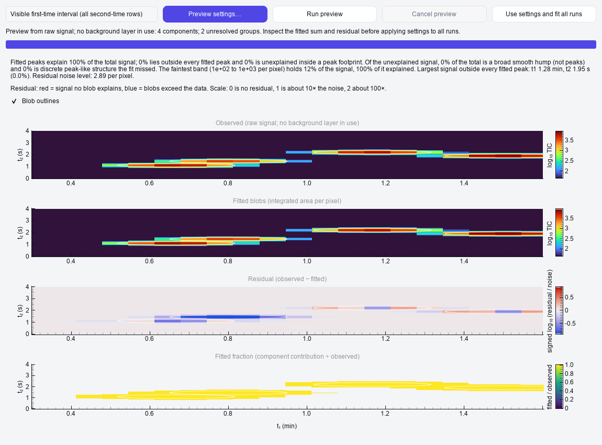

Step 4 offers two detection methods in a saved selector. **MS-aware separation** is the default route for crowded real data. **Legacy blob borders** keeps the old behaviour for comparison and for existing tools that still consume `BlobSet`. Both run across every loaded run from **Find peaks**.

**Tilted Gaussian is the default peak shape**, in both automatic separation and manual
refits. Every component has its own widths and tilt: its second retention time may drift
across modulation slices. The algorithm still chooses how many components the evidence
supports; selecting tilt does not force an extra peak. Other shapes remain available in
the manual refit dialog and advanced detection settings.

Click **▶ How it works** beside the fitting controls for a 16-second animation. The top
plot shows the detector-time chromatogram: narrow pulses, with component widths of 250 ms
at half height and a 10 s modulation interval in this synthetic example. These values
illustrate the principle; they do not set your acquisition or fitting parameters. Each
modulation cycle becomes one column of the 2D map, rather than being summed into a broad
1D peak. A shared highlight follows a cycle through the trace and map; the lower-left plot
enlarges its overlapping pulses against second retention time. Coloured curves and contours
show separate contributions while the dashed sum approaches the observed signal. Pause,
scrub the timeline or replay it. Motion is scripted, not a fit of your sample; opening it
does not start or change an analysis.

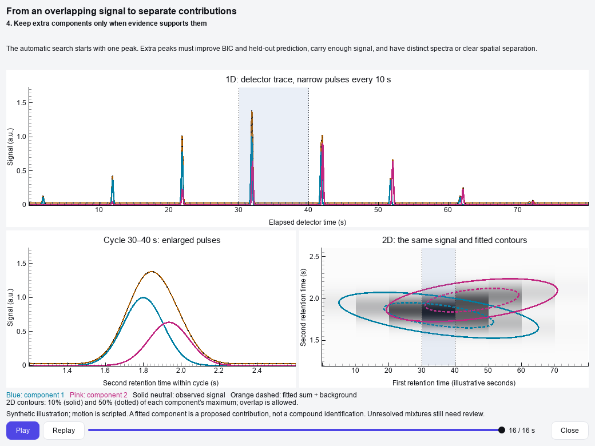

On reopening an older project, the previous automatic Gaussian/adaptive default upgrades
to tilt. Explicitly fixed alternative models are retained. Existing results are not rewritten
on load; restart the application and rerun **Find peaks** to recompute automatic fits. Accepted
manual fits remain overrides when their saved region geometry still matches, so inspect/refit
those groups explicitly if you want tilt applied to them too. The previous 24-evaluation
default upgrades to 60, retaining custom budgets.

**MS-aware separation** finds local peaks on individual mass channels, groups channels that independently agree on position, and fits their shapes and mass spectra together. Its normal result is one table row and a pair of contours per proposed component. The contours may overlap because several compounds can contribute to the same measured pixel. The table reports estimated intensity, diagnostic ions and confidence. Weak or poorly modelled groups remain visible and are labelled unresolved. Select a row and press **Resolve selected region…** to inspect or refit its calculation window. **Export peaks CSV…** writes every component together with its quality warning.

**Legacy blob borders** combines ion evidence into one surface and uses watershed to assign every pixel to one blob. On the supplied busy real file, small positive residuals across hundreds of ions accumulate and make this route over-detect broad background and join peaks. It remains useful for compatibility and controlled comparison, but should not be treated as the preferred scientific representation of overlap.

How many peaks a calculation window holds is decided from the data, not from how many apexes the candidate finder placed there. Each window starts from one peak and gains another only if the fit improves (BIC and held-out reconstruction), the new peak carries a mass spectrum different from its neighbours or is resolved from them, and it holds at least 2% of the signal. Two peaks with near-identical spectra that are not resolved are reported as one peak with a warning, because their spectra cannot separate them. The same peak found by several windows is kept once. Calculation windows are internal and are never drawn.

Three further points apply to MS-aware peaks:

- **📊 Signal accounting** reports how much of the run's total signal the fitted peaks explain, how much lies outside every fitted peak, how that splits between a broad smooth hump and discrete peak-like leftovers, and where the largest leftovers are. It also breaks the signal down by pixel intensity. Use it to judge what the finder is missing.
- **Sensitivity.** Faint peaks are limited by `tic_prominence_snr` in the candidate settings (default 2). Lowering it to 1 raised detection of peaks with apex TIC 4e4 to 1e5 from 50% to 81% on planted test peaks, at the cost of more components and some in background-only regions. `seed_snr` made no difference.
- **Downstream.** 🧬 Classify and 🧩 Cluster use the fitted peaks, with each spectrum re-solved on every ion, and no longer run the legacy detector. Siloxane blocking, hydrocarbon mapping, batch and the 14 eV path of Classify still need legacy blobs. Amounts remain estimates and do not feed quantification.

In legacy mode, **🔍 Find peaks** detects blobs on every loaded run: the sum of every ion's own signal-to-noise image combined with plain total-ion S/N. A watershed grows each seed into a footprint, trimmed to 1% of its own apex.

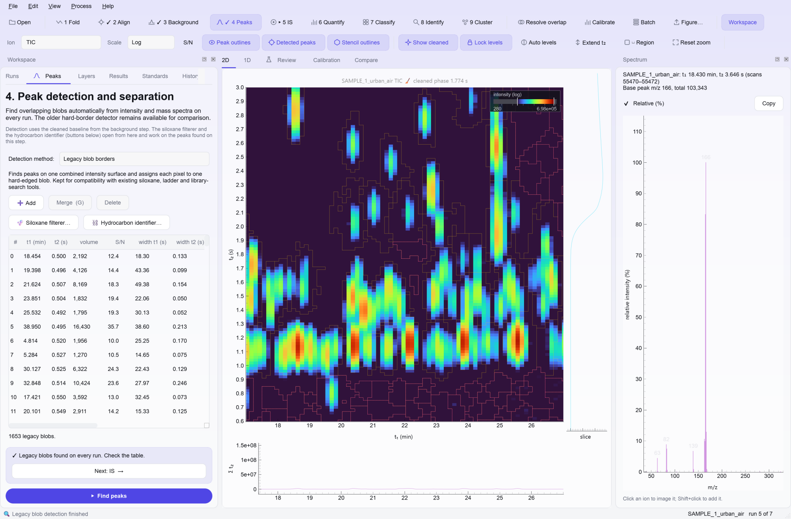

In legacy mode, the table lists every blob on the current run: position, volume, S/N, width in t1 and t2, how many modulations it spans, a co-elution flag, and whether it looks like siloxane (see 🫧 below).

- **🔍 Blob outlines** (toolbar or View menu) draws every footprint in amber; clicking a peak in the 2D view selects the nearest one in the panel, and selecting a row in the panel bolds its outline in the view.
- **➕ Add** starts a one-click flow (like 📍 add anchor or 🧪 pick a peak): click a real peak that automatic detection missed (too faint on its own, or shadowed by a bigger neighbour), and its footprint is grown from that pixel.
- **Merge (G)** combines the blobs selected in the panel into one: volume, pixel count and the summed spectrum are exact sums (footprints never overlap), and the combined position and width come from each one's own position and width weighted by volume (the parallel-axis theorem). Co-elution isn't re-tested on a merged peak.
- **Delete** removes the selected blobs.
- Add, delete and merge are all undoable (Ctrl+Z), and are saved with the project as a small edit log, replayed on top of a fresh detection the same way 🧪's review decisions sit on top of a fresh quantification. The log is positional (which blob is "the third one" depends on `find_blobs` producing blobs in the same order), which holds up across a fold or 🧹 change but not across a change to the 🔍 settings, so a settings change clears it rather than risk applying it to the wrong blob. Settings are under Process → 🔍 Peak detection settings….

**Not built:** the watershed/seeding pass is split into overlapping stretches of t1 and run across a thread pool for speed on long runs, but that hasn't been exercised against real, hours-long data yet. Co-elution clustering is a heuristic (single-linkage on each ion's own local apex position) that hasn't been checked against real co-eluting compounds either.

### ✂️ Resolve overlap

![✂️ Resolve overlap: the peak-shape fit of the region holding benz[a]anthracene and chrysene](images/screenshot_overlap_fit.png)

Open a selected MS-aware component group directly from step 4, or inspect a legacy blob from the toolbar. Press **Accept components** to replace the automatic result for that group. Acceptance is saved with the project and can be undone. Component spectra are available to identification and CSV export, but component amounts are not yet sent to production quantification.

- **Region/blob picker.** MS-aware regions are listed when that method is active; otherwise every legacy blob is available, with co-elution flags first.
- **3D surface.** The picked blob's own footprint, as a rotatable height surface (pyqtgraph OpenGL, coloured with the same magma map as the 2D view) -- two peaks close in position and height are often easier to tell apart from an angle than looking straight down.
- **Unique ions / split.** Where each of the blob's own significant ions actually peaks, and which cluster they fall into (more than one means the ions don't agree on where the compound peaks -- probably more than one compound). "Split at each cluster's own apex" runs a fresh watershed seeded there and reports each region's volume.
- **Peak-shape fit.** A joint fit of k two-dimensional peak shapes times mass spectra, starting with tilted Gaussian and offering alternative tailing and measured-template shapes. "Choose k automatically" picks whichever manual fit minimises BIC. Reports each component's position (with a standard error, from the fit's own Jacobian) and volume. The main automatic detector additionally checks held-out reconstruction and spectral/spatial evidence when adding a component.
- **MCR-ALS.** A free-form alternating-least-squares decomposition into k non-negative concentration profiles and spectra, no peak shape assumed; reports each component's dominant ion and volume.

**Not built:** a way to draw a straight-line or valley-path split by hand in the 2D view (`core/overlap.split_by_line`/`split_by_valley` exist and are tested, just not wired to a drawing tool); PARAFAC across several runs at once (`core/overlap.parafac`, `core_consistency`, `split_half_stability`, `build_run_tensor` are all built and tested, but there's no button anywhere yet -- call them from Python); PARAFAC2 itself was never built (see [Known limitations](../ROADMAP.md)).

### 🫧 Siloxane filterer (siloxane removal)

Opened from the **🫧 Siloxane filterer…** button under the 4 🔍 Peaks table.

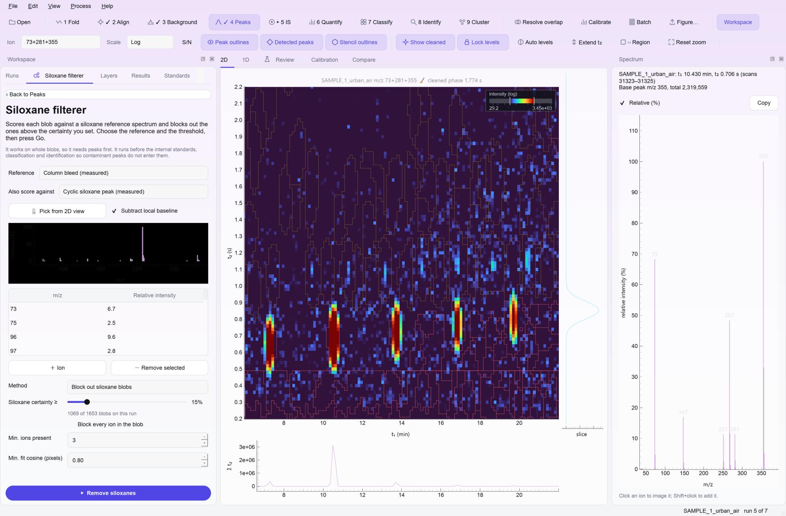

Column bleed and cyclic siloxane contaminants (Dn) fragment under EI onto a recognisable set of ions, but differently: bleed is dominated by m/z 207, a discrete Dn peak by 73 and 281. Blobs are therefore scored against two **reference spectra** and keep the larger score; the per-pixel method fits the first one only.

**The reference spectra** (🫧 Siloxane tab, left). The first defaults to the column bleed measured on the earlier real run: m/z 207 is the base ion, followed by 281 (18%), 208 (17%), 209, 96, 191, 133 and 73 (only about 7%). It was taken as the slope of each ion against m/z 207 through the last 30 minutes of the run, which keeps what rises with the oven temperature and drops the constant background (39, 40, 44). *Also score against* sets the second, by default *Cyclic siloxane peak (measured)*; choose None to score against the first alone. Three ways to change the first:
- **Presets:** *Column bleed (measured)*, *Cyclic siloxane peak (measured)* (a discrete Dn peak at 29.3 min in the same run: 73, 147, 281, 282, 283) and *Generic Dn (old default)*.
- **Edit the table:** change an intensity, add an ion (＋ Ion) or drop one (－ Remove selected). The bar chart shows the reference as it will be used.
- **🖱 Pick from 2D view:** click a siloxane peak, and that point's spectrum (ions of at least 3% of the base peak above m/z 45, at most 20) becomes the reference. *Subtract local baseline* is on by default, which is right for a discrete peak; switch it off when you click plain column bleed, which the baseline subtraction would otherwise remove. Esc cancels.

On its own the bleed reference leaves a discrete Dn peak alone (its ion ratios do not match), and the cyclic reference leaves the bleed alone, which is why both are used: on the September 2026 runs either alone missed most peaks of the other kind, and the pair caught all 38 and 21 siloxane-like blobs on two runs with no hydrocarbon blob flagged. Changing the reference updates the 🔍 flags at once; layers already applied keep their old fit until you press 🫧 Apply again (the panel says how many).

**Flagging** happens automatically wherever 🔍 blobs are shown: every blob is scored (the fraction of its volume on the reference ions, times its cosine similarity to the reference) and the 🔍 Blobs panel's "🫧 siloxane?" column marks anything at or above the threshold. The default threshold, 15%, was chosen on two of the September 2026 runs ([audit](validation/audit-2026-09-24.md)); check it on your own runs.

**Blocking out siloxane blobs (default method).** The slider in the 🫧 tab, *Siloxane certainty ≥*, sets how sure a 🔍 blob must be to count as siloxane. A blob's certainty is the score above as a percentage. Drag it and the blobs at or above it are outlined in dashed magenta in the 2D view (the 🔍 outlines switch on for you), the 🔍 table's 🫧 column shows each blob's percentage, marked *yes* at or above the slider, and the panel counts how many blobs on the current run qualify. **🫧 Siloxanes** then zeroes the ions of both references in every scan inside those blobs' footprints, leaving other mass channels intact; co-eluting analytes can still lose signal on shared siloxane ions (tick *Block every ion in the blob* to zero everything; on a busy run that removed several per cent of the hydrocarbon signal with the bleed). Nothing is fitted. Projects saved before 24 September 2026 keep the settings they were saved with (30%, every ion, one reference): pick the preset again and set the slider to 15% to use the new defaults.
- 🫧 finds the 🔍 blobs first if a run has none, or if they are out of date. Blobs are always found on the layer beneath 🫧 (🧹 if applied, otherwise raw), so a blocked-out blob is still listed and outlined, and the slider keeps working after 🫧 is applied.
- Delete a blob in the 🔍 panel to keep it out of the removal, or use ➕ Add to include a peak the detector missed.
- A blob's footprint stops at 1% of its apex, so a faint edge tail (about 0.4% of the signal in the synthetic test) remains.
- Pressing 🫧 again replaces the previous layer using the current slider and reference; it does not stack on it. Ctrl+Z undoes it, and Process → Remove 🫧 from all runs takes it off.
- The *Method* box in the 🫧 tab switches back to the older per-pixel fit, described next.

**Per-pixel method.** Fits and subtracts the siloxane component from every loaded run, pixel by pixel, on top of 🧹 where that's been applied. Every siloxane ion at every pixel is fit against the reference pattern by non-negative least squares (a single reference reduces this to a clipped projection), and only the fitted component is subtracted, never a whole ion outright: a real analyte that happens to share one siloxane ion (behenic acid on m/z 73) doesn't bring the others up in the matching ratio, so little or nothing is removed there, while column bleed and Dn peaks, which do show that ratio across several ions at once, are subtracted almost entirely.

- Shown under the same raw/🧹-cleaned toggle as background removal (Space); the Layers panel reports how many runs it's been applied to.
- Undoable (Ctrl+Z), and its settings are saved with the project; the result itself is rebuilt on reopening, the same way as 🧹 and 🔍.
- "Remove 🫧 from all runs" is in the Process menu.

**Not built:** more than two references, and a second reference for the per-pixel fit; automatic re-fitting when 🧹 or the fold changes underneath an applied 🫧 layer (it's cleared instead, so a stale fit is never shown silently); wiring into 🧪's own measurement, which still reads the 🧹 layer directly.

### ⛓️ Hydrocarbon identifier (and isomer mapper)

Opened from the **⛓️ Hydrocarbon identifier…** button under the 4 🔍 Peaks table.

A hydrocarbon chromatogram is usually a big diagonal smudge: every homologous series (n-alkanes, branched alkanes, cycloalkanes, ...) climbs across the plot together, because adding a CH2 group moves a compound almost the same distance in t1 whichever series it belongs to. This tool names the one series you can be confident about (the n-alkanes) and describes everything else relative to it, which is also what makes a stencil drawn on the alkane standard transfer straight onto a sample: it's recorded against the standard's own ladder, and reads back out against the sample's.

**➕ Find alkane series** starts a two-click flow: click an n-alkane peak (on m/z 57 by default) and type its carbon number, then do the same for a second one further along. The ladder then grows outward one carbon at a time. Each carbon is predicted from its two nearest confirmed neighbours and searched for on m/z 57 within a window in t1 (at most 45 s, and never more than 0.45 of the local spacing) and in t2 (0.25 s) around the predicted alkane line; the tallest pulse whose qualifier ratios match is taken. The t2 restriction matters: on the real hydrocarbon run a brighter m/z 57 pulse from a branched or cyclic compound at another t2 is nearly always close by, and a time-only search locks onto it. The 🔍 Blobs panel doesn't need to have found anything first; this searches the raw ion directly, the same way 📍 add anchor and 🧪 pick a peak do.

**Alkane qualifier ratios** (top of the ⛓️ panel). Each candidate's m/z 71 and 85 are compared with the quantifier (57). The defaults, 71/57 = 0.66 and 85/57 = 0.44 with a 30% relative tolerance, are the medians over C13 to C28 in the real run. A candidate outside the tolerance is rejected (untick the gate to fall back to the tallest pulse, flagged). Three ways to change them: type new ratios, press **🖱 Pick from 2D view** and click an n-alkane (its baseline-subtracted ratios become the expected ones), or **Reset to measured default**. The ladder table shows each hit's measured ratios, shaded where they are outside the tolerance. The ratios fall for light alkanes (C12 0.54/0.32, C11 0.48/0.25), so the default gate stops the ladder at C12; the seeds you click are trusted regardless.

**Ladder shape** (⛓️ panel, below the ladder table). A real ladder is rarely straight across the plot, because the spacing between alkanes shrinks through the temperature programme and individual alkanes can be found a modulation off. The shape sets how the ladder is read between and beyond the confirmed alkanes: *Straight between points* (the default, and the earlier behaviour), *Smooth curve through points* (a monotone cubic that bends through every alkane without overshooting), or *Polynomial fit* (degree 1 to 6, an averaged curve that ignores one wonky point). Beyond the first and last alkane every shape continues along the end slope. The shape is a setting saved with the project and applies to stencils, the t₂-above-the-alkane-line axis and assignment alike.

**🏷️ Assign peaks to hydrocarbons** labels every 🔍 legacy blob on every run that has a ladder, and lists the current run's labels (double-click a row to go to the peak). A blob is an *n-alkane* ("n-C17") only if it sits on a whole carbon number of the ladder (within 0.15 carbon-equivalents, setting `assign_carbon_tol`), within 0.3 s of the alkane line in t₂ (`assign_t2_tol_s`), has an alkane-like spectrum and passes the 57/71/85 ratio gate. An alkane-like blob that fails any of those is a *branched alkane* at its carbon-equivalent number ("branched alkane C17-eq"). The other families are chosen by the share of the blob's signal on their diagnostic ions: cycloalkane (55, 69, 83, 97, 82, 96), alkylbenzene (91, 92, 105, 119, 133) and alkylnaphthalene (128, 141, 142, 155, 156, 170). A blob that matches none stays *unassigned*. The ion sets and minimum shares (`TYPE_RULES` in `core/hcassign.py`) are starting values, not validated on real data. Labels are not saved with the project; press the button again after changing the ladder, its shape or the peaks.

**⛓️ Propagate to other runs** searches every other loaded run for the same confirmed carbons, centred on where they are in the reference run (retention drifts a little run to run, not by a whole modulation — the same assumption 📍 batch alignment makes for internal standards).

**Stencils** are group-type polygons, drawn once and lifted onto any run with its own alkane series:
- **✏️ Draw stencil** drops an editable polygon onto the 2D view (drag its corners, or add more via pyqtgraph's usual ROI controls) positioned over the group you want to lump, using whichever run's alkane series is current.
- **💾 Save** (with a name and a response factor) records it — not in absolute t1/t2, but as carbon number and offset from the alkane line, so it means the same thing on any run.
- Every stencil is shown lifted onto the current run automatically (⛓️ Stencil outlines, toolbar or View menu), and the ⛓️ Hydrocarbons panel lists each one's summed TIC volume, blob count and amount (volume × response factor) for the current run, needs 🔍 blobs to have been found on it first.
- Add, delete and reweight are all undoable (Ctrl+Z), and the stencils and each run's alkane series are saved with the project.

**Markers** (pristane, phytane) are looked up automatically at a measured carbon-equivalent offset from their neighbouring n-alkane (+0.01 C from n-C17 and +0.08 C from n-C18, measured on the real run) and shown at the bottom of the panel. At a 10 s modulation they share a column with their alkane, so the nearest blob is often the alkane's own; the m/z 183 and 113 excess is what tells them apart.

**🔗 Find series** and **✎ Edit shape** are described under [Working order, settings and figures](#working-order-settings-and-figures); ⚙️ All settings edits every `HydrocarbonSettings` field. The series finder's diagnostic ion pairs (91/105, 82/83, 142/156, 58/59) are not validated; the (57, 71) pair recovers the alkane ladder as a positive control.

**On the current instrument tune.** On the four September 2026 runs the n-alkane ratios are 71/57 = 0.60 and 85/57 = 0.38 (medians, C13 to C28), below the defaults. The defaults are nonetheless the better gate: the branched isomers it has to reject have lower ratios still, and a gate centred on the n-alkane values let one in and put a whole ladder one carbon out. The gate drops the odd alkane (C12 on one run, one carbon above C25 on others); untick it to fill gaps, then check them. From two correct clicks the ladder reaches C9 or C10 to C29 or C30 on all four runs; seeds typed in the wrong carbon order are refused. Ladders are saved with the project.

### 🧬 Classify

Open **Assign (step 6) → Assign compound classes…**. It assigns compound classes from
peak spectra, retention relative to the n-alkane ladder and, where supported, a loaded
14 eV partner. The editable rules cover alkanes, aromatics, oxygenates and other classes
without requiring a spectral library.

**Running it.** Open a 70 eV run, choose **Assign → Assign compound classes…**, then
**Classify blobs**. It uses detected legacy peaks, or re-solves full-ion spectra for
the fitted MS-aware components. If neither result is available, it finds legacy blobs
privately and says so in the notes. The alkane ladder is optional; without it, retention
evidence is skipped. A loaded 14 eV partner can supply evidence for legacy footprints,
with background removed here if needed. That evidence is unavailable for fitted MS-aware
components. Selecting the 14 eV run itself is refused: classification uses the 70 eV run.

**What a call is.** Each blob gets a class, a score from 0 to 1, a tier and a plain-language reason.

- **Tier:** confident (score 0.75 or more), probable (0.5), possible (0.3), otherwise unclassified. The tier is lowered one step when a rival class in another group scores within 0.15, or when the blob is flagged as co-eluting.
- **Reason:** select a row and the pane below shows every criterion that was tested, its value, and whether it helped, was skipped (unknown for this blob) or failed. This is the tool for finding out why a blob was called what it was.
- **Unclassified is an answer.** A blob that fits nothing is left blank, not forced into the nearest class.

**Panel.**

- **Use the 14 eV channel:** corroborates the molecular ion and fixes its parity (the nitrogen rule). Every rule also works without it.
- **Rule file:** *Load rules…* reads your own file, *Save an editable copy…* writes a copy of the shipped rules to start from, *Reload* rereads the file after you edit it, *Shipped* returns to the defaults. A mistake in a rule file is refused with the class and criterion it is in and, for a mistyped feature name, the closest valid names; the previous rules stay in force.
- **Class list:** each class can be switched off with its checkbox (saved with the project). Hover for the note on what the class is and where it is weak. Colours match the overlay.
- **Tables:** a summary of blobs and volume per class, and the blob table (sortable; *Hide unclassified* filters it). Selecting a blob moves the 2D view to it, and double-clicking centres it.
- **Overlay:** *Colour blob outlines by group in the 2D view* outlines classified blobs in their group's colour while this step is open.
- **Export CSV…:** one row per blob: position (t1 in minutes, t2 in seconds), volume, class, group, tier, score, runner-up and its score, margin, what held the score back, co-elution flag, `dt2` and the molecular-ion candidate at 70 and 14 eV.

**Rules.** The shipped rules are `src/pygcgc/presets/chemical_classes.toml`; the header of that file documents every feature and the syntax, and it is meant to be read. A class is a list of `need` criteria (all must hold; the class scores as its weakest) and `prefer` criteria (raise the score from 0.5 to 1.0, never block). A criterion is `name: a -> b`, a ramp from not satisfied at `a` to fully satisfied at `b`, or a hard cut such as `M_odd <= 0`. Names are ion-set shares you define in `[ions]`, or built-in features: the molecular-ion candidate (`M_mass`, `M_rel`, `M_share`, `M_odd`, `M_plus2`), neutral losses (`loss_X`), `siloxane`, `dt2` (t2 above the alkane line, a polarity axis) and their `soft_*` 14 eV versions, including `soft_M_mod14`, which names the hydrocarbon series. Settings such as the molecular-ion threshold and the tier cut-offs are in `ClassSettings` (Python).

**What was checked.** On the supplied run the ladder recovers as alkanes, and 1-octanol, indole, carbazole, phthalates, chrysene-d12 and column bleed were checked one by one and the rules corrected where they failed (`docs/validation/classes-2026-09-21.md`). With the 14 eV channel, 9 of 10 n-alkane molecular masses are recovered and 86% of alkylbenzene calls have M ≡ 8 (mod 14), but only about 25 of 4068 calls changed: it corroborates rather than reclassifies. Nothing was tuned to the class volumes. There is no reference library of class labels for this run, so the calls are checked for chromatographic sense, not against a ground truth beyond the ladder.

**Limits.**

- **Alkenes and cycloalkanes** cannot be separated at unit mass, even at 14 eV (both have M ≡ 0 mod 14).
- **Ketones and aliphatic amines** share m/z 58, 72 and 86. Only m/z 44 and an odd M separate them, so both can score and the tier is lowered.
- **Primary alcohols** look like alkenes without m/z 31, which is below this instrument's range; polarity is the only handle.
- **Saturated peaks** distort the isotope ratios and can move the molecular-ion candidate by a mass; such blobs are usually left unclassified rather than misclassified.
- **Sulfur heteroaromatics** are disabled. M+2 over M is inflated on intense or co-eluting peaks, so the sulfur signature is unreliable here.
- **Polarity** (`dt2`) is tuned to the supplied column set and is only ever a `prefer` term.
- **Alkylbenzene volume.** About half of the alkylbenzene volume lies at t2 above 4 s and t1 7 to 19 min; the spectra fit but whether it is real wrapped-around aromatics or solvent tail cannot be told from this run.

The settings are saved with the project; results are not, so classify again after reopening. Changing the rules, the blobs or the fold marks the results stale. In Python: `load_rules`, `classify_blobs`, `soft_spectra_for_blobs`, `write_classes_csv` (`pygcgc.core`); `benchmarks/classify_real_data.py` runs it on the supplied run.

**Not built:** a settings dialog for `ClassSettings`; a rule editor in the panel (edit the file and reload); saving results in the project; a command-line `--classify`; feeding the class into 🏷️ Identify to narrow the library search.

### 📚 Library matcher (Assign → Search a spectral library…)

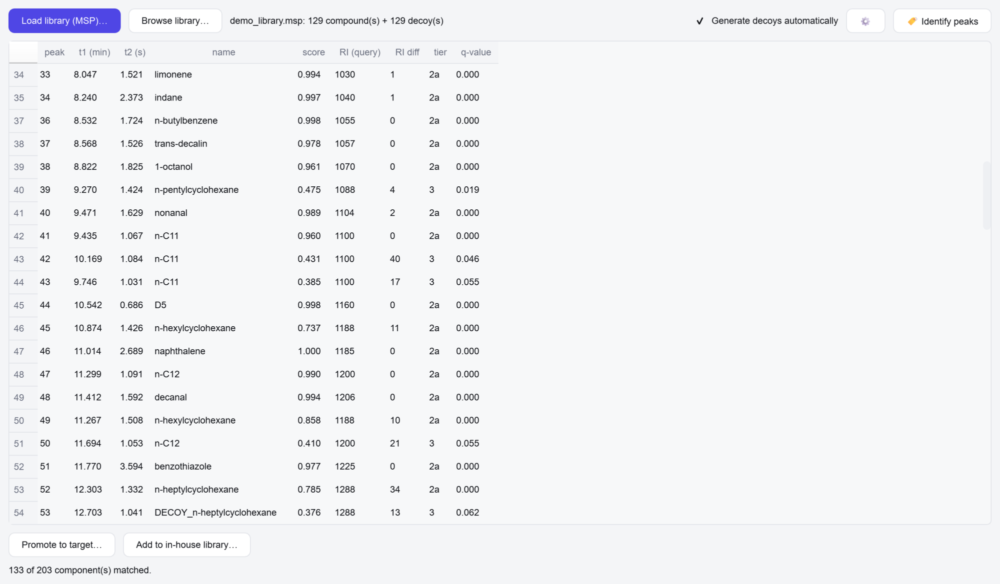

The matcher names the detected peaks from the **mass spectrum and the retention index together**, against the NIST library or an MSP file. It is written to make three things plain: what the largest peaks are, how sure each match is, and what is uncertain about it. (The screenshot shows the older MSP-only window, still available under Tools as **Older MSP-only search**.)

**What it needs.** The NIST folder (the one holding `mainlib.sdf`, ideally with `replib.sdf` and `nist_ri.sdf`, or its `SDF` subfolder) or an MSP file; fitted peaks in the run (step 4); and your first-dimension **column class**, which for a 5 % phenyl column is *semi-standard non-polar*. For retention indices it also uses an **n-alkane ladder** (⛓️), the run's own or another run's. **Column dimensions and the oven programme are not needed**: a retention index is measured against the alkanes run on the same method, which cancels most of their effect. Without a ladder the match rests on the spectrum alone and every peak says so.

**Reading the first time.** The library is read once, which takes about a minute for the full NIST files (244,000 spectra and 350,000 literature indices), and is kept in a local cache (`%LOCALAPPDATA%\PyGCGC\libraries`) so later sessions load it in a few seconds. The literature retention indices are cached per column class. Nothing from the library is stored in the project or the repository.

**The window, top to bottom.**

- *Set-up strip.* Library, column class, the run or all 70 eV runs, and where the ladder comes from ("each run's own", or borrow another run's: through the alignment if both are aligned, otherwise with the same times, which the window states). Anything missing is one sentence in red.
- *Largest peaks.* The ten peaks with the most fitted signal, each with its share of the run, its best match and its confidence.
- *All peaks,* largest first, with filters (confidence, flagged only, name, minimum share). Confidence is a symbol and a word: ● confident, ◐ probable, ○ tentative, ✕ unknown. The last column says where the peak stands against a subtracted blank.
- *The selected peak.* The measured spectrum above and the library's below, the candidates with their match factors and retention indices, the peak's retention index against each candidate's with its uncertainty, and every uncertainty as a sentence.

**How a match is judged.** The *match factor* (MF) is 999 times the squared cosine of the two intensity- and mass-weighted spectra (Stein and Scott weighting); the *reverse* factor ignores library ions the entry does not have, so a neighbour's extra ions in the peak do not count against it. These resemble NIST MS Search's values but are not identical; do not read NIST's thresholds across. The retention index is a **gate, not a score**: a candidate whose index is within 3 standard deviations of the peak's is ranked by MF. The deviation combines the peak's own time uncertainty (a quarter of a modulation), the spread of the published values for that compound, and 15 index units for the difference between a GC×GC first dimension and the one-dimensional columns of the literature. A strong spectral match that fails the gate is still shown, demoted, and the peak is flagged `RI_CONFLICT`.

| Level | Rule (provisional) |
|---|---|
| Confident (Schymanski 2a) | MF ≥ 850, a measured library RI within 2 standard deviations, no close runner-up, no more than 5 % estimated false discovery rate |
| Probable (2b) | MF ≥ 750 and within 3 standard deviations; or confident apart from an estimated-only RI, or no RI to check |
| Tentative (3) | MF ≥ 650 |
| Unknown | anything else; the best candidate is still shown |

**Where the library's retention index comes from.** The experimental median for your column class from `nist_ri.sdf` (temperature-programmed records only), linked by CAS number, NIST number or name; n-alkanes take 100 × carbon number by definition. Where there is no measurement, NIST's *estimated* index is used, corrected for your column class. Checked against the measured values on 20 October 2026, that estimate describes a standard non-polar column (median error 0, spread 62 units) and reads 21 units low on a 5 % phenyl column (spread 89); on a polar column it is useless, and estimates NIST itself gives an error of 120 or more were wrong by hundreds of units, so neither is used. Evidence in the [matcher validation](validation/library-matcher-2026-10-20.md).

**Uncertainty flags.** Each is a code with a sentence, shown in the table, the detail pane and the export: `RI_MISSING`, `RI_ESTIMATED`, `RI_LIBRARY_MISSING`, `RI_EXTRAPOLATED` (outside the ladder), `RI_BORROWED`, `RI_TENSION` (more than 2 standard deviations), `RI_CONFLICT`, `ISOMER_AMBIGUOUS` and `CLOSE_RUNNER_UP` (another compound within 30 MF points inside the gate), `FEW_IONS`, `COELUTION`, `HIGH_FDR` and `CLASS_DISAGREES` (the 🧬 class contradicts the library formula). A flag can lower the level but never raise it. Isomers with near-identical spectra and retention indices (phenanthrene and anthracene, for example) are honestly left as "probable, isomer ambiguous"; only a standard separates them.

**False discovery rate.** Every library spectrum has a decoy with the same ions and retention index but shuffled intensities. A peak whose best match scores no better than its best decoy is not believed; the rate at each peak's score is estimated across the run. It needs at least 20 peaks to mean anything, and is blank below that.

**Names on the 2D image.** Once a run has been matched, hover the mouse over a peak in the 2D view and a tag shows its name, how sure the match is and its match factor, with a white ring on the peak. This is on by default; **Display options → Peak names on hover** switches it off, and **Show every peak name** writes every matched peak's name beside it (crowded on a busy run). **Double-click a peak** (or press **Suggest another name…** in the matcher) to type a different name. The name is checked as you type: capitals, commas, dashes, spaces and brackets do not make a new compound (`toluene`, `TOLUENE` and ` Tolu-ene ` are one name), and neither does the order of comma-separated parts (`Benzene, 1,2-dimethyl-` and `1,2-dimethyl-, benzene`). If the library has the compound, its spelling and CAS number are used and the dialog says so; digits stay significant (`1,2-` is not `1,3-`), and two library compounds with one spelling but different CAS numbers are pointed out. A name the library does not have is kept as typed with its spacing tidied, called out as new, with close library names suggested in case of a slip; a name already given to another peak in the run is noted. A name you give is saved with the same evidence signature as any decision, so it stands only while the peak's matches are unchanged, and it never changes the confidence shown.

**Your decisions.** *Accept best*, *Use selected candidate*, *Suggest another name…*, *Reject* and *Mark unknown* are saved with the project, together with a signature of the evidence they were made on (the run's fitted peaks, the library, the settings, the ladder, the fold). They show only while that evidence is unchanged, and a decision never raises the confidence shown beside it. **Promote to target…** writes the chosen candidate as a target-table row at the position the peak was found. **Export identifications…** writes one CSV row per peak with every doubt as a code and a sentence; the main Export action writes `identifications_NNN.csv` per run and the settings in provenance.

**Not built.** Level 1 identification (needs a co-injected standard); labels on the 2D image; the in-house library builder from the older window; MS/MS libraries. All thresholds above are provisional and unvalidated against a known mixture beyond the checks in the validation note.

### 🏷️ Older MSP-only search

The previous identifier remains under **Tools** for MSP files. Open **Tools → Older MSP-only search** to use it: **Load library (MSP)…**, **Identify blobs**, **Promote to target…**, **Add to in-house library…** and **Browse library…** work as before. Its scoring is the weighted dot product with a retention-index penalty and a simplified confidence tier (2a/2b/3); the matcher above replaces it for the NIST library.

### ➖ Subtract a run's peaks (Assign → Subtract a run's peaks…)

Use this when a blank (or any run whose signal you want to remove) has a messy baseline, so that subtracting it pixel by pixel would subtract noise from noise. Fitted peaks are summed over many pixels, so subtracting the blank's *peaks* is far less noisy.

1. Choose the **blank run** and a **factor**: the amount of blank each sample carries. 1 means the sample saw exactly the blank's contamination; less if it was sampled for a shorter time or diluted.
2. Choose how close a blank peak must be (**Only pair peaks within t₁ … min and t₂ … s**, always on show; the defaults are 0.2 min and 0.2 s, and 1 min and 1 s is a loose setting). Press **Subtract the blank**. Every other run's peaks are paired one to one with the blank's: a blank peak must lie within those limits of the sample peak (after mapping through the alignment if the runs are aligned) and its mass spectrum must match (squared weighted cosine at least 0.7, the measure ⚖️ Compare uses, under *More matching options*). **A blank peak outside the limits is never used, however alike the spectra are, and nothing is removed from that sample peak.** Such peaks are counted in the status line and marked in the table with how far away the similar blank peak was, so you can see what the limits turned away and widen them if they were too tight. The same limits apply to the unknowns in quantification. The blank's volume times the factor is taken off the sample peak's volume, never below zero. Peaks with no partner are untouched.
3. Read the table for any run. Each peak is marked **above blank** when its volume is at least 3 times the blank's contribution (or the blank has no such peak) and **near blank** otherwise. The panel suggests a factor, the median sample-to-blank volume ratio of the shared peaks, but never applies it: if real compounds also sit in the blank the ratios run high, so the lower end is the safer guide.

**Quantified amounts.** While *Also take the blank's amounts off the quantified amounts* is ticked (the default), 🧪 reports each target as the sample's amount **minus the factor times the blank run's amount of that compound** (a compound the blank did not show counts as zero). The corrected amount is never below zero; one at or below the blank is set to zero and flagged "at or below blank". The uncertainties are combined. The Results table gains **before blank**, **blank amount** and **against blank** columns, and the unknown peaks' semi-quantitative amounts are read off their corrected volumes. Calibration runs, internal standards (a spiked standard is in the sample on purpose, and on the real blank-and-sample pair the standard was in both runs) and the blank itself are left alone, because a calibration curve is built from responses that a blank does not touch. The peak table of the step itself does not know which peaks are standards, so read those rows with that in mind. **Phases first:** a peak's t₂ is measured from its run's phase, so if the blank and the sample have different phases and are not aligned the same peak sits at different t₂ and will not pair; the panel says so. On the real pair the automatic phases differed by 0.5 s and only 5 of 234 peaks paired, against 18 once both had the same phase. Press Quantify again after changing the blank or factor. The matcher shows each peak's standing against the blank, and the main Export writes `peak_blank_NNN.csv` and the settings.

### 🏷️ Internal standards

**Review exceptions instead of searching every cell.** Press **Review missing or uncertain
matches…** in Standards or **Review exceptions…** above its results grid. The queue initially
contains unsearched, stale, missing and uncertain standard/run pairs. Turn off the filter to
revisit every pair. **Next exception** advances through the queue; recording a decision moves
to the next remaining pair.

For current results, the dialog ranks nearby candidates and compares the selected candidate
with an alternative. Each spectrum overlays the reference; fitted MS-aware groups also show
observed signal, all fitted component contributions, the selected contribution and a residual
projection. The residual includes local background, because only component contributions are
shown here. Use **Show selected peak** to jump to the chromatogram or **Inspect/refit this
group** for the existing refit tool.

- **Use selected candidate and next** records a per-run choice without changing the reference
  spectrum. A candidate failing automatic thresholds needs the explicit override checkbox.
- **Keep current match; mark reviewed** records an acknowledgement. Unresolved-fit warnings
  remain; “reviewed” does not turn a poor model into a reliable amount.
- **Confirm missing and next** keeps the standard missing. It cannot normalise targets, so
  dependent quantitative amounts remain unavailable rather than using a convenient neighbour.

Review decisions are saved with source, settings and peak-result signatures. A new background,
phase, fitting result, reference or match threshold can require searching and reviewing again;
outdated choices cannot silently reach quantification. Reviewed positions guide the independent
quantifier-ion measurement; fitted component intensities are not substituted for calibrated
target areas. Existing quantitative results become stale when a review decision changes.
The export includes the review decisions and standard-match freshness alongside the usual table.

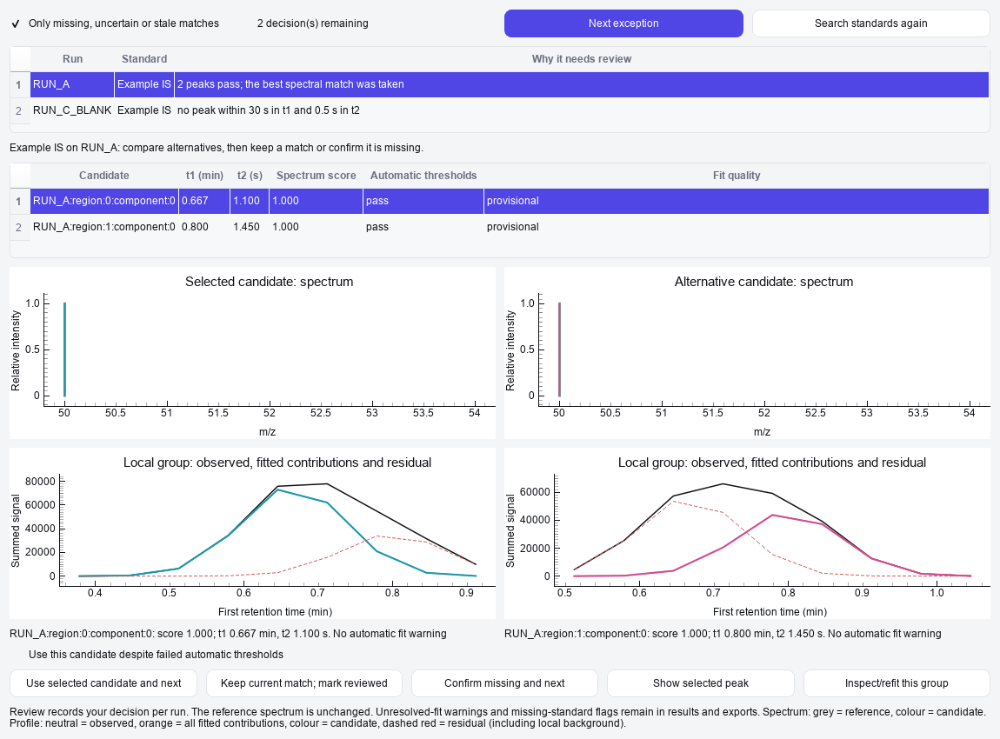

Step 5 on the toolbar. A small library of standards (seven shipped library candidates; ➕ Add to library for your own, kept in `~/.pygcgc/istd_library.json`), each labelled once by clicking its peak, then looked for in every chromatogram on the first dimension, the second dimension and the mass spectrum.

1. Find peaks (step 4) first: labelling picks the detected peak nearest the click and keeps its spectrum.
2. Select a standard in the table, press **🏷️ Label peak on this run** and click its peak. The table then shows where it was labelled, its t₁ and t₂, and later on how many runs it was found.
3. Set the three **thresholds**. A peak counts as the standard only if it passes all three:

   | Threshold | Default | Tests |
   |---|---|---|
   | Max Δt₁ | 30 s | distance from the expected first-dimension time, either side |
   | Max Δt₂ | 0.5 s | distance from the expected second-dimension time, either side |
   | Min spectral match | 0.80 | weighted dot product (Stein and Scott, 1994) with the labelled peak's spectrum, 1 = identical |

   With **Expect each standard where the others moved to** ticked (the default), the expected position on each run is the labelled one moved by the median offset of the *other* standards found there with a confident spectrum (0.90 or better), so a run-wide retention shift does not break tight position thresholds. Unticked, it is the labelled position. Of the peaks that pass, the best spectral match is taken.
4. **Go** (🔎 Find in every chromatogram) searches every loaded run, the labelled one included. The **Standards** tab of the Workspace shows one row per standard and one column per run: ✓ where it passed (amber if more than one peak did), ✗ where it did not, · where the run has no peaks. **Show** picks what the cells display (spectral match, t₁, t₂, or Δt₁ and Δt₂ from the expected or labelled position); hover a cell for every number and, for a ✗, which threshold failed. Click a cell to open that run on the peak; double-click to label it there by hand. **Export results (CSV)…** writes one row per standard per run, with the thresholds used.
5. **📋 Use as target table…** writes the labelled standards as `istd` rows into the target table (the quantifier and two qualifiers are the strongest ions weighted by m/z, with their measured ratios), keeping any other rows, and loads it: the standards then anchor the phase and normalise 🧪.

The September audit reported high spectral matches for five provisional IS labels
on four exhaust/diesel runs; this establishes matching behaviour, not independent
chemical identity. For the August calibration files, three names match the supplied
inventory, while the m/z 240 deuterated PAH remains isomer-unconfirmed. The local
[starter tables](input-tables.md#local-starter-tables-supplied-on-19-october) retain
that distinction and assume no IS amount. Review uncertain or multiple matches.

### 🧩 Peak clusters

Open **Assign → Explore spectral clusters…**. It groups peaks by spectral similarity
without a rule set or library. Pool runs to compare their cluster contributions.
The “Made of” column compares clusters with any available class assignments.

**Method.** Each peak's spectrum is weighted (intensity^0.5 × m/z^1, m/z ≥ 35) and scaled to unit length; peaks with fewer than five ions are left unassigned. The largest 5000 peaks are grouped by average-linkage hierarchical clustering of the cosine distance, cut at a merge distance (default 0.3, i.e. a mean similarity of 0.7 within a merged group), and groups of fewer than three peaks are not called clusters. Every other peak joins the cluster with the nearest centroid if that is within 0.4, otherwise it stays unassigned. Clusters are numbered by total volume, largest first. Retention time is not part of the distance: two runs never line up exactly, so using position would turn drift into false differences, and it means no alignment is needed to compare runs.

**Two ways to divide a chromatogram.** *Detected peaks* (above) groups the blobs from 🔍. *Pixel regions* needs no peak detection at all: every bright scan is a pixel with a spectrum, the spectra are reduced by truncated SVD and grouped by k-means into the number of regions you ask for (default 12), each pixel takes the commonest region among its scans, and a small majority filter removes speckle. Regions cover what blob detection handles badly (an unresolved hump, a saturated solvent front, overlapping peaks) and come out as coherent bands: on the fuel run they separate the C3 and C4 alkylbenzene bands along the front, the aromatic roof-tile band, the aliphatics and the siloxane bleed, in about 12 s. Needs scikit-learn (`pip install "pygcgc[cluster]"`, included in the `gui` extra). Regions are numbered by the signal they hold, and a region model fitted on all runs at once labels every run the same way, so each run's share of its signal per region can be compared (percent, or PQN).

**A retention-aware variant of peak clustering.** *Method → Spectra and retention (density)* uses HDBSCAN on the ten main spectral directions plus retention time (120 s of t1 or 1 s of t2 counts as one unit of spectral distance, times the retention weight), so peaks must be near each other as well as similar, which finds bands and series that spectra alone cannot tell apart. It needs no cluster count and leaves what belongs to nothing as noise. On the fuel run it gives about 77 clusters and leaves about 30% of the volume unassigned, against 2% for the tree, because peak density is continuous across a GC×GC plane: treat it as a way to explore retention structure, and prefer the tree for class assignment and for comparing runs. Retention is compared as recorded, so pooled runs should be aligned first (📍), and a new peak is placed by its spectrum alone.

**On the panel.**

- **Cluster:** this run, or every 70 eV run pooled. Pool to compare runs: one clustering of all the peaks, so "cluster 3" means the same thing in every run.
- **Group / Regions / Method / Retention weight:** detected peaks or pixel regions, how many regions, tree or density, and how much retention counts (density only). Controls that do not apply to the choice are greyed out.
- **Merge up to distance / Cut at a set number / Smallest cluster:** how fine the grouping is. Lower distances give tighter clusters (carbon numbers and isomers apart); higher give broader ones (compound classes).
- **Leave out siloxane ions:** drops the polydimethylsiloxane ions so column bleed does not form a cluster of its own.
- **Add the 14 eV spectrum:** when the 14 eV file of the same acquisition is loaded alongside (as for 🧬), each peak is also compared on its 14 eV spectrum at half the weight. The molecular ion survives there, so it can separate peaks whose 70 eV spectra look alike. When pooling, every run needs a partner or the 14 eV block is dropped (the notes line says which).
- **Fill / outline peaks in the 2D view:** the chromatogram coloured by cluster while this step is open. Select rows in the table (Ctrl or Shift for several) to colour just those; with none selected, the seven largest are coloured (Okabe-Ito, colour-blind safe) and the rest are light grey. The fill only shows on the plain folded view, not on an aligned or extended one.
- **Cluster table:** peaks (pixels for regions), runs, share of the volume, median retention, the ions with the largest share of each cluster's ion current, silhouette, what 🧬 called most of its peaks, and a **Name** column (double-click) whose text is used in the figure key and the peaks CSV. Names are lost when you cluster again or merge, because the numbers change. **Merge selected** joins a family the tree split; clusters are renumbered by volume. Peak clusters only.
- **Check stability:** reclusters random 80% samples of the peaks and reports the adjusted Rand index against the full result (1 means the same clusters every time). **Scan distances** reports the number of clusters, the unassigned volume and the mean silhouette at merge distances 0.1 to 0.5.
- **Run table (pooled):** each run's share of its own peak volume (or signal, for regions) in each cluster. *Percent, then PQN* also divides each run by its median quotient against the median run (probabilistic quotient normalisation), so one large cluster changing does not make every other appear to change the other way. Type a group name in the Group column (double-click) for each run, then **Test groups** runs PERMANOVA (Bray-Curtis, 999 permutations) on those shares and, for exactly two groups, a Welch t-test per cluster with Benjamini-Hochberg correction. **Run PCA figure…** saves a PCA of the runs with a caption.
- **Save coloured chromatogram…:** a publication figure of the current run (89 or 183 mm, 300 dpi) with a sibling caption `.txt`: hue is the cluster, brightness the signal, with a key of the coloured clusters' top ions. It uses the 2D view's window and scale if this run is on show.
- **Export peaks CSV… / Export run table CSV…:** every peak with its cluster, and every cluster's percent share in every run (the input to PCA, volcano and PERMANOVA elsewhere).

**From the command line.** `pygcgc batch <folder> --cluster` pools the blobs of every run after the pipeline and writes `peak_clusters.csv` and `cluster_run_table.csv` to the output folder (plus a "Clusters" sheet with `--report xlsx`). If the saved pipeline (`--config`) names two run groups, it also prints the PERMANOVA of the two groups. `--cluster-threshold` sets the merge distance. `--regions N` divides every run into N pixel regions (fitted on all runs at once, on the cleaned data) and writes `region_run_table.csv` and one `region_labels_<run>.npy` label image per run. In Python: `PeakTable.from_blobs`, `cluster_peaks`, `cluster_features`, `permanova` (`pygcgc.core.cluster`) and `fit_regions`, `segment_pixels`, `region_shares` (`pygcgc.core.segment`).

**Limits.** Peaks come from the legacy detector's blobs (found privately if 🔍 has not been run), or from the fitted MS-aware components when that detector is in use, so a cluster is only as good as the peak boundaries under it: on a run with saturated peaks the legacy footprints are wide bands, and they are coloured as such. The settings are saved with the project; results are not, so cluster again after reopening. The defaults are not tuned to your samples; use **Scan distances** and **Check stability** on a real sample set before trusting a threshold.

**Not built:** normalisation of the run table to an internal standard or by centred log-ratio (CLR is negative, which the existing PCA's log transform cannot take) and QC-based drift correction; saving cluster results and names in the project file; pooled pixel regions that align retention first (regions are spectral only, so they do not need it, but the label images are per run); a spatially aware region method (each pixel is grouped on its own spectrum, then smoothed, rather than with its neighbours in the model); choosing the number of regions automatically (k-means needs it given); a bounded landmark/subsample density fit for very large pools (the optional density method currently fits all usable peaks).

### ⚖️ Compare runs

⚖️ Compare on the toolbar (key 5, or B to open it blinking) opens a separate window for comparing two runs. Choose run A and run B at the top; ⇄ swaps them. Everything is drawn on A's grid. When both runs are 📍 aligned (one the reference, or both with a transform), B is read through the alignment; otherwise B is read at A's own retention times, which is fine for runs whose drift is smaller than a peak. The line beside the run boxes says which. Nothing in the window changes a run, so there is nothing to undo or save.

The Images tab shows the ion expression from the main window four ways:

- Blink alternates A and B on one colour scale (A's), so a peak that moved or changed in size jumps out.
- Grid tiles every loaded run (up to 12) on A's grid, on one colour scale, with linked pan and zoom.
- Difference shows A minus B, with B scaled by the median ratio of their brightest shared pixels (a brightness match, not a concentration ratio), on a diverging colour scale.
- Overlay puts A in magenta and B in green, so shared peaks look white and differences show colour.

The Spectra tab compares the mass spectra themselves. Click any point of the image to see A's spectrum (up) and B's (down) at that point, three scans summed, with their similarity. Map spectral similarity scores A against B at every pixel over all shared m/z, using the weighted cosine that 🏷️ library search uses (intensity to the power 0.6 times m/z cubed, squared), so 1 means the same spectrum whatever the amount, and 0 means nothing in common. Pixels whose signal in the brighter run is below the Hide below share of the brightest pixel are left blank. The map picks out co-elution and compounds present in one run only, which an intensity difference cannot separate from a change in amount.

The Peaks tab pairs the detected peaks (🔍, on both runs) one to one. Peaks carrying the same identity in both runs pair first, wherever they are: a 🏷️ internal standard found on both, or a tier 2a or 2b 🏷️ library hit (the identifier records these for each run it searches, for the session). The remaining peaks pair by position and spectrum: B's peaks within Δt₁ and Δt₂ of an A peak (after 📍, if used) and at least the chosen spectral similarity, most similar first. The defaults are 12 s, 0.2 s and 0.7. The table lists every pair with its 🧬 classes, shifts, similarity, both volumes and log₂ of B over A, then the peaks found in one run only; Show filters it (identified only, only in A, and so on), a double-click jumps the main window to the peak, and Export CSV writes it. The plot shows log₁₀ volume in B against A for the shared peaks, identified ones as squares, with the 1:1 line.

The Classes tab puts each 🧬 compound class's share of A's and B's total peak volume side by side, once both runs are classified.

### 🗂️ Batch

A one-shot, whole-folder analysis (**Tools → Batch**, or the Process menu), separate from the per-run project the rest of the app is built around: pick a folder, choose which steps to run, and go.

**The pipeline** reads the sequence the same way `pygcgc quant` does (`sequence.csv`, `target_table.csv`, calibration levels, `method.json`), then runs 🧹 (always), 🫧 and 🔍 (optional) on every run **in a process pool** -- real multiprocessing, not the thread pool used elsewhere in the app for responsiveness, because the GIL means a thread pool doesn't actually parallelise this kind of work. Every step's result is cached to disk keyed by a hash of its inputs and settings, in `<folder>/.pygcgc_cache`; re-running the same folder with the same settings loads straight from the cache instead of recomputing, which is also how an interrupted batch resumes -- just run it again. 🧪 quantification (optional) runs once, in the main process, on the results of that parallel prep, the same `quantify_prepared` the CLI and the GUI already use.

**Feature table.** With 🔍 on, every blob in one reference run becomes a "feature"; every other run's own blobs are matched onto them (the Hungarian algorithm, the same scaled 2D distance `BlobSet.nearest` uses), and a run with no match for a feature is gap-filled instead of left blank -- a small box integrated directly at the expected position in that run's own cleaned image. Double-click a cell to jump to that run and position (if the folder is the one currently open).

**QC chart.** Pick an internal standard; its volume across the sequence is plotted with mean ± 2/3 SD lines, and flagged against the standard multi-rule scheme (Westgard et al., 1981: 1-2s, 1-3s, 2-2s, R-4s, 4-1s, 10x).

**PCA.** Log-transformed, autoscaled, plain SVD (no new dependency) -- click a point to jump to that run.

**Volcano.** Pick two groups of runs; each feature gets a Welch's t-test (unequal variance) between them, log2 fold change, and a Benjamini-Hochberg FDR-corrected q-value. Click a point to jump to that feature on the reference run.

⚙️ Settings… edits every step's settings and the feature-table reference run. **Not built:** a progress bar beyond the status line; blank subtraction (the batch pipeline and CLI do not subtract blanks).

### Export the main project (step 8)

Open **8 Export** and choose an output folder. The export includes the available
quantitative tables, per-run peak tables, internal-standard matches, assignments,
input tables, calibration setup, standard-review decisions, a project snapshot and
provenance. `manifest.json` lists the files and records missing or stale results.
The export remains available before quantification, so check those status fields.

Raw acquisitions remain at their source paths, and exporting does not change the
active project's save location. The exported snapshot points to the exported target
and level CSVs. Provenance records blob edits, quantitative decisions and stencils.
**Export current figure…** saves the current view separately.

### Batch reports (Excel, HTML and PDF)

A "📤 Export…" button and a format dropdown sit next to "▶ Run batch", enabled once a run finishes. Whichever format you pick writes exactly what the tabs are currently showing: the QC compound selected in its dropdown, and the volcano groups selected (if two or more runs are picked in each list) -- so the exported file matches what's on screen, not some fixed default.

- **Excel (`report.xlsx`)** -- one sheet per table (targets, calibrations, all signals, internal standards, feature table), a light orange fill on any row that needs a look (a target flagged or not "ok", a calibration that didn't pass, an internal standard out of tolerance) and a light blue fill on a feature table cell that was gap-filled rather than measured, plus a Provenance sheet.
- **HTML (`report.html`)** -- the same tables (with the same flagged/filled row highlighting, as CSS classes) as one self-contained page, with the QC, PCA and volcano charts (whichever have data) embedded as plain PNGs. Nothing else needs to load for it to open, now or later.
- **PDF (`report.pdf`)** -- a short, print-ready document: one cover page with the provenance and headline counts, then one page per chart that had data to draw.

Every format also records **provenance**: the PyGCGC version, the modulation period, `method.json`'s own contents, the settings the batch ran with, and a manual-edit log -- which is always empty for anything 🗂️ produces, since the batch dialog is deliberately a one-shot, whole-folder tool with no interactive review of its own to report (see "Not built" above, and the Architecture section). `pygcgc quant --xlsx` and `pygcgc batch --report {xlsx,html,pdf,all}` write the same files from the command line, and both always write a small standalone `provenance.json` regardless of `--report`/`--xlsx`.

**Main-project export is separate.** Step **8 Export** already writes available result
tables, inputs, a project snapshot, freshness flags and provenance containing blob edits,
quantitative decisions and stencils. Batch Excel/HTML/PDF reports have no interactive
edit log because they are produced by a one-shot batch. Producing those rich reports
directly from the reviewed main project remains on the roadmap. A Python wheel was built
and checked on 19 October; the Windows executable spec (`packaging/pygcgc.spec`) remains
unbuilt and untested. See [known gaps](../ROADMAP.md#3-known-gaps).

### Working order, settings and figures

**Toolbar order** follows eight steps: Load, Align (optional), Background, Peaks, Standards, Assign, Quantify and Export. Modulation checks are under Load; Classify, Identify and Cluster are under Assign. Peak editing and display options live in contextual menus. The step buttons open settings on the left; see [Workflow panel](#workflow-panel). Blank subtraction reads the blank through both runs' alignment to the reference, so alignment comes before background removal. A run without a transform counts as the reference.

**Settings.** Available forms include: Process → 🔍 Peak detection settings… edits whichever method is selected, ⛓️ Hydrocarbon settings… (or ⚙️ in the ⛓️ panel), ⚙️ in the 🏷️ dialog, ⚙️ Settings… in 🗂️ Batch (every step, plus the feature-table reference run), the 🫧 tab, and 🧪 Quantification settings. Restore defaults is in each. Changing legacy settings clears hand edits to the blob list.

**Figures.** 📤 Figure… (File menu too) saves the 2D view as it is: window, colour levels, scale and ion, at 89 mm or 183 mm wide, 300 dpi, PNG or TIFF, boxed axes with inward ticks and a short horizontal colour bar, no title, plus a sibling `.txt` caption to finish (site, sampling, instrument, levels).

**2D and 1D.** The 1D tab shows the raw chromatogram (reconstructed trace above, the unfolded detector stream below). D toggles between it and the 2D image.

**Hand-drawn integration.** In the 🧪 Review gallery press I on a peak (Process → 🧪 Re-integrate peak…). An orange polygon appears, initially the bounding box of the automatic footprint. Drag its corners and press Ctrl+Enter: the target is re-measured inside the polygon (rim baseline still subtracted), flagged "integrated by hand", saved with the project and undoable. Esc cancels; Process → ↺ Automatic footprint removes it.

**Saturated targets (optional).** Quantification settings → *Saturated target: quantify on a qualifier* (off by default). A target whose quantifier ion is saturated is quantified from the first unsaturated qualifier ion: its volume divided by its expected ratio from the target table. To use an M+1 ion, list it as a qualifier with its ratio. The hit is flagged "saturated (quantified on m/z N)".

**🔗 Homologous series** (⛓️ panel, bottom). Pick or type a diagnostic pair (major/minor ions), press Find series; the members (carbon-equivalent, t1, t2, blob) are listed, double-click goes to one. Needs 🔍 blobs and an alkane series on the run. Only the (57, 71) pair is validated.

**✎ Stencil shapes.** Select a stencil in the ⛓️ panel, ✎ Edit shape, drag its corners, 💾 Save under the same name.

**🏷️ Library browser.** Browse library… in the 🏷️ dialog: filter, edit name, RI, formula and CAS in place, delete entries, view a spectrum, save as MSP.

**✂️ Peak models.** The dialog starts with **tilt** (correlated Gaussian), and also offers gaussian, emg (t1 tail), emg_t2 (t2 tail), emg2, emg_t2_tilt, cell and emg_t2_cell. Tilt gave the lowest median held-out error in 32 October calibration windows; individual windows favour different models. The [fitting comparison](validation/peak-fitting-2026-10-18.md) records the evidence and limitations. **▶ How it works** opens the same animated explanation as the Peaks panel.

### Projects and the results cache

The project saves itself beside the runs (`project.pygcgc.json`) and offers to resume when the folder is opened again. It holds the fold, every setting and decision, run types and levels, alkane ladders, stencils, internal-standard labels and MS-aware components. Background layers and peak detections are kept in a cache on local disk (`%LOCALAPPDATA%\PyGCGC\results`, or the folder in `PYGCGC_CACHE`), never in the data folder, so reopening a project reads them back when their cache keys remain valid. Each entry is keyed by the run file, its fold, the settings and the code that made it, so a changed setting or a new version of a method recomputes. A real run's background layer takes about 380 MB; the least recently used entries are deleted beyond 10 GB (`PYGCGC_CACHE_GB`), and File → Clear results cache… empties it. Layers made with a blank are not cached.

### Undo

- Alignment points/transforms, accepted component fits, phase, period, 🧹, 🫧, 🧪 review decisions (accept, reject, exclude, curve overrides, peaks picked by hand), 🔍 blob edits (delete, merge, add) and ⛓️ stencils (add, delete, reweight) can be undone (Ctrl+Z) and redone (Ctrl+Shift+Z).
- Dragging a slider counts as one step.
- The History tab lists every step.
- Zoom, ion and colour settings are view choices, so they aren't on the undo stack.

### Jobs

- Reading, phase estimation, background removal and image building all run in a thread pool, so the window never freezes.
- The Jobs tab shows progress, with cancel buttons.
- Failures are written in full to the Log tab.
- Cancel also suppresses a result that has finished computing but is still waiting
  to reach the window. Cancelled or failed analyses release their running controls.
- If source runs, fold settings or relevant analysis inputs change while a job is
  running, obsolete results are discarded. The Log explains when another run is
  needed; a discarded result does not mark the workflow step complete.

### Keyboard

| Key | Action |
|---|---|
| PgUp / PgDn | previous / next run |
| M | ion box |
| L | cycle colour scale |
| E | extend t₂ |
| R | region box |
| Space | raw / cleaned |
| O | 🧪 peak overlay |
| 3 / 4 | 🧪 Review / Calibration |
| 5 | ⚖️ Compare runs |
| A | 📍 start or finish guided anchor picking across all loaded runs |
| B | ⚖️ Compare in blink mode |
| G | 🔍 merge the selected blobs |
| Y / N / U | accept / reject / clear (Review and Results) |
| P | pick another peak (Review) |
| Esc | cancel picking |
| Home | reset zoom |
| 1 / 2 | 2D / 1D view |
| Ctrl+L | auto levels |
| Ctrl+O | open a folder |
| Ctrl+Shift+O | open a project |
| Ctrl+S | save the project |
| Ctrl+Z / Ctrl+Shift+Z | undo / redo |
| F1 | list of shortcuts |

## How it works

Every core module opens with a plain-English explanation; these are summaries.

**Folding** (`core/fold.py`). The detector records one long stream, and every modulation the modulator releases a new slice of the first-column effluent. Folding cuts the stream at each modulation boundary and stacks the pieces side by side. Scans are placed by their time, and each scan's intensity is shared between the two nearest rows. This keeps peaks level even when the period isn't a whole number of scans, and conserves intensity exactly.

**Phase** (`core/phase.py`). The modulator's cycle rarely starts when the acquisition does.
- The *anchor method* finds each internal standard's brightest pulse in the raw stream and works out which phase puts it at its known t₂. The anchors are combined with a circular mean, because t₂ wraps round like a clock face.
- Without usable anchors, the *bleed method* puts the cut just before the repeating column-bleed rise. If no convincing bleed is found, the *void method* chooses a quiet band. These are display cuts, not proof of the modulator's physical start. Runs without anchors borrow phase from usable anchors elsewhere in the sequence when available.

**Period** (`core/period.py`). Without anchors, the period is the frequency at which the whole detector stream repeats (bleed and unresolved hump are locked to the modulator), found from a spectrum of the total signal and refined by folding at trial periods; it reports a confidence and how far peaks could drift. It does not track single peaks, because a genuine drift of t₂ looks exactly like a period error. With anchors, each anchor's phase estimate drifts in proportion to its modulation number if the period is wrong, and a straight-line fit gives the correction with a standard error.

**Timing** (`core/timing.py`). Scans are placed on an evenly spaced grid, fitted over progressively longer stretches so that small errors can't accumulate. This reveals the true scan rate, the jitter and any dropped scans.

**Background** (`core/background.py`). For each ion that carries background:
1. Take a low percentile down t₂ in every modulation, corrected upwards so it sits in the middle of the noise.
2. Smooth it along t₁ with arPLS, an asymmetric smoother that ignores peaks. The stiffness is scaled with run length.
3. Remove any stripe that repeats every modulation, using a low rolling percentile across many complete modulations.
4. Subtract the result from every stored point, keeping small negative values so noise stays unbiased.

Before this, single-scan spikes are removed. Afterwards, an optional cleaned blank is subtracted, and the noise map records each ion's leftover spread for every stretch of t₁. Ions that are mostly below the instrument's storage threshold have no measurable background; their noise is set to a third of that threshold.

**Peaks** (`core/peaks.py`). Blobs are found on the pixel-wise maximum of the smoothed total-ion S/N and the sum of every ion's own S/N image (which catches a compound spread thinly but consistently across many ions that the total-ion signal alone wouldn't flag), and local maxima well above the noise become seeds. A watershed grows each seed downhill until it meets a neighbour or the noise, and each footprint is trimmed to 1% of its own total-ion apex; a long run is split into overlapping stretches of t1 for this step, run across a thread pool, one peak processed by whichever stretch owns its seed. Every stored point is assigned to the footprint it falls in, which gives each peak a spectrum, a volume, a width in each dimension and a co-elution flag (its ions' own local apexes clustered into more than one group). Targets are measured the same way on their own quantifier ion, with a local baseline taken from the footprint's rim. Wrapped peaks are handled by working on an image extended by half a second. Blobs can also be deleted, merged (an exact combination: volume and spectrum sum, position and width via the parallel-axis theorem) or added by hand from a clicked pixel.

**Candidates, components and overlap** (`core/candidates.py`, `core/components.py`, `core/modelselect.py`, `core/overlap.py`). The MS-aware path finds local maxima ion by ion, groups agreeing ions and requires local TIC prominence. Padded rectangles bound calculations. The default pursuit starts with one tilted Gaussian, fits independent positions, widths and correlations on diagnostic ions, and adds components only with BIC, spectral/spatial and held-out support. Spectra and estimated intensities are then solved on a wider ion set using the same count weights, non-negative spectra and signed local background. Interacting windows are merged and duplicates removed. Results and warnings live in a serialisable `ComponentSet`; reaching width limits or failing quality checks marks a group unresolved. Manual `fit_overlap` uses weighted variable projection; `fit_template_overlap` shifts a measured profile. The projected Gaussian/tilt Jacobian accounts for the solved spectra. Low-level fitting functions retain their Gaussian API defaults; pass `model="tilt"` explicitly in scripts. The [October comparison](validation/peak-fitting-2026-10-18.md) supersedes earlier injection figures: tilt improved median held-out reconstruction, while experimental free-modulation models recovered copied-profile total areas better. Component intensities remain estimates and do not directly replace calibrated quantification.

The durable component model, automatic separation, overlapping contours, manual acceptance
and persistence are implemented. Some downstream tools still use legacy footprints;
see the [remaining migration gaps](../ROADMAP.md#3-known-gaps). The
[original component plan](history/ms-aware-component-plan.md) is a historical design record.

**Siloxane** (`core/siloxane.py`). Legacy blobs are scored against the selected bleed
and cyclic reference spectra, retaining the larger score. The default blob method
zeroes only the selected reference-ion channels inside qualifying footprints.
Other channels remain; analyte signal on shared ions can be removed. Blocking every
ion is an explicit alternative. The per-pixel method fits the first reference only
and subtracts its estimated contribution, capped at the available positive signal,
where the multi-ion presence and spectral-similarity gates pass.

**Hydrocarbons** (`core/hydrocarbons.py`). The n-alkane ladder is found from two confirmed points and grows one carbon at a time: each carbon is predicted from the line through its two nearest confirmed neighbours and searched for on m/z 57 inside a t₁ and t₂ window, taking the tallest pulse whose qualifier ratios match; a couple of passes retry carbons still missing. A group-type stencil is recorded not in absolute t1/t2 but as carbon number and t2 offset from the alkane line, so it transfers onto any other run through that run's own ladder rather than the run it was drawn on. Other homologous series are found among blobs carrying a strong share of a diagnostic ion pair, placed in the ladder's carbon-equivalent space: members must sit one carbon apart at a consistent t₂ offset from the alkane line.

**Identify** (`core/identify.py`). Retention index is one line: 100 x the Van den Dool carbon-number equivalent ⛓️'s `AlkaneSeries.carbon_of` already computes. `load_msp` parses the common NIST/MoNA/MassBank text format into `LibraryEntry` objects; `build_library` packs every entry's spectrum into one sparse (entries, unit mass) matrix and precomputes each entry's own top ions, so `search` only needs a cheap RI-window-and-shared-top-ion prefilter before scoring the handful of candidates left: a forward and reverse weighted dot product (Stein and Scott, 1994 intensity/mass weighting -- reverse ignores mass channels the library entry has nothing on, useful when the query carries a co-eluting neighbour's peaks too), a peak-overlap ratio, and a retention-index penalty. `assign_qvalues` is target-decoy competition (every query's best hit, real library entries competing against `generate_decoys`' shuffled ones, ranked together) and `classify` gives a simplified confidence tier -- only Schymanski and colleagues' (2014) levels 2a/2b/3 are reachable from a unit-mass EI spectrum plus RI, not level 1 (needs a co-injected standard) or level 4 (needs an exact-mass formula). `promote_to_target` turns a hit into a `Target` row at the position it was actually found, with quantifier/qualifier ions read from the library entry's own strongest peaks; `build_inhouse_entry` does the reverse, turning an accepted standard's own apex spectrum into a new library entry.

**Batch** (`core/batch.py`). Each run is prepped independently (background, then optionally siloxane removal, then blob finding), so a folder of runs is split across a process pool rather than run one at a time. Every step's output is cached to disk under a hash of its inputs and settings, so re-running after tweaking one setting only recomputes from that step onward, and an interrupted batch resumes for free by re-reading what's already cached. Quantification is not reimplemented here: prepped runs are handed to the same `quantify_prepared` used by the interactive 🧪 workflow. A feature table matches every run's blobs onto a chosen reference run's blobs by the Hungarian algorithm (`scipy.optimize.linear_sum_assignment`) on scaled t1/t2 distance, and any blob a run is missing within the match radius is gap-filled by directly integrating a small window of its own TIC at the reference position, rather than being left as a zero. QC uses the standard Westgard multi-rule scheme (1-2s, 1-3s, 2-2s, R-4s, 4-1s, 10x) on a chosen feature's values across the batch. PCA is plain SVD on the log-transformed, autoscaled feature table, no new dependency needed. The volcano plot is a per-feature Welch's t-test between two chosen groups of runs, with Benjamini-Hochberg FDR correction across all tested features.

**Reports** (`core/report.py`). `Provenance` is a small, plain record of what made an output: version, modulation period, `method.json`'s contents, the settings used, and a manual-edit summary built by `build_provenance` from whatever's given (🔍's edit log, 🧪's decisions, ⛓️'s stencils) -- none, for a batch run, since 🗂️ has no interactive state of its own to hand over. `write_excel` (openpyxl) puts one table per sheet with a fill colour on any row worth a second look. `write_html_report` builds one self-contained page (tables as plain HTML, charts as embedded base64 PNGs); `write_pdf_report` builds a short cover-page-plus-charts PDF with `matplotlib.backends.backend_pdf.PdfPages`. The three chart functions (`plot_qc_chart`, `plot_pca`, `plot_volcano`) are matplotlib, not pyqtgraph, deliberately: core stays Qt-free, so a script or the CLI can produce the exact same chart the GUI shows, headless, sized in real millimetres for a publication figure (`save_figure`) rather than pixels for a screen.

**Calibration** (`core/calibration.py`). Weighted least squares, with weights of 1, 1/x or 1/x² chosen by the smallest summed relative error of the back-calculated amounts (Almeida and colleagues, 2002). A quadratic is used only when Mandel's test says the curvature is real. The intercept is tested against zero. R² is reported but never used to decide anything. LOD and LOQ are 3.3 and 10 times the scatter at the lowest level divided by the slope, and every amount carries a standard error from inverse prediction.

**Quantification and calibration sets** (`core/quant.py`). See the 🧪 section above for how targets are found and reported; the module docstring gives the details. `bracket_cal_sets` places a sample between the two nearest calibration sets by run order (the mean position of each set's own runs), and `blended_amount` reads its response ratio against both curves, mixing the two amounts by how far along it sits. This is the standard bracketing-standard method for correcting instrument drift between calibrations, and assumes the drift is roughly linear in run order between them.

**Alignment** (`core/align.py`). See the 📍 section above for the workflow; the module docstring gives the details. Fitting is Huber-weighted (one bad anchor can't dominate), `fit_alignment(..., kind="auto")` picks the simplest tier whose leave-one-out error is already within tolerance rather than always reaching for the most flexible one, and `cross_validate` gives an honest leave-one-out error rather than the always-optimistic in-sample residual. Resampling (`resample_to_reference`) reads each reference pixel from wherever the inverse transform says it came from in the run, by bilinear interpolation (`scipy.ndimage.map_coordinates`); pixels with no counterpart in the run come back as 0.
