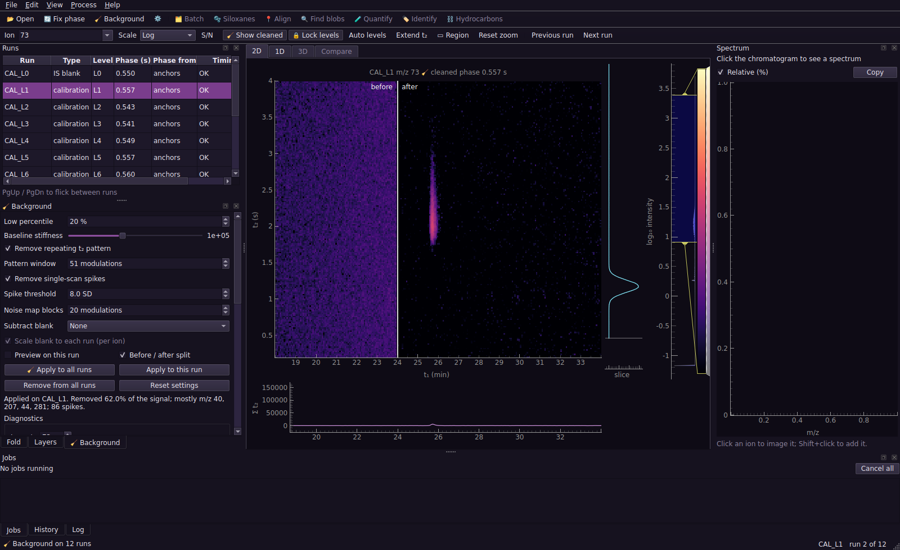

# PyGCGC user guide

Reference for every step and panel of the app, followed by how the methods work.
Install and quick start are in the [README](../README.md).

## Using the app



### Layout

- **Left:** one panel, "Workspace", with three tabs. **Runs** is the run list, **Tool** shows the open step's settings and its Go button (its tab is named after the step), and **Layers** shows which runs are cleaned or aligned. Opening a step from the toolbar switches to the Tool tab.
- **Top toolbar:** 📂 Open, the eleven numbered steps, then ✂️ Resolve overlap, 🗂️ Batch, 📤 Figure and the panel buttons.
- **Centre:** the 2D and 1D views, the 🧪 Review gallery and the Calibration curves.
- **Right:** the spectrum.
- **Bottom:** four tabs, 🧪 Results, Jobs, History (undo) and Log.

Every panel can be moved, floated onto a second screen or hidden. To bring one back, use the **Workspace** and **Spectrum** buttons at the right of the top toolbar, or **Panels ▾** (also View → Panels) for every panel, including the bottom tabs. **Reset layout** in the same menu restores the default arrangement.

**Colours.** The default theme uses the Financial Times palette: a salmon paper background, near-black text and claret highlights. View → Dark theme switches to the dark palette. The chromatogram colour map (turbo) is the same in both.

### Workflow panel

The eleven numbered buttons on the top toolbar are the steps, in working order. The left-hand panel shows only the open step: its settings, then one Go button.

1. Press a step on the toolbar. Its settings appear on the left; nothing runs yet.
2. Set what you want.
3. Press **▶ Go** at the bottom of the left panel. It runs that step on every run.
4. A banner reports the result and offers **Next: …**. It never switches step by itself, so you can look at the result first.

| Step | Settings shown | Go does |
|---|---|---|
| 1 🔄 Fold | period, phase | estimates the phase of every run |
| 2 📍 Align | reference run, anchors | finds the anchors on every other run |
| 3 🧹 Background | 🧹 settings, aligned blank, preview, split view, diagnostics | removes background on every run |
| 4 🔍 Peaks | MS-aware regions or legacy blob table | runs the selected detection method on every run |
| 5 🫧 Siloxane | reference spectrum, certainty slider | blocks out (or fits) siloxane blobs on every run |
| 6 ⛓️ Hydrocarbons | qualifier ratios, stencils, series | starts the two-click alkane flow |
| 7 🧬 Classify | 14 eV switch, rule file, class list, results | assigns a compound class to every blob of the open 70 eV run |
| 8 🏷️ Identify | notes | opens the identifier window |
| 9 🧪 Quantify | what is loaded, load buttons, settings | quantifies (disabled, with the reason, until a target table is loaded) |
| 10 🧩 Cluster | scope, method, thresholds | groups peaks by spectrum, within or across runs |
| 11 🏷️ Internal standards | IS library, labelled peaks, thresholds on Δt₁, Δt₂ and spectral match | finds every labelled standard in every run; results table in the bottom dock |

**Why this order.** Each step's panel shows a "Why here" line, the toolbar tooltips repeat it, and Help → Workflow guide lists all eleven. In short:

1. **Fold first.** Every later step works on the folded image, and a wrong phase splits peaks across its top and bottom edges.
2. **Align second.** Retention drifts between runs. Aligning early puts every run on the reference run's coordinates, so a blank can be subtracted through the alignment in step 3. With a single run, skip it.
3. **Background third.** It removes bleed, the repeating t₂ stripes and spikes, and builds the noise map that peak detection uses for signal-to-noise.
4. **Blobs fourth.** Detection needs the flat baseline from step 3. Steps 5 to 10 all start from these blobs.
5. **Siloxane fifth.** It blocks out whole blobs, so it needs step 4. It runs before the ladder and identification so contaminants do not enter them.
6. **Hydrocarbons sixth.** The n-alkane ladder gives the retention index that identification uses.
7. **Classify seventh.** It reads each blob's class from its spectrum and uses the ladder from step 6 for retention evidence, so it follows both. It comes before Identify because a class says what a peak is without a library.
8. **Identify eighth.** It searches the blobs from step 4 and uses the retention index from step 6 when there is one.
9. **Quantify ninth.** It needs the phase and the cleaned data; everything before it makes its peaks clean and correctly placed.
10. **Cluster tenth.** It groups peaks by spectral shape and can compare them with the classes from step 7.
11. **Internal standards** can run any time after step 4. Label each standard once, find it on every run, then **Use as target table** so the same peaks anchor the phase and normalise step 9.

The order is a recommendation. Nothing stops you running a step early or again after changing something upstream, but results from later steps are not rerun for you: rerun them.

On the toolbar a ✓ marks a finished step, ▸ marks the suggested next one and the open step is highlighted. Removing 🧹 or 🫧 clears its tick. The old menu items (Process menu) and the extra buttons inside each step (Apply to this run, Remove, Propagate, Reset) still work. ✂️ Resolve overlap, 🗂️ Batch and 📤 Figure are separate windows on the toolbar.

### 2D view

- The folded chromatogram runs t₁ across and t₂ up.
- The default colour map is turbo. A small colour key is pinned to the top-right corner of the image. The grey track is the range of the data and the coloured part is what the colour map is stretched over, with the lower and upper limits printed underneath. Drag either end to move that limit, drag the coloured part to slide both, and double-click the key to type exact limits, or press Reset to default to return to the automatic levels. On the log scale the key is a logarithmic axis: limits are shown and typed as intensities (for example 1e3 to 1e6), with a tick at each decade; on the √ scale they are in √ units. Right-click the key to change the colour map.
- A t₂ slice follows the cursor, and a reconstructed 1D trace underneath shares the t₁ axis.
- The status bar shows t₁, t₂ and the value under the cursor.
- **Click** any pixel to see its spectrum.
- **▭ Region (R)** gives a draggable box whose summed spectrum appears on the right.
- **Extend t₂ (E)** adds a band above the dashed period line so wrapped peaks appear whole. The band repeats the bottom of the next modulation.
- **Scale** can be log, square root or linear (L cycles through them). **Auto levels** (Ctrl+L) resets the colour range.
- **🔒 Lock levels** (on by default) keeps the colour range when you flick between runs, so differences stand out.
- **S/N** shows signal-to-noise. It needs 🧹 on that run, because the noise map comes from background removal.

### Ion box (M)

| Type | Shows |
|---|---|
| `TIC` | total ion signal |
| `178` | one ion |
| `178+202+228+252` | the sum of ions |
| `200:260` | every ion in a range |
| `57/71` | a ratio image, handy for telling compound classes apart; the colour scale switches to linear |
| `57+71/85` | the ratio of a sum to an ion |

In the spectrum, click an ion to image it; Shift+click adds it to the current sum.

### 1D view

- **Top:** the reconstructed 1D chromatogram, with a draggable band. The same band appears on the 2D view.
- **Bottom:** the raw detector stream for that band. Zoom in to a few minutes and the modulation boundaries appear, which is the quickest way to see how peaks are sliced and to spot wrap-around.
- Double-click either plot for the spectrum at that time.

### Runs

- Select a row, or use PgUp/PgDn, to change run. Zoom, ion and colour levels stay put.
- Neighbouring runs are prepared in the background, so flicking is instant.
- **Type, Level, Cal set and Volume (m³)** can be typed straight into the table (double-click, or F2). Right-click several runs to set their type, level, calibration set or volume at once. A type containing "cal" plus a level makes a calibration run; a type containing "blank" is offered as a blank. These values are saved with the project and win over `sequence.csv`; **Save types and levels as sequence.csv…** (right-click, or File → Save sequence list…) writes them out.
- Right-click a run to remove it from the project.
- The Timing column warns about dropped scans or irregular timing.

### 🔄 Fold

- Set the modulation period, and the current run's phase, with the spin box or slider. The image refolds as you drag.
- **Go** (or the Process menu) re-estimates every run. With a target table it uses the internal standards; runs where they aren't found, such as tube blanks, borrow the phase of the others.
- **Use for all runs** copies the current phase to every run.
- **Check period** fits the period from this run's internal standards and offers to apply it if the correction is statistically significant.
- **Estimate period** replaces the period, even one set by hand or by `method.json`, with an estimate from the runs, then re-estimates every phase. It is undoable.

When runs open and no period has been set by hand or by `method.json`, the period is estimated from up to three evenly spaced runs and applied at once. The line under the period box says how it was found and whether to trust it. A period set by `method.json` or by hand is kept; the runs are only checked against it, and a message appears if they clearly disagree.

- The period is the frequency at which the total signal repeats, so it needs no anchors. A solvent front is detected and left out.
- **Confidence** says whether a period is established at all. If it is low, the period is left unchanged.
- **Drift** says how well it is pinned down: the standard error times the number of modulations, i.e. how far peaks at the end of the run could sit from where they should. Compounds alone constrain the period only to a few milliseconds; column bleed and other structure locked to the modulator do better. If the drift exceeds a quarter of a second the line turns amber, and the period should be checked with **Check period** against internal standards.
- Without anchors, the phase puts the cut 0.2 s before the start of the column bleed. The bleed (the siloxanes) is released with every modulation and is present in every column, so a low percentile across columns, row by row, keeps it and discards the analytes. The cut goes just before that baseline leaves its floor, so the siloxanes sit at the bottom of the image. If a run has no such baseline, the cut goes just inside the far edge of the longest quiet stretch of the second dimension instead; its confidence is low when wrap-around leaves no quiet stretch. Either way this is a place to cut, not the modulator's proven start. Internal standards, when found, give the true phase and take priority; a table with a single anchor is enough.
- On the command line, `pygcgc fold`, `phase`, `clean` and `quant` estimate the period when `--period` is omitted (and no `method.json`), print the estimate, and stop if none can be found reliably. `pygcgc batch` does the same and records `modulation_period_estimated` in `provenance.json`.

### 🧹 Background

- Step **3 🧹 Background** shows the settings; **Go** cleans every run with them (Process → 🧹 Background does the same).
- Tick **Preview on this run** to try settings live on the current run before applying.
- Tick **Before / after split** and drag the white line to compare.
- **Space** switches between raw and cleaned data everywhere: the image, the 1D view and spectra.
- The Layers tab shows which runs are cleaned.

The settings:

| Setting | Default | What it does |
|---|---|---|
| Low percentile | 20% | Low value taken down each modulation as the starting point for the background |
| Baseline stiffness | 1e4 | How closely the baseline may follow changes along t₁: about ten modulations on a 31-minute run. The setting is scaled with run length, so it means the same smoothness in minutes for shorter or longer runs. Soften it if bleed changes quickly, stiffen it if big tailing peaks get eaten |
| Remove repeating t₂ pattern | on, 51 modulations | Stripes that repeat every modulation. The window must be much wider than any peak |
| Remove single-scan spikes | on, 8 SD | Points far above all four neighbouring scans |
| Noise map blocks | 20 modulations | Length of each stretch of t₁ in the noise map |
| Subtract blank | none | A blank run, cleaned the same way and subtracted per ion, never going below zero |
| Scale blank to each run | on | Per-artefact scale from the median sample-to-blank ratio, worked out separately for each connected region of significant blank pixels on an ion, so two artefacts sharing an ion but varying independently between tubes don't share one compromise factor. Whatever significant signal isn't part of any of those regions still falls back to one scale for the ion as a whole |

The diagnostics show what's left of the background for one ion. A good correction looks like:
- a histogram centred on zero, with a spread matching the noise map (the blue curve)
- points lying along the line in the normal quantile plot

The panel also lists the ions that lost most signal.

Background layers are rebuilt automatically when a run's phase or the period changes. Applying and removing 🧹 are both undoable.

### 🧪 Quantification

![Review gallery: benz[a]anthracene across the sequence, flagged where it shares a peak with chrysene](images/screenshot_review.png)

Step **9 🧪 Quantify** (Go) runs the whole thing in the background:
1. Every target and internal standard is found in the calibration runs on its own quantifier ion, and their average positions are learned from there, together with the qualifier ratios of any row that leaves them blank. Each later search is also shifted by however far its internal standard has moved in that run.
2. Every run is measured with those positions. Several candidate peaks may sit inside a target's window; each is scored on its distance from the expected position, how well its qualifier ratios match, and how clearly it stands out of the noise. If the runner-up scores almost as well, the result is flagged as ambiguous.
3. Every other peak in every run (a TIC blob) is found as well.
4. For each target, its volume is divided by its internal standard's volume (the response ratio), and a calibration curve is fitted for every calibration set.
5. Samples are read back through their bracketing set(s) to give amounts with a standard error, then divided by the sampled volume.

It works on 🧹 cleaned data where that has been applied, and on raw data otherwise. A compound whose true t₂ is longer than the period (give it that way in the table, for example 9.1 s at an 8 s period) is matched and reported on that side of the wrap.

**Choosing ions.** On a busy ion (m/z 57 among alkanes, m/z 105 among alkylbenzenes) the matrix adds to the peak: in a planted test on the real exhaust and diesel runs, targets on such ions were 15 to 60% off, and qualifier ratios only catch interferents with a different spectrum. A less common ion of the same compound is almost always the better quantifier. See [the September 2026 audit](validation/audit-2026-09-24.md).

**Peak overlay.** On the 2D view every peak found is outlined. Targets are marked with circles (lilac, amber when flagged, red when rejected) and internal standards with teal squares. O shows or hides the overlay.

**🧪 Review tab (3).** One tile per peak, showing its quantifier-ion image, its outline, the amount and any flags. Show one compound across every run, or every compound in one run, and tick Only to check to skip the clean ones.
- Arrow keys move, Y accepts, N rejects, U clears the decision.
- Enter or double-click opens the peak in the 2D view with its spectrum.
- P picks a different peak: click the right one in the 2D view (Esc cancels), and that run is re-measured.

A tile is flagged amber when:
- a qualifier ratio is off
- the peak is saturated
- the choice was ambiguous
- two targets share one peak
- the peak is cut by the wrap boundary
- it sits on the flank of a larger peak
- it is off position


**Calibration tab (4).**
- **Plot:** each compound's curve with its points, the samples as diamonds, and a relative-error plot underneath with the acceptance limits dashed. Choose the calibration set, and whether to show the quantifier-ion curve or the whole-peak (TIC) curve used for nearby unknowns.
- **Weights, model and zero:** Auto picks the weights by relative error and uses Mandel's test for straight versus curved. You can override either, and force the curve through zero.
- **Points:** click a point to select it. Exclude… asks for a reason, which is saved; Include puts it back; Open peak shows it.
- **Statistics:** the text below lists the model, weights, R², worst back-calculation, LOD, LOQ, Mandel p and intercept p, plus any points with large studentised residuals or Cook's distance.

**🧪 Results panel.** Four views of the same results. Double-click any row to jump to the peak. Filter by run and compound, or tick Only to check. Export CSV… writes all four tables.

| View | Contents |
|---|---|
| Targets | every target in every run: status, flags, amount ± SE, concentration, response ratio, position, calibration set (e.g. `mon→fri (40%)` when blended) |
| All signals | every peak in every run: volume, the nearest internal standard, **volume ÷ that standard's volume**, the target it belongs to (if any), and a semi-quantitative amount |
| Internal standards | each standard in each run, its volume relative to its own median across the sequence, and a flag beyond the tolerance, with a trend chart above the table |
| Calibrations | one row per compound and set, with pass or fail and the statistics |

**How "nearest" works.** Distance is measured with 60 s along t₁ counting the same as 0.5 s along t₂ (both adjustable in the settings). The internal standard named in the target table always wins for that target; unknown peaks use the nearest one.

**Semi-quantitative amounts for nearby peaks.** An unknown peak within 3 distance units of a calibrated target is given an amount "as" that target. This uses the target's whole-peak (TIC) curve, so it assumes the unknown gives the same total signal per nanogram as its neighbour. That is roughly true within a compound class and can be badly wrong across classes, which is why these amounts are labelled with the target used and kept in their own table. Treat them as estimates.

**Settings** (⚙️ in the Results panel, or Process → Quantification settings). The main ones:

| Setting | Default | What it does |
|---|---|---|
| Qualifier tolerance | 20% | allowed relative deviation of each qualifier ratio |
| t₁ / t₂ tolerance | 4 s / 0.04 s | how far a peak may sit from its expected position before its score drops |
| Learn positions | on | take expected positions from the calibration runs |
| Move with internal standard | on | shift each target by its standard's shift in that run |
| Ambiguity | 0.8 | runner-up score, relative to the best, above which a result is flagged |
| Detector ceiling | from the data | intensity at which a point counts as saturated |
| IS tolerance | 50% | internal standard volumes further than this from their median are flagged |
| Interpolate calibration sets | on | blend the two bracketing sets by run position; off uses the nearest set before |
| Peak S/N | 10 (blobs), 5 (targets) | minimum signal-to-noise for a peak |
| Calibration limits | ±15%, ±20% lowest | back-calculation acceptance |

Changing settings marks the results out of date; the banner in the Results panel reruns them.

### 📈 Calibration builder

**📈 Calibrate** on the main toolbar opens a separate window for building curves by hand from a set of standard runs. It keeps its own runs, fold, 🧹 layers and 🔍 blobs, apart from the main window's, and never writes the main project's file. Its guide line lists the steps and ticks them off.

1. **Runs.** 📂 Open runs… (or From main window…, which ticks the runs typed as calibration). The period is the main window's, or the one in a `method.json` beside the runs; each run's phase is estimated, and 🔄 Phase estimates it again.
2. **Compounds.** Load compounds… reads a CSV; a `target_table.csv` works as it is. Or click peaks with *Click: add a compound here* or *add an internal standard here*: the position snaps to the blob clicked. Edit any cell of the table: name, t₁, t₂, IS, quantifier ion (blank for the whole blob) and *Divide by* (the nearest internal standard unless you choose one).
3. **Amounts.** One column per run. *Same amount in every run…* fills a row, which suits an internal standard. *Amounts in* sets the unit for labels and exports.
4. **▶ Clean and find blobs.** 🧹 then 🔍 (TIC blobs) on every run, with the main window's settings to start with (🧹 Settings…, 🔍 Settings… change them). Both are cached, so running it again is quick. Each compound is matched in every run to the blob holding its position, otherwise to the nearest apex within 20 s of t₁ and 0.25 s of t₂ (*Matching…*).
5. **➗ Normalise to IS.** Each compound's signal (blob volume, or its quantifier ion) is divided by its internal standard's in the same run. Everything after this updates at once.
6. **Curves tab.** One curve per compound, with its residuals and a table of its points.
   - Click a point (or a row) to select it. **Leave out** (or Delete, or untick *Use*) takes it out of the curve; **Put back** returns it. Retype the amount in the table to move it; blank removes it.
   - **Show in chromatogram** opens that run with the compound selected and *Click: match the selected compound to this blob*. Click the right blob; a click away from every blob adds one there. **No peak here** removes the run's point; **Automatic match** forgets the hand match. Hand matches carry a ✋ on the chromatogram.
   - Weights, model and *Through zero* can be set per compound, as in the Calibration tab. *x = amount / IS amount* is for an internal standard not added at the same amount to every run.

Ctrl+Z and Ctrl+Shift+Z undo and redo every change to compounds, amounts, matches and curves. Blobs added by a click stay added.

**Files.** Save compounds… writes the table with its amounts. Save session… writes everything needed to carry on (runs, fold, settings, compounds, hand matches, left-out points and curve choices); Open session… reads the runs again and replays it. 📤 Export… writes four CSV tables:

| File | Contents |
|---|---|
| `calibration_curves.csv` | one row per compound: internal standard, model, weights, coefficients, R², Mandel and intercept p, worst back-calculation, pass or fail, LOD, LOQ, points left out and why |
| `calibration_points.csv` | every compound in every run: amount, matched blob position, whether matched by hand, signal, internal standard and its signal, ratio, whether in the curve, back-calculated amount and error |
| `calibration_compounds.csv` | the compound table, readable by Load compounds… |
| `calibration_normalised_blobs.csv` | every blob in every run divided by the nearest matched internal standard in that run (whole-blob volumes) |

A compound table looks like this. Amount columns are named after the runs, or after the part of the run name that differs between them (`L1` for `CAL_L1_mon`); `amount` applies to every run without its own value.

```
compound,t1_s,t2_s,role,quant_ion,istd,amount,L1,L2,L3
phenanthrene-d10,2708,4.60,istd,188,,2.5,,,
phenanthrene,2715,4.55,target,178,phenanthrene-d10,,0.1,0.5,1.0
fluorene,2310,4.10,target,,,,0.1,0.5,1.0
```

`t1_min` may replace `t1_s`. The curves use the same fitting as 🧪 (`core/calibration.py`); the builder's own logic is in `core/calbuilder.py`.

### 📍 Alignment and compare

Retention drifts a little from run to run: a few seconds in t1, a few hundredths of a second in t2. Alignment fits a map from one run's true coordinates onto a chosen reference run's, so images can be resampled onto the same grid and compared pixel for pixel.

**Picking a reference.** In the 📍 Align panel, choose the run everything else will be aligned to (a calibration run in the middle of the sequence is a reasonable default). The reference is always shown as itself, never resampled.

**Anchors, by hand.** ➕ Add anchor (A) starts a two-click flow: the view switches to the reference run for you to click a peak, then to the target run to click the same peak, and the pair is recorded. Add a few (spread across the run) and a transform is fitted automatically:
- **1 anchor:** a plain shift in t1 and t2.
- **3 or more:** a straight stretch and shift in t1, plus a t2 offset that can itself vary linearly with t1 (useful when the second dimension drifts differently early and late in the run). Both fits are Huber-weighted, so one bad click doesn't wreck the rest.
- **6 or more:** a smooth curve instead of a straight line — a monotone cubic through the t1 anchors and a smoothing spline for the t2 offset.

Auto (the default) picks the simplest tier that already fits the anchors well; you can force a tier with the Transform dropdown. If a run's anchors come out in a different order than the reference's, no honest time correction passes through them; the transform is flagged rather than trusted, and the panel explains why.

**Anchors, in bulk.** 📍 Auto-find on all runs searches every other loaded run for the anchors you've already named (by ion, within a window around the reference position, the same search phase estimation uses) and builds a transform for each. Missing ones are reported rather than silently skipped.

**How good is it?** The panel's residual plot and summary give leave-one-out error in seconds: each anchor is predicted from the others and compared to where it was actually clicked, which is a more honest number than how well the curve fits the points it was built from.

**Seeing it.** 📍 Show aligned (in the panel, or the toolbar) resamples the current run onto the reference's grid in the 2D and 1D views, so the ion box, colour scale and everything else keep working as normal, just on the reference's axes.

**Compare tab (5).** Once at least one run has a transform:
- **Blink** alternates the reference and the current run at a steady rate, so anything that moved (or didn't) jumps out.
- **Grid** tiles every aligned run (up to 12) on a shared colour scale with linked pan and zoom.
- **Difference** shows the reference minus the current run, scaled by the median ratio of their brightest shared pixels (a brightness match, not a concentration ratio), on a diverging colour scale.
- **Overlay** puts the reference in magenta and the current run in green, so shared peaks look white and differences show colour.

**Undo.** Every anchor added, removed or cleared, and every reference or transform-kind change, is undoable.


**Not built:** clicks don't yet snap to a peak's intensity-weighted centre (click precisely, or zoom in first); the batch search matches anchors independently rather than with a full Hungarian-plus-RANSAC pass across every blob; and there's no small-multiples gallery of one target across every run yet. These are candidates for the milestone 11 batch upgrade once real data show whether they're worth it.

### 🔍 Peak detection and separation

Step 4 offers two peer detection methods in a saved selector. **MS-aware separation** is the new route for crowded real data. **Legacy blob borders** keeps the old behaviour for comparison and for existing tools that still consume `BlobSet`. Both run across every loaded run from **Find peaks**.

**MS-aware separation** finds local peaks on individual mass channels, groups channels that independently agree on position, and fits their shapes and mass spectra together. Its normal result is one table row and a pair of contours per proposed component. The contours may overlap because several compounds can contribute to the same measured pixel. The table reports estimated intensity, diagnostic ions and confidence. Weak or poorly modelled groups remain visible and are labelled unresolved. Select a row and press **Resolve selected region…** to inspect or refit its calculation window. **Export peaks CSV…** writes every component together with its quality warning.

**Legacy blob borders** combines ion evidence into one surface and uses watershed to assign every pixel to one blob. On the supplied busy real file, small positive residuals across hundreds of ions accumulate and make this route over-detect broad background and join peaks. It remains useful for compatibility and controlled comparison, but should not be treated as the preferred scientific representation of overlap.

How many peaks a calculation window holds is decided from the data, not from how many apexes the candidate finder placed there. Each window starts from one peak and gains another only if the fit improves (BIC and held-out reconstruction), the new peak carries a mass spectrum different from its neighbours or is resolved from them, and it holds at least 2% of the signal. Two peaks with near-identical spectra that are not resolved are reported as one peak with a warning, because their spectra cannot separate them. The same peak found by several windows is kept once. Calculation windows are internal and are never drawn.

Three further points apply to MS-aware peaks:

- **📊 Signal accounting** reports how much of the run's total signal the fitted peaks explain, how much lies outside every fitted peak, how that splits between a broad smooth hump and discrete peak-like leftovers, and where the largest leftovers are. It also breaks the signal down by pixel intensity. Use it to judge what the finder is missing.
- **Sensitivity.** Faint peaks are limited by `tic_prominence_snr` in the candidate settings (default 2). Lowering it to 1 raised detection of peaks with apex TIC 4e4 to 1e5 from 50% to 81% on planted test peaks, at the cost of more components and some in background-only regions. `seed_snr` made no difference.
- **Downstream.** 🧬 Classify and 🧩 Cluster use the fitted peaks, with each spectrum re-solved on every ion, and no longer run the legacy detector. Siloxane blocking, hydrocarbon mapping, batch and the 14 eV path of Classify still need legacy blobs. Amounts remain estimates and do not feed quantification.

In legacy mode, **🔍 Find peaks** detects blobs on every loaded run: the sum of every ion's own signal-to-noise image combined with plain total-ion S/N. A watershed grows each seed into a footprint, trimmed to 1% of its own apex.

In legacy mode, the table lists every blob on the current run: position, volume, S/N, width in t1 and t2, how many modulations it spans, a co-elution flag, and whether it looks like siloxane (see 🫧 below).

- **🔍 Blob outlines** (toolbar or View menu) draws every footprint in amber; clicking a peak in the 2D view selects the nearest one in the panel, and selecting a row in the panel bolds its outline in the view.
- **➕ Add** starts a one-click flow (like 📍 add anchor or 🧪 pick a peak): click a real peak that automatic detection missed (too faint on its own, or shadowed by a bigger neighbour), and its footprint is grown from that pixel.
- **Merge (G)** combines the blobs selected in the panel into one: volume, pixel count and the summed spectrum are exact sums (footprints never overlap), and the combined position and width come from each one's own position and width weighted by volume (the parallel-axis theorem). Co-elution isn't re-tested on a merged peak.
- **Delete** removes the selected blobs.
- Add, delete and merge are all undoable (Ctrl+Z), and are saved with the project as a small edit log, replayed on top of a fresh detection the same way 🧪's review decisions sit on top of a fresh quantification. The log is positional (which blob is "the third one" depends on `find_blobs` producing blobs in the same order), which holds up across a fold or 🧹 change but not across a change to the 🔍 settings, so a settings change clears it rather than risk applying it to the wrong blob. Settings are under Process → 🔍 Peak detection settings….

**Not built:** the watershed/seeding pass is split into overlapping stretches of t1 and run across a thread pool for speed on long runs, but that hasn't been exercised against real, hours-long data yet. Co-elution clustering is a heuristic (single-linkage on each ion's own local apex position) that hasn't been checked against real co-eluting compounds either.

### ✂️ Resolve overlap

Open a selected MS-aware component group directly from step 4, or inspect a legacy blob from the toolbar. Press **Accept components** to replace the automatic result for that group. Acceptance is saved with the project and can be undone. Component spectra are available to identification and CSV export, but component amounts are not yet sent to production quantification.

- **Region/blob picker.** MS-aware regions are listed when that method is active; otherwise every legacy blob is available, with co-elution flags first.
- **3D surface.** The picked blob's own footprint, as a rotatable height surface (pyqtgraph OpenGL, coloured with the same magma map as the 2D view) -- two peaks close in position and height are often easier to tell apart from an angle than looking straight down.
- **Unique ions / split.** Where each of the blob's own significant ions actually peaks, and which cluster they fall into (more than one means the ions don't agree on where the compound peaks -- probably more than one compound). "Split at each cluster's own apex" runs a fresh watershed seeded there and reports each region's volume.
- **Peak-shape fit.** A joint fit of k two-dimensional peak shapes (Gaussian, or an EMG along t1 for a tailing peak) times mass spectra, "Choose k automatically" picking whichever fit minimises BIC. Reports each component's position (with a standard error, from the fit's own Jacobian) and volume.
- **MCR-ALS.** A free-form alternating-least-squares decomposition into k non-negative concentration profiles and spectra, no peak shape assumed; reports each component's dominant ion and volume.

**Not built:** a way to draw a straight-line or valley-path split by hand in the 2D view (`core/overlap.split_by_line`/`split_by_valley` exist and are tested, just not wired to a drawing tool); PARAFAC across several runs at once (`core/overlap.parafac`, `core_consistency`, `split_half_stability`, `build_run_tensor` are all built and tested, but there's no button anywhere yet -- call them from Python); PARAFAC2 itself was never built (see [Known limitations](../ROADMAP.md)).

### 🫧 Siloxane removal

Column bleed and cyclic siloxane contaminants (Dn) fragment under EI onto a recognisable set of ions, but differently: bleed is dominated by m/z 207, a discrete Dn peak by 73 and 281. Blobs are therefore scored against two **reference spectra** and keep the larger score; the per-pixel method fits the first one only.

**The reference spectra** (🫧 Siloxane tab, left). The first defaults to the column bleed measured on the earlier real run: m/z 207 is the base ion, followed by 281 (18%), 208 (17%), 209, 96, 191, 133 and 73 (only about 7%). It was taken as the slope of each ion against m/z 207 through the last 30 minutes of the run, which keeps what rises with the oven temperature and drops the constant background (39, 40, 44). *Also score against* sets the second, by default *Cyclic siloxane peak (measured)*; choose None to score against the first alone. Three ways to change the first:
- **Presets:** *Column bleed (measured)*, *Cyclic siloxane peak (measured)* (a discrete Dn peak at 29.3 min in the same run: 73, 147, 281, 282, 283) and *Generic Dn (old default)*.
- **Edit the table:** change an intensity, add an ion (＋ Ion) or drop one (－ Remove selected). The bar chart shows the reference as it will be used.
- **🖱 Pick from 2D view:** click a siloxane peak, and that point's spectrum (ions of at least 3% of the base peak above m/z 45, at most 20) becomes the reference. *Subtract local baseline* is on by default, which is right for a discrete peak; switch it off when you click plain column bleed, which the baseline subtraction would otherwise remove. Esc cancels.

On its own the bleed reference leaves a discrete Dn peak alone (its ion ratios do not match), and the cyclic reference leaves the bleed alone, which is why both are used: on the September 2026 runs either alone missed most peaks of the other kind, and the pair caught all 38 and 21 siloxane-like blobs on two runs with no hydrocarbon blob flagged. Changing the reference updates the 🔍 flags at once; layers already applied keep their old fit until you press 🫧 Apply again (the panel says how many).

**Flagging** happens automatically wherever 🔍 blobs are shown: every blob is scored (the fraction of its volume on the reference ions, times its cosine similarity to the reference) and the 🔍 Blobs panel's "🫧 siloxane?" column marks anything at or above the threshold. The default threshold, 15%, was chosen on two of the September 2026 runs ([audit](validation/audit-2026-09-24.md)); check it on your own runs.

**Blocking out siloxane blobs (default method).** The slider in the 🫧 tab, *Siloxane certainty ≥*, sets how sure a 🔍 blob must be to count as siloxane. A blob's certainty is the score above as a percentage. Drag it and the blobs at or above it are outlined in dashed magenta in the 2D view (the 🔍 outlines switch on for you), the 🔍 table's 🫧 column shows each blob's percentage, marked *yes* at or above the slider, and the panel counts how many blobs on the current run qualify. **🫧 Siloxanes** then zeroes the ions of both references in every scan inside those blobs' footprints, so anything co-eluting inside a blob survives (tick *Block every ion in the blob* to zero everything; on a busy run that removed several per cent of the hydrocarbon signal with the bleed). Nothing is fitted. Projects saved before 24 September 2026 keep the settings they were saved with (30%, every ion, one reference): pick the preset again and set the slider to 15% to use the new defaults.
- 🫧 finds the 🔍 blobs first if a run has none, or if they are out of date. Blobs are always found on the layer beneath 🫧 (🧹 if applied, otherwise raw), so a blocked-out blob is still listed and outlined, and the slider keeps working after 🫧 is applied.
- Delete a blob in the 🔍 panel to keep it out of the removal, or use ➕ Add to include a peak the detector missed.
- A blob's footprint stops at 1% of its apex, so a faint edge tail (about 0.4% of the signal in the synthetic test) remains.
- Pressing 🫧 again replaces the previous layer using the current slider and reference; it does not stack on it. Ctrl+Z undoes it, and Process → Remove 🫧 from all runs takes it off.
- The *Method* box in the 🫧 tab switches back to the older per-pixel fit, described next.

**Per-pixel method.** Fits and subtracts the siloxane component from every loaded run, pixel by pixel, on top of 🧹 where that's been applied. Every siloxane ion at every pixel is fit against the reference pattern by non-negative least squares (a single reference reduces this to a clipped projection), and only the fitted component is subtracted, never a whole ion outright: a real analyte that happens to share one siloxane ion (behenic acid on m/z 73) doesn't bring the others up in the matching ratio, so little or nothing is removed there, while column bleed and Dn peaks, which do show that ratio across several ions at once, are subtracted almost entirely.

- Shown under the same raw/🧹-cleaned toggle as background removal (Space); the Layers panel reports how many runs it's been applied to.
- Undoable (Ctrl+Z), and its settings are saved with the project; the result itself is rebuilt on reopening, the same way as 🧹 and 🔍.
- "Remove 🫧 from all runs" is in the Process menu.

**Not built:** more than two references, and a second reference for the per-pixel fit; automatic re-fitting when 🧹 or the fold changes underneath an applied 🫧 layer (it's cleared instead, so a stale fit is never shown silently); wiring into 🧪's own measurement, which still reads the 🧹 layer directly.

### ⛓️ Hydrocarbon and isomer mapper

A hydrocarbon chromatogram is usually a big diagonal smudge: every homologous series (n-alkanes, branched alkanes, cycloalkanes, ...) climbs across the plot together, because adding a CH2 group moves a compound almost the same distance in t1 whichever series it belongs to. This tool names the one series you can be confident about (the n-alkanes) and describes everything else relative to it, which is also what makes a stencil drawn on the alkane standard transfer straight onto a sample: it's recorded against the standard's own ladder, and reads back out against the sample's.

**➕ Find alkane series** starts a two-click flow: click an n-alkane peak (on m/z 57 by default) and type its carbon number, then do the same for a second one further along. The ladder then grows outward one carbon at a time. Each carbon is predicted from its two nearest confirmed neighbours and searched for on m/z 57 within a window in t1 (at most 45 s, and never more than 0.45 of the local spacing) and in t2 (0.25 s) around the predicted alkane line; the tallest pulse whose qualifier ratios match is taken. The t2 restriction matters: on the real hydrocarbon run a brighter m/z 57 pulse from a branched or cyclic compound at another t2 is nearly always close by, and a time-only search locks onto it. The 🔍 Blobs panel doesn't need to have found anything first; this searches the raw ion directly, the same way 📍 add anchor and 🧪 pick a peak do.

**Alkane qualifier ratios** (top of the ⛓️ panel). Each candidate's m/z 71 and 85 are compared with the quantifier (57). The defaults, 71/57 = 0.66 and 85/57 = 0.44 with a 30% relative tolerance, are the medians over C13 to C28 in the real run. A candidate outside the tolerance is rejected (untick the gate to fall back to the tallest pulse, flagged). Three ways to change them: type new ratios, press **🖱 Pick from 2D view** and click an n-alkane (its baseline-subtracted ratios become the expected ones), or **Reset to measured default**. The ladder table shows each hit's measured ratios, shaded where they are outside the tolerance. The ratios fall for light alkanes (C12 0.54/0.32, C11 0.48/0.25), so the default gate stops the ladder at C12; the seeds you click are trusted regardless.

**⛓️ Propagate to other runs** searches every other loaded run for the same confirmed carbons, centred on where they are in the reference run (retention drifts a little run to run, not by a whole modulation — the same assumption 📍 batch alignment makes for internal standards).

**Stencils** are group-type polygons, drawn once and lifted onto any run with its own alkane series:
- **✏️ Draw stencil** drops an editable polygon onto the 2D view (drag its corners, or add more via pyqtgraph's usual ROI controls) positioned over the group you want to lump, using whichever run's alkane series is current.
- **💾 Save** (with a name and a response factor) records it — not in absolute t1/t2, but as carbon number and offset from the alkane line, so it means the same thing on any run.
- Every stencil is shown lifted onto the current run automatically (⛓️ Stencil outlines, toolbar or View menu), and the ⛓️ Hydrocarbons panel lists each one's summed TIC volume, blob count and amount (volume × response factor) for the current run, needs 🔍 blobs to have been found on it first.
- Add, delete and reweight are all undoable (Ctrl+Z), and the stencils and each run's alkane series are saved with the project.

**Markers** (pristane, phytane) are looked up automatically at a measured carbon-equivalent offset from their neighbouring n-alkane (+0.01 C from n-C17 and +0.08 C from n-C18, measured on the real run) and shown at the bottom of the panel. At a 10 s modulation they share a column with their alkane, so the nearest blob is often the alkane's own; the m/z 183 and 113 excess is what tells them apart.

**🔗 Find series** and **✎ Edit shape** are described under [Working order, settings and figures](#working-order-settings-and-figures); ⚙️ All settings edits every `HydrocarbonSettings` field. The series finder's diagnostic ion pairs (91/105, 82/83, 142/156, 58/59) are not validated; the (57, 71) pair recovers the alkane ladder as a positive control.

**On the current instrument tune.** On the four September 2026 runs the n-alkane ratios are 71/57 = 0.60 and 85/57 = 0.38 (medians, C13 to C28), below the defaults. The defaults are nonetheless the better gate: the branched isomers it has to reject have lower ratios still, and a gate centred on the n-alkane values let one in and put a whole ladder one carbon out. The gate drops the odd alkane (C12 on one run, one carbon above C25 on others); untick it to fill gaps, then check them. From two correct clicks the ladder reaches C9 or C10 to C29 or C30 on all four runs; seeds typed in the wrong carbon order are refused. Ladders are saved with the project.

### 🧬 Classify

Step 7 on the toolbar. It gives every blob of the open run a compound class (alkane, alkene, cycloalkane, alkylbenzene, indane, naphthalene, PAH, N-heteroaromatic, aliphatic amine, alcohol or ether, ketone or aldehyde, carboxylic acid, ester, aromatic oxygenate, siloxane, phthalate) from its mass spectrum, its retention relative to the n-alkane ladder and, when available, its 14 eV spectrum. It needs no library. It replaces the rule language of commercial packages (GC Image's CLIC) with a plain text file you can read and edit.

**Running it.** Open a 70 eV run, press step 7 and then **▶ Go**. It uses the blobs from 🔍 if they exist. If you have run only the MS-aware detector, the legacy detector is run here on the same cleaned run, because classification needs whole-peak spectra; the notes line says so. The ladder from ⛓️ is optional: without it the retention evidence is skipped, not counted against a blob. The 14 eV channel of a tandem acquisition is found automatically when it is loaded alongside (same acquisition, lower energy) and is switched on by the checkbox at the top; its background is removed here if you have not done it. Selecting the 14 eV run itself is refused with the reason, since classes are read from the 70 eV spectrum.

**What a call is.** Each blob gets a class, a score from 0 to 1, a tier and a plain-language reason.

- **Tier:** confident (score 0.75 or more), probable (0.5), possible (0.3), otherwise unclassified. The tier is lowered one step when a rival class in another group scores within 0.15, or when the blob is flagged as co-eluting.
- **Reason:** select a row and the pane below shows every criterion that was tested, its value, and whether it helped, was skipped (unknown for this blob) or failed. This is the tool for finding out why a blob was called what it was.
- **Unclassified is an answer.** A blob that fits nothing is left blank, not forced into the nearest class.

**Panel.**

- **Use the 14 eV channel:** corroborates the molecular ion and fixes its parity (the nitrogen rule). Every rule also works without it.
- **Rule file:** *Load rules…* reads your own file, *Save an editable copy…* writes a copy of the shipped rules to start from, *Reload* rereads the file after you edit it, *Shipped* returns to the defaults. A mistake in a rule file is refused with the class and criterion it is in and, for a mistyped feature name, the closest valid names; the previous rules stay in force.
- **Class list:** each class can be switched off with its checkbox (saved with the project). Hover for the note on what the class is and where it is weak. Colours match the overlay.
- **Tables:** a summary of blobs and volume per class, and the blob table (sortable; *Hide unclassified* filters it). Selecting a blob moves the 2D view to it, and double-clicking centres it.
- **Overlay:** *Colour blob outlines by group in the 2D view* outlines classified blobs in their group's colour while this step is open.
- **Export CSV…:** one row per blob: position (t1 in minutes, t2 in seconds), volume, class, group, tier, score, runner-up and its score, margin, what held the score back, co-elution flag, `dt2` and the molecular-ion candidate at 70 and 14 eV.

**Rules.** The shipped rules are `src/pygcgc/presets/chemical_classes.toml`; the header of that file documents every feature and the syntax, and it is meant to be read. A class is a list of `need` criteria (all must hold; the class scores as its weakest) and `prefer` criteria (raise the score from 0.5 to 1.0, never block). A criterion is `name: a -> b`, a ramp from not satisfied at `a` to fully satisfied at `b`, or a hard cut such as `M_odd <= 0`. Names are ion-set shares you define in `[ions]`, or built-in features: the molecular-ion candidate (`M_mass`, `M_rel`, `M_share`, `M_odd`, `M_plus2`), neutral losses (`loss_X`), `siloxane`, `dt2` (t2 above the alkane line, a polarity axis) and their `soft_*` 14 eV versions, including `soft_M_mod14`, which names the hydrocarbon series. Settings such as the molecular-ion threshold and the tier cut-offs are in `ClassSettings` (Python).

**What was checked.** On the supplied run the ladder recovers as alkanes, and 1-octanol, indole, carbazole, phthalates, chrysene-d12 and column bleed were checked one by one and the rules corrected where they failed (`docs/validation/classes-2026-09-21.md`). With the 14 eV channel, 9 of 10 n-alkane molecular masses are recovered and 86% of alkylbenzene calls have M ≡ 8 (mod 14), but only about 25 of 4068 calls changed: it corroborates rather than reclassifies. Nothing was tuned to the class volumes. There is no reference library of class labels for this run, so the calls are checked for chromatographic sense, not against a ground truth beyond the ladder.

**Limits.**

- **Alkenes and cycloalkanes** cannot be separated at unit mass, even at 14 eV (both have M ≡ 0 mod 14).
- **Ketones and aliphatic amines** share m/z 58, 72 and 86. Only m/z 44 and an odd M separate them, so both can score and the tier is lowered.
- **Primary alcohols** look like alkenes without m/z 31, which is below this instrument's range; polarity is the only handle.
- **Saturated peaks** distort the isotope ratios and can move the molecular-ion candidate by a mass; such blobs are usually left unclassified rather than misclassified.
- **Sulfur heteroaromatics** are disabled. M+2 over M is inflated on intense or co-eluting peaks, so the sulfur signature is unreliable here.
- **Polarity** (`dt2`) is tuned to the supplied column set and is only ever a `prefer` term.
- **Alkylbenzene volume.** About half of the alkylbenzene volume lies at t2 above 4 s and t1 7 to 19 min; the spectra fit but whether it is real wrapped-around aromatics or solvent tail cannot be told from this run.

The settings are saved with the project; results are not, so classify again after reopening. Changing the rules, the blobs or the fold marks the results stale. In Python: `load_rules`, `classify_blobs`, `soft_spectra_for_blobs`, `write_classes_csv` (`pygcgc.core`); `benchmarks/classify_real_data.py` runs it on the supplied run.

**Not built:** a settings dialog for `ClassSettings`; a rule editor in the panel (edit the file and reload); saving results in the project; a command-line `--classify`; feeding the class into 🏷️ Identify to narrow the library search.

### 🏷️ Identify

Search every 🔍 blob on the current run against an MSP library (toolbar, or Process menu). Opens on whichever run is open when it's shown; reopening it is how it picks up a run switch, but the loaded library stays put since it isn't tied to any one run. Read-only in the sense that nothing here is saved or undoable, the same as ✂️ and 🗂️ -- but "Promote to target…" and "Add to in-house library…" do write files.

- **Load library (MSP)…** reads any plain-text MSP file (NIST via `lib2nist`, MoNA, MassBank, or one built here). "Generate decoys automatically" (on by default) adds a shuffled decoy per real entry, so a target-decoy q-value can be estimated even from a library that doesn't carry its own decoys already.
- **🏷️ Identify blobs** searches every blob's own apex spectrum (cleaner than the whole-footprint sum, which can pick up a co-eluting neighbour), using the retention index from ⛓️'s own alkane ladder if one's been found on this run (search still works without it, on the spectrum alone). The results table gives each blob's best hit, its score, the query and library retention indices, a simplified confidence tier (2a/2b/3, see [Known limitations](../ROADMAP.md)), and a target-decoy q-value.
- **Promote to target…** writes the selected hit as a row in a target table CSV (appending to the one already loaded, or starting a new file), with quantifier and qualifier ions read from the library entry's own strongest peaks, at the position the compound was actually found on this run. Reload the target table to use it.
- **Add to in-house library…** writes the selected blob's own apex spectrum as a new MSP entry (typing a name, since a blob without a confident hit has none of its own), building a real, reusable library from standards run on this instrument over time.

⚙️ edits `IdentifySettings` and **Browse library…** edits a loaded library (see below). **Not built:** genuine Schymanski level 1 (needs a co-injected reference standard) or level 4 (needs an exact-mass molecular formula) confidence -- only 2a/2b/3 are reachable from a unit-mass EI spectrum plus RI. See [Known limitations](../ROADMAP.md) for what else is provisional.

### 🏷️ Internal standards

Step 11 on the toolbar. A small library of standards (the seven in the shipped mix; ➕ Add to library for your own, kept in `~/.pygcgc/istd_library.json`), each labelled once by clicking its peak, then looked for in every chromatogram on the first dimension, the second dimension and the mass spectrum.

1. Find peaks (step 4) first: labelling picks the detected peak nearest the click and keeps its spectrum.
2. Select a standard in the table, press **🏷️ Label peak on this run** and click its peak. The table then shows where it was labelled, its t₁ and t₂, and later on how many runs it was found.
3. Set the three **thresholds**. A peak counts as the standard only if it passes all three:

   | Threshold | Default | Tests |
   |---|---|---|
   | Max Δt₁ | 30 s | distance from the expected first-dimension time, either side |
   | Max Δt₂ | 0.5 s | distance from the expected second-dimension time, either side |
   | Min spectral match | 0.80 | weighted dot product (Stein and Scott, 1994) with the labelled peak's spectrum, 1 = identical |

   With **Expect each standard where the others moved to** ticked (the default), the expected position on each run is the labelled one moved by the median offset of the *other* standards found there with a confident spectrum (0.90 or better), so a run-wide retention shift does not break tight position thresholds. Unticked, it is the labelled position. Of the peaks that pass, the best spectral match is taken.
4. **Go** (🔎 Find in every chromatogram) searches every loaded run, the labelled one included. The **🏷️ Internal standards** dock along the bottom shows one row per standard and one column per run: ✓ where it passed (amber if more than one peak did), ✗ where it did not, · where the run has no peaks. **Show** picks what the cells display (spectral match, t₁, t₂, or Δt₁ and Δt₂ from the expected or labelled position); hover a cell for every number and, for a ✗, which threshold failed. Click a cell to open that run on the peak; double-click to label it there by hand. **Export results (CSV)…** writes one row per standard per run, with the thresholds used.
5. **📋 Use as target table…** writes the labelled standards as `istd` rows into the target table (the quantifier and two qualifiers are the strongest ions weighted by m/z, with their measured ratios), keeping any other rows, and loads it: the standards then anchor the phase and normalise 🧪.

On the September 2026 runs, five standards are present (acenaphthene-d10, phenanthrene-d10, n-tetracosane-d50, chrysene-d12, perylene-d12; perylene wraps, true t₂ about 9.1 s at an 8 s period). Labelled on ATWC, all five passed the default thresholds on the other three runs: within 2.3 s in t₁ and 0.09 s in t₂ of the expected position, spectral match 0.97 to 0.99. Twice a second peak also passed (phenanthrene-d10 on BTWC, perylene-d12 on T191), so check the amber cells. n-Dotriacontane-d66 elutes after the end of those runs and di-n-octyl phthalate-d4 was not found.

### 🧩 Peak clusters

Step 10 on the toolbar. It groups peaks by the shape of their mass spectra, with no rules and no library, so a chromatogram divides into chemically similar regions and, when several runs are pooled, the runs can be compared cluster by cluster. Where 🧬 says what kind of compound a peak is from rules you write, this asks which peaks look alike; the "Made of" column compares the two once a run has been classified.

**Method.** Each peak's spectrum is weighted (intensity^0.5 × m/z^1, m/z ≥ 35) and scaled to unit length; peaks with fewer than five ions are left unassigned. The largest 5000 peaks are grouped by average-linkage hierarchical clustering of the cosine distance, cut at a merge distance (default 0.3, i.e. a mean similarity of 0.7 within a merged group), and groups of fewer than three peaks are not called clusters. Every other peak joins the cluster with the nearest centroid if that is within 0.4, otherwise it stays unassigned. Clusters are numbered by total volume, largest first. Retention time is not part of the distance: two runs never line up exactly, so using position would turn drift into false differences, and it means no alignment is needed to compare runs.

**Two ways to divide a chromatogram.** *Detected peaks* (above) groups the blobs from 🔍. *Pixel regions* needs no peak detection at all: every bright scan is a pixel with a spectrum, the spectra are reduced by truncated SVD and grouped by k-means into the number of regions you ask for (default 12), each pixel takes the commonest region among its scans, and a small majority filter removes speckle. Regions cover what blob detection handles badly (an unresolved hump, a saturated solvent front, overlapping peaks) and come out as coherent bands: on the fuel run they separate the C3 and C4 alkylbenzene bands along the front, the aromatic roof-tile band, the aliphatics and the siloxane bleed, in about 12 s. Needs scikit-learn (`pip install "pygcgc[cluster]"`, included in the `gui` extra). Regions are numbered by the signal they hold, and a region model fitted on all runs at once labels every run the same way, so each run's share of its signal per region can be compared (percent, or PQN).

**A retention-aware variant of peak clustering.** *Method → Spectra and retention (density)* uses HDBSCAN on the ten main spectral directions plus retention time (120 s of t1 or 1 s of t2 counts as one unit of spectral distance, times the retention weight), so peaks must be near each other as well as similar, which finds bands and series that spectra alone cannot tell apart. It needs no cluster count and leaves what belongs to nothing as noise. On the fuel run it gives about 77 clusters and leaves about 30% of the volume unassigned, against 2% for the tree, because peak density is continuous across a GC×GC plane: treat it as a way to explore retention structure, and prefer the tree for class assignment and for comparing runs. Retention is compared as recorded, so pooled runs should be aligned first (📍), and a new peak is placed by its spectrum alone.

**On the panel.**

- **Cluster:** this run, or every 70 eV run pooled. Pool to compare runs: one clustering of all the peaks, so "cluster 3" means the same thing in every run.
- **Group / Regions / Method / Retention weight:** detected peaks or pixel regions, how many regions, tree or density, and how much retention counts (density only). Controls that do not apply to the choice are greyed out.
- **Merge up to distance / Cut at a set number / Smallest cluster:** how fine the grouping is. Lower distances give tighter clusters (carbon numbers and isomers apart); higher give broader ones (compound classes).
- **Leave out siloxane ions:** drops the polydimethylsiloxane ions so column bleed does not form a cluster of its own.
- **Add the 14 eV spectrum:** when the 14 eV file of the same acquisition is loaded alongside (as for 🧬), each peak is also compared on its 14 eV spectrum at half the weight. The molecular ion survives there, so it can separate peaks whose 70 eV spectra look alike. When pooling, every run needs a partner or the 14 eV block is dropped (the notes line says which).
- **Fill / outline peaks in the 2D view:** the chromatogram coloured by cluster while this step is open. Select rows in the table (Ctrl or Shift for several) to colour just those; with none selected, the seven largest are coloured (Okabe-Ito, colour-blind safe) and the rest are light grey. The fill only shows on the plain folded view, not on an aligned or extended one.
- **Cluster table:** peaks (pixels for regions), runs, share of the volume, median retention, the ions with the largest share of each cluster's ion current, silhouette, what 🧬 called most of its peaks, and a **Name** column (double-click) whose text is used in the figure key and the peaks CSV. Names are lost when you cluster again or merge, because the numbers change. **Merge selected** joins a family the tree split; clusters are renumbered by volume. Peak clusters only.
- **Check stability:** reclusters random 80% samples of the peaks and reports the adjusted Rand index against the full result (1 means the same clusters every time). **Scan distances** reports the number of clusters, the unassigned volume and the mean silhouette at merge distances 0.1 to 0.5.
- **Run table (pooled):** each run's share of its own peak volume (or signal, for regions) in each cluster. *Percent, then PQN* also divides each run by its median quotient against the median run (probabilistic quotient normalisation), so one large cluster changing does not make every other appear to change the other way. Type a group name in the Group column (double-click) for each run, then **Test groups** runs PERMANOVA (Bray-Curtis, 999 permutations) on those shares and, for exactly two groups, a Welch t-test per cluster with Benjamini-Hochberg correction. **Run PCA figure…** saves a PCA of the runs with a caption.
- **Save coloured chromatogram…:** a publication figure of the current run (89 or 183 mm, 300 dpi) with a sibling caption `.txt`: hue is the cluster, brightness the signal, with a key of the coloured clusters' top ions. It uses the 2D view's window and scale if this run is on show.
- **Export peaks CSV… / Export run table CSV…:** every peak with its cluster, and every cluster's percent share in every run (the input to PCA, volcano and PERMANOVA elsewhere).

**From the command line.** `pygcgc batch <folder> --cluster` pools the blobs of every run after the pipeline and writes `peak_clusters.csv` and `cluster_run_table.csv` to the output folder (plus a "Clusters" sheet with `--report xlsx`). If the saved pipeline (`--config`) names two run groups, it also prints the PERMANOVA of the two groups. `--cluster-threshold` sets the merge distance. `--regions N` divides every run into N pixel regions (fitted on all runs at once, on the cleaned data) and writes `region_run_table.csv` and one `region_labels_<run>.npy` label image per run. In Python: `PeakTable.from_blobs`, `cluster_peaks`, `cluster_features`, `permanova` (`pygcgc.core.cluster`) and `fit_regions`, `segment_pixels`, `region_shares` (`pygcgc.core.segment`).

**Limits.** Peaks come from the legacy detector's blobs (found privately if 🔍 has not been run), or from the fitted MS-aware components when that detector is in use, so a cluster is only as good as the peak boundaries under it: on a run with saturated peaks the legacy footprints are wide bands, and they are coloured as such. The settings are saved with the project; results are not, so cluster again after reopening. The defaults are not tuned to your samples; use **Scan distances** and **Check stability** on a real sample set before trusting a threshold.

**Not built:** normalisation of the run table to an internal standard or by centred log-ratio (CLR is negative, which the existing PCA's log transform cannot take) and QC-based drift correction; saving cluster results and names in the project file; pooled pixel regions that align retention first (regions are spectral only, so they do not need it, but the label images are per run); a spatially aware region method (each pixel is grouped on its own spectrum, then smoothed, rather than with its neighbours in the model); choosing the number of regions automatically (k-means needs it given); a peak-clustering method that fits the largest peaks of a big pool by density rather than a tree.

### 🗂️ Batch

A one-shot, whole-folder analysis (toolbar, or Process menu), separate from the per-run project the rest of the app is built around: pick a folder, choose which steps to run, and go.

**The pipeline** reads the sequence the same way `pygcgc quant` does (`sequence.csv`, `target_table.csv`, calibration levels, `method.json`), then runs 🧹 (always), 🫧 and 🔍 (optional) on every run **in a process pool** -- real multiprocessing, not the thread pool used elsewhere in the app for responsiveness, because the GIL means a thread pool doesn't actually parallelise this kind of work. Every step's result is cached to disk keyed by a hash of its inputs and settings, in `<folder>/.pygcgc_cache`; re-running the same folder with the same settings loads straight from the cache instead of recomputing, which is also how an interrupted batch resumes -- just run it again. 🧪 quantification (optional) runs once, in the main process, on the results of that parallel prep, the same `quantify_prepared` the CLI and the GUI already use.

**Feature table.** With 🔍 on, every blob in one reference run becomes a "feature"; every other run's own blobs are matched onto them (the Hungarian algorithm, the same scaled 2D distance `BlobSet.nearest` uses), and a run with no match for a feature is gap-filled instead of left blank -- a small box integrated directly at the expected position in that run's own cleaned image. Double-click a cell to jump to that run and position (if the folder is the one currently open).

**QC chart.** Pick an internal standard; its volume across the sequence is plotted with mean ± 2/3 SD lines, and flagged against the standard multi-rule scheme (Westgard et al., 1981: 1-2s, 1-3s, 2-2s, R-4s, 4-1s, 10x).

**PCA.** Log-transformed, autoscaled, plain SVD (no new dependency) -- click a point to jump to that run.

**Volcano.** Pick two groups of runs; each feature gets a Welch's t-test (unequal variance) between them, log2 fold change, and a Benjamini-Hochberg FDR-corrected q-value. Click a point to jump to that feature on the reference run.

⚙️ Settings… edits every step's settings and the feature-table reference run. **Not built:** a progress bar beyond the status line; blank subtraction (the batch pipeline and CLI do not subtract blanks).

### 📤 Report export

A "📤 Export…" button and a format dropdown sit next to "▶ Run batch", enabled once a run finishes. Whichever format you pick writes exactly what the tabs are currently showing: the QC compound selected in its dropdown, and the volcano groups selected (if two or more runs are picked in each list) -- so the exported file matches what's on screen, not some fixed default.

- **Excel (`report.xlsx`)** -- one sheet per table (targets, calibrations, all signals, internal standards, feature table), a light orange fill on any row that needs a look (a target flagged or not "ok", a calibration that didn't pass, an internal standard out of tolerance) and a light blue fill on a feature table cell that was gap-filled rather than measured, plus a Provenance sheet.
- **HTML (`report.html`)** -- the same tables (with the same flagged/filled row highlighting, as CSS classes) as one self-contained page, with the QC, PCA and volcano charts (whichever have data) embedded as plain PNGs. Nothing else needs to load for it to open, now or later.
- **PDF (`report.pdf`)** -- a short, print-ready document: one cover page with the provenance and headline counts, then one page per chart that had data to draw.

Every format also records **provenance**: the PyGCGC version, the modulation period, `method.json`'s own contents, the settings the batch ran with, and a manual-edit log -- which is always empty for anything 🗂️ produces, since the batch dialog is deliberately a one-shot, whole-folder tool with no interactive review of its own to report (see "Not built" above, and the Architecture section). `pygcgc quant --xlsx` and `pygcgc batch --report {xlsx,html,pdf,all}` write the same files from the command line, and both always write a small standalone `provenance.json` regardless of `--report`/`--xlsx`.

**Not built:** a way to feed a real edit log into these reports from the GUI (🔍's edit log, 🧪's review decisions, ⛓️'s stencils) -- `core.report.build_provenance` accepts all three and is tested against synthetic ones, but nothing in the shipped batch dialog or CLI has that state to pass, by the same design choice that keeps 🗂️ out of the per-run Project; a future "generate a report for the run open right now" action on the main window would be the natural place to wire it in. A PyInstaller spec (`packaging/pygcgc.spec`) is written but **not built or run anywhere** -- there was no environment available to try it in during this milestone; see the [Known limitations](../ROADMAP.md) entry before relying on it.

### Working order, settings and figures

**Toolbar order** follows the workflow: 📂 Open | the eleven numbered steps (1 🔄 Fold, 2 📍 Align, 3 🧹 Background, 4 🔍 Peaks, 5 🫧 Siloxane, 6 ⛓️ Hydrocarbons, 7 🧬 Classify, 8 🏷️ Identify, 9 🧪 Quantify, 10 🧩 Cluster, 11 🏷️ IS) | ✂️ Resolve overlap, 🗂️ Batch, 📤 Figure. The step buttons only open that step's settings on the left; see [Workflow panel](#workflow-panel). 🧹 with a blank reads the blank through both runs' alignment to the reference, which is why 📍 comes first (an applied blank subtraction is not redone when an alignment changes; the status bar says so). Give the blank and every non-reference run anchors; a run with no transform counts as the reference.

**Settings.** Every settings object has a form: Process → 🔍 Peak detection settings… edits whichever method is selected, ⛓️ Hydrocarbon settings… (or ⚙️ in the ⛓️ panel), ⚙️ in the 🏷️ dialog, ⚙️ Settings… in 🗂️ Batch (every step, plus the feature-table reference run), the 🫧 tab, and 🧪 Quantification settings. Restore defaults is in each. Changing legacy settings clears hand edits to the blob list.

**Figures.** 📤 Figure… (File menu too) saves the 2D view as it is: window, colour levels, scale and ion, at 89 mm or 183 mm wide, 300 dpi, PNG or TIFF, boxed axes with inward ticks and a short horizontal colour bar, no title, plus a sibling `.txt` caption to finish (site, sampling, instrument, levels).

**2D and 1D.** The 1D tab shows the raw chromatogram (reconstructed trace above, the unfolded detector stream below). D toggles between it and the 2D image.

**Hand-drawn integration.** In the 🧪 Review gallery press I on a peak (Process → 🧪 Re-integrate peak…). An orange polygon appears, initially the bounding box of the automatic footprint. Drag its corners and press Ctrl+Enter: the target is re-measured inside the polygon (rim baseline still subtracted), flagged "integrated by hand", saved with the project and undoable. Esc cancels; Process → ↺ Automatic footprint removes it.

**Saturated targets (optional).** Quantification settings → *Saturated target: quantify on a qualifier* (off by default). A target whose quantifier ion is saturated is quantified from the first unsaturated qualifier ion: its volume divided by its expected ratio from the target table. To use an M+1 ion, list it as a qualifier with its ratio. The hit is flagged "saturated (quantified on m/z N)".

**🔗 Homologous series** (⛓️ panel, bottom). Pick or type a diagnostic pair (major/minor ions), press Find series; the members (carbon-equivalent, t1, t2, blob) are listed, double-click goes to one. Needs 🔍 blobs and an alkane series on the run. Only the (57, 71) pair is validated.

**✎ Stencil shapes.** Select a stencil in the ⛓️ panel, ✎ Edit shape, drag its corners, 💾 Save under the same name.

**🏷️ Library browser.** Browse library… in the 🏷️ dialog: filter, edit name, RI, formula and CAS in place, delete entries, view a spectrum, save as MSP.

**✂️ Peak models.** The ✂️ dialog offers gaussian, emg (t1 tail), emg_t2 (t2 tail), emg2, tilt, emg_t2_tilt, cell and emg_t2_cell. On real alkane peaks none beat gaussian by more than about 3% (see ROADMAP.md section 5).

### Projects and the results cache

The project saves itself beside the runs (`project.pygcgc.json`) and offers to resume when the folder is opened again. It holds the fold, every setting and decision, run types and levels, alkane ladders, stencils, internal-standard labels and MS-aware components. Background layers and peak detections are kept in a cache on local disk (`%LOCALAPPDATA%\PyGCGC\results`, or the folder in `PYGCGC_CACHE`), never in the data folder, so reopening a project reads them back in a second instead of recomputing them. Each entry is keyed by the run file, its fold, the settings and the code that made it, so a changed setting or a new version of a method recomputes. A real run's background layer takes about 380 MB; the least recently used entries are deleted beyond 10 GB (`PYGCGC_CACHE_GB`), and File → Clear results cache… empties it. Layers made with a blank are not cached.

### Undo

- Phase, period, 🧹, 🫧, 🧪 review decisions (accept, reject, exclude, curve overrides, peaks picked by hand), 🔍 blob edits (delete, merge, add) and ⛓️ stencils (add, delete, reweight) can be undone (Ctrl+Z) and redone (Ctrl+Shift+Z).
- Dragging a slider counts as one step.
- The History tab lists every step.
- Zoom, ion and colour settings are view choices, so they aren't on the undo stack.

### Jobs

- Reading, phase estimation, background removal and image building all run in a thread pool, so the window never freezes.
- The Jobs tab shows progress, with cancel buttons.
- Failures are written in full to the Log tab.

### Keyboard

| Key | Action |
|---|---|
| PgUp / PgDn | previous / next run |
| M | ion box |
| L | cycle colour scale |
| E | extend t₂ |
| R | region box |
| Space | raw / cleaned |
| O | 🧪 peak overlay |
| 3 / 4 / 5 | 🧪 Review / Calibration / 📍 Compare |
| A | 📍 add anchor (click reference, then the target run) |
| B | jump to Compare in blink mode |
| G | 🔍 merge the selected blobs |
| Y / N / U | accept / reject / clear (Review and Results) |
| P | pick another peak (Review) |
| Esc | cancel picking |
| Home | reset zoom |
| 1 / 2 | 2D / 1D view |
| Ctrl+L | auto levels |
| Ctrl+O | open a folder |
| Ctrl+Shift+O | open a project |
| Ctrl+S | save the project |
| Ctrl+Z / Ctrl+Shift+Z | undo / redo |
| F1 | list of shortcuts |

## How it works

Every core module opens with a plain-English explanation; these are summaries.

**Folding** (`core/fold.py`). The detector records one long stream, and every modulation the modulator releases a new slice of the first-column effluent. Folding cuts the stream at each modulation boundary and stacks the pieces side by side. Scans are placed by their time, and each scan's intensity is shared between the two nearest rows. This keeps peaks level even when the period isn't a whole number of scans, and conserves intensity exactly.

**Phase** (`core/phase.py`). The modulator's cycle rarely starts when the acquisition does.
- The *anchor method* finds each internal standard's brightest pulse in the raw stream and works out which phase puts it at its known t₂. The anchors are combined with a circular mean, because t₂ wraps round like a clock face.
- The *void method* finds the quietest band in the average t₂ profile and cuts there. It is used only when no run has usable anchors.

**Period** (`core/period.py`). Without anchors, the period is the frequency at which the whole detector stream repeats (bleed and unresolved hump are locked to the modulator), found from a spectrum of the total signal and refined by folding at trial periods; it reports a confidence and how far peaks could drift. It does not track single peaks, because a genuine drift of t₂ looks exactly like a period error. With anchors, each anchor's phase estimate drifts in proportion to its modulation number if the period is wrong, and a straight-line fit gives the correction with a standard error.

**Timing** (`core/timing.py`). Scans are placed on an evenly spaced grid, fitted over progressively longer stretches so that small errors can't accumulate. This reveals the true scan rate, the jitter and any dropped scans.

**Background** (`core/background.py`). For each ion that carries background:
1. Take a low percentile down t₂ in every modulation, corrected upwards so it sits in the middle of the noise.
2. Smooth it along t₁ with arPLS, an asymmetric smoother that ignores peaks. The stiffness is scaled with run length.
3. Remove any stripe that repeats every modulation, using a low rolling percentile across many complete modulations.
4. Subtract the result from every stored point, keeping small negative values so noise stays unbiased.

Before this, single-scan spikes are removed. Afterwards, an optional cleaned blank is subtracted, and the noise map records each ion's leftover spread for every stretch of t₁. Ions that are mostly below the instrument's storage threshold have no measurable background; their noise is set to a third of that threshold.

**Peaks** (`core/peaks.py`). Blobs are found on the pixel-wise maximum of the smoothed total-ion S/N and the sum of every ion's own S/N image (which catches a compound spread thinly but consistently across many ions that the total-ion signal alone wouldn't flag), and local maxima well above the noise become seeds. A watershed grows each seed downhill until it meets a neighbour or the noise, and each footprint is trimmed to 1% of its own total-ion apex; a long run is split into overlapping stretches of t1 for this step, run across a thread pool, one peak processed by whichever stretch owns its seed. Every stored point is assigned to the footprint it falls in, which gives each peak a spectrum, a volume, a width in each dimension and a co-elution flag (its ions' own local apexes clustered into more than one group). Targets are measured the same way on their own quantifier ion, with a local baseline taken from the footprint's rim. Wrapped peaks are handled by working on an image extended by half a second. Blobs can also be deleted, merged (an exact combination: volume and spectrum sum, position and width via the parallel-axis theorem) or added by hand from a clicked pixel.

**Candidates, components and overlap** (`core/candidates.py`, `core/components.py`, `core/overlap.py`). The MS-aware path finds local maxima ion by ion, groups agreeing ions and requires local TIC prominence. Padded rectangles only bound each calculation. `detect_components` screens component count and fits peak positions and shapes on a small ion set, then solves spectra and estimated intensities on a wider ion set. It stores overlapping shapes and quality warnings in a serialisable `ComponentSet`; workflow step 4 displays them and can accept a slower manual refit. Single-candidate regions use their observed local widths and solve their spectrum and background directly. Overlapping Gaussian fits share widths to keep weak peaks from spreading into the background; any fit that reaches a width limit is marked unresolved. `blob_cube` retains the legacy route. `fit_overlap` jointly fits k analytic shapes times spectra by weighted variable projection; `fit_template_overlap` shifts copies of a measured peak. Both fit signed local background while keeping compound spectra non-negative. Weak estimates are retained and marked low confidence. The fast Gaussian fit recovers both software-injected peak areas within 10% in 5 of 9 real-background cases; the measured n-C16 template passes 6 of 9. Every 10%-minor case fails, so components are not yet used for production quantification.

The planned end state is one durable result per overlapping component—shape, spectrum,
intensity and confidence—with analysis rectangles hidden as an implementation detail. The
data model, automatic separation pipeline, visual design, persistence and downstream
migration are specified in
[`docs/history/ms-aware-component-plan.md`](history/ms-aware-component-plan.md).

**Siloxane** (`core/siloxane.py`). Every blob is scored: the fraction of its volume on a set of ions common to siloxane fragmentation, times its cosine similarity to the reference pattern. By default, every blob scoring at or above the threshold is blocked out (`remove_siloxane_blobs`: each scan inside its footprint is zeroed). The older method is per pixel: every siloxane ion's image is fit against the same reference pattern by non-negative least squares (one reference reduces this to a clipped projection), and only the fitted component, capped at what's actually there, is subtracted, so a real analyte sharing one ion without the others rising in the matching ratio is barely touched.

**Hydrocarbons** (`core/hydrocarbons.py`). The n-alkane ladder is found from two confirmed points and grows one carbon at a time: each carbon is predicted from the line through its two nearest confirmed neighbours and searched for on m/z 57 inside a t₁ and t₂ window, taking the tallest pulse whose qualifier ratios match; a couple of passes retry carbons still missing. A group-type stencil is recorded not in absolute t1/t2 but as carbon number and t2 offset from the alkane line, so it transfers onto any other run through that run's own ladder rather than the run it was drawn on. Other homologous series are found among blobs carrying a strong share of a diagnostic ion pair, placed in the ladder's carbon-equivalent space: members must sit one carbon apart at a consistent t₂ offset from the alkane line.

**Identify** (`core/identify.py`). Retention index is one line: 100 x the Van den Dool carbon-number equivalent ⛓️'s `AlkaneSeries.carbon_of` already computes. `load_msp` parses the common NIST/MoNA/MassBank text format into `LibraryEntry` objects; `build_library` packs every entry's spectrum into one sparse (entries, unit mass) matrix and precomputes each entry's own top ions, so `search` only needs a cheap RI-window-and-shared-top-ion prefilter before scoring the handful of candidates left: a forward and reverse weighted dot product (Stein and Scott, 1994 intensity/mass weighting -- reverse ignores mass channels the library entry has nothing on, useful when the query carries a co-eluting neighbour's peaks too), a peak-overlap ratio, and a retention-index penalty. `assign_qvalues` is target-decoy competition (every query's best hit, real library entries competing against `generate_decoys`' shuffled ones, ranked together) and `classify` gives a simplified confidence tier -- only Schymanski and colleagues' (2014) levels 2a/2b/3 are reachable from a unit-mass EI spectrum plus RI, not level 1 (needs a co-injected standard) or level 4 (needs an exact-mass formula). `promote_to_target` turns a hit into a `Target` row at the position it was actually found, with quantifier/qualifier ions read from the library entry's own strongest peaks; `build_inhouse_entry` does the reverse, turning an accepted standard's own apex spectrum into a new library entry.

**Batch** (`core/batch.py`). Each run is prepped independently (background, then optionally siloxane removal, then blob finding), so a folder of runs is split across a process pool rather than run one at a time. Every step's output is cached to disk under a hash of its inputs and settings, so re-running after tweaking one setting only recomputes from that step onward, and an interrupted batch resumes for free by re-reading what's already cached. Quantification is not reimplemented here: prepped runs are handed to the same `quantify_prepared` used by the interactive 🧪 workflow. A feature table matches every run's blobs onto a chosen reference run's blobs by the Hungarian algorithm (`scipy.optimize.linear_sum_assignment`) on scaled t1/t2 distance, and any blob a run is missing within the match radius is gap-filled by directly integrating a small window of its own TIC at the reference position, rather than being left as a zero. QC uses the standard Westgard multi-rule scheme (1-2s, 1-3s, 2-2s, R-4s, 4-1s, 10x) on a chosen feature's values across the batch. PCA is plain SVD on the log-transformed, autoscaled feature table, no new dependency needed. The volcano plot is a per-feature Welch's t-test between two chosen groups of runs, with Benjamini-Hochberg FDR correction across all tested features.

**Reports** (`core/report.py`). `Provenance` is a small, plain record of what made an output: version, modulation period, `method.json`'s contents, the settings used, and a manual-edit summary built by `build_provenance` from whatever's given (🔍's edit log, 🧪's decisions, ⛓️'s stencils) -- none, for a batch run, since 🗂️ has no interactive state of its own to hand over. `write_excel` (openpyxl) puts one table per sheet with a fill colour on any row worth a second look. `write_html_report` builds one self-contained page (tables as plain HTML, charts as embedded base64 PNGs); `write_pdf_report` builds a short cover-page-plus-charts PDF with `matplotlib.backends.backend_pdf.PdfPages`. The three chart functions (`plot_qc_chart`, `plot_pca`, `plot_volcano`) are matplotlib, not pyqtgraph, deliberately: core stays Qt-free, so a script or the CLI can produce the exact same chart the GUI shows, headless, sized in real millimetres for a publication figure (`save_figure`) rather than pixels for a screen.

**Calibration** (`core/calibration.py`). Weighted least squares, with weights of 1, 1/x or 1/x² chosen by the smallest summed relative error of the back-calculated amounts (Almeida and colleagues, 2002). A quadratic is used only when Mandel's test says the curvature is real. The intercept is tested against zero. R² is reported but never used to decide anything. LOD and LOQ are 3.3 and 10 times the scatter at the lowest level divided by the slope, and every amount carries a standard error from inverse prediction.

**Quantification and calibration sets** (`core/quant.py`). See the 🧪 section above for how targets are found and reported; the module docstring gives the details. `bracket_cal_sets` places a sample between the two nearest calibration sets by run order (the mean position of each set's own runs), and `blended_amount` reads its response ratio against both curves, mixing the two amounts by how far along it sits. This is the standard bracketing-standard method for correcting instrument drift between calibrations, and assumes the drift is roughly linear in run order between them.

**Alignment** (`core/align.py`). See the 📍 section above for the workflow; the module docstring gives the details. Fitting is Huber-weighted (one bad anchor can't dominate), `fit_alignment(..., kind="auto")` picks the simplest tier whose leave-one-out error is already within tolerance rather than always reaching for the most flexible one, and `cross_validate` gives an honest leave-one-out error rather than the always-optimistic in-sample residual. Resampling (`resample_to_reference`) reads each reference pixel from wherever the inverse transform says it came from in the run, by bilinear interpolation (`scipy.ndimage.map_coordinates`); pixels with no counterpart in the run come back as 0.
