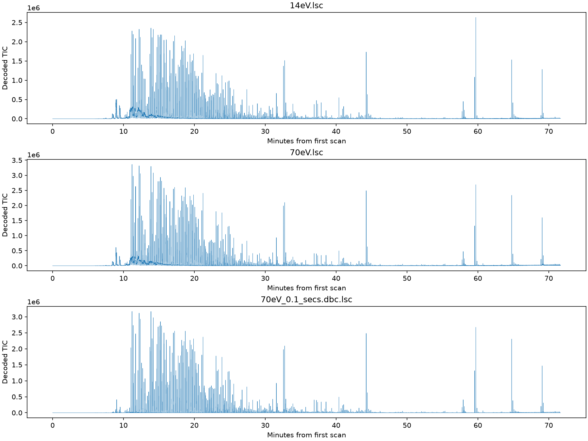

# Native Markes LSC investigation and PyGCGC integration proposal

> Implementation update: native import is now registered in `core/io/markes_lsc.py`
> and connected to GUI/CLI/batch loading. See README.md for usage and HANDOVER.md
> for the current state. This report retains the original investigation/proposal
> below; its statements that the app was not yet changed describe that earlier stage.
> Production times use the whole acquisition-clock second as a shared channel
> origin; audit CSVs remain relative to each channel's first scan. Vendor validation
> and the true modulation period remain outstanding.

Date: 2026-09-19. Scope: the six instrument files in this folder, especially the
three LSC files. This report supersedes the technical conclusions in FORMAT_NOTES.md.

## Outcome

**Direct import of these instrument-produced `.lsc` files is feasible.** An
investigative decoder now reads every spectrum in all three files without a vendor
library or an intermediate CDF export. It produces coherent chromatograms and
extracts individual ion traces. The app itself has not been modified: this task
was investigation followed by an integration proposal.

The important discovery is that LSC already contains calibrated, centroided mass
spectra. It does not require decoding the compressed detector waveforms in DAT or
applying the TOF calibration again. Its embedded method explicitly identifies
`Markes.TOFDS.DPA.MassConversion`, `MASSRESOLUTION_1AMU_CENTROIDED`, mass limits
38–300, and `Markes.TOFDS.DataFile.LineSpectraChromatogram`.

This is strong internal evidence for a native reader, not a vendor-certified format
specification. A comparison against vendor-displayed spectra and retention times
remains necessary before treating quantitative results as validated. It is a
validation step for direct import, not a requirement to use converted files routinely.

## Reproduce and inspect the results

Run from the repository root using the existing central environment:

```powershell
& C:/Users/BreanJ/venvs/main/Scripts/python.exe real_data/audit_lsc.py
& C:/Users/BreanJ/venvs/main/Scripts/python.exe real_data/verify_lsc_relationships.py
```

Dependencies are NumPy and Matplotlib, already available in that environment.
The scripts read the original binaries without modifying them. Outputs include:

- `LSC_AUDIT.json`: per-file SHA-256, structural checks, all-point statistics,
  timing statistics, flags and selected spectra (scan numbers are zero-based).
- `LSC_RELATIONSHIPS.json`: independent indexed raw/DBC comparisons, DAX block
  validation and calibration residuals.
- `LSC_decoded_TIC.png`: the three directly decoded total-ion chromatograms.
- `*.chromatogram.csv`: all 215,015 scan times, TIC and m/z 57, 73, 91, 207, 281
  extracted-ion signals for each file. Times are relative to each file's first scan.
- `*.PD01.txt`, `*.SM01.txt`, `*.MD01.txt`: extracted embedded metadata.
- `probe_lsc.py`: the small initial byte-dump experiment, retained for transparency.



## What was checked across the complete files

| Measurement | 70 eV | 14 eV | 70 eV after DBC |
|---|---:|---:|---:|
| File bytes | 446,136,696 | 375,661,208 | 60,302,328 |
| Spectra | 215,015 | 215,015 | 215,015 |
| Stored ion records | 27,398,105 | 22,993,387 | 3,283,430 |
| Empty spectra | 15,040 | 15,042 | 15,510 |
| First-to-last scan span (s) | 4300.279510 | 4300.280128 | 4300.279510 |
| Median scan interval (s) | 0.019996643 | 0.019996643 | 0.019996643 |
| Observed m/z limits | 38.924–299.497 | 38.868–299.498 | 38.948–299.496 |
| Stored intensity limits | 2–518,438 | 2–709,592 | 2–448,115 |
| Largest spectrum (points) | 261 | 261 | 244 |

All 645,045 spectra and 53,674,922 ion records passed these checks:

- Chunk lengths walk exactly to EOF and remain within file bounds.
- FT04 points to the actual DI02 directory.
- Every directory offset for every present chunk agrees with the independent walk.
- Every spectrum's declared point count predicts its byte length exactly.
- Mass coordinates strictly increase within every nonempty spectrum.
- Every decoded intensity is finite, positive and integer-valued, despite float64 storage.
- The two unassigned zero-field locations described below are zero throughout.
- Every channel's scan times strictly increase.

These checks establish consistency for this file variant. They do not establish
support for other LSC revisions, profile data or different instrument settings.

## Byte layout that works

All multibyte values below are little-endian. Offsets in this section are relative
to the **start of the chunk**, including its eight-byte framing header.

The outer framing is `ASCII tag[4], uint32 total_chunk_bytes`, followed by payload.
FT04 has total length 16; its uint64 at offset 8 is the DI02 file offset.

### SD04 spectra

| Chunk offset | Type | Observed interpretation |
|---:|---|---|
| 0 | 4 ASCII bytes | `SD04` |
| 4 | uint32 | Total length = `28 + 16 * point_count` |
| 8 | uint32 | Fractional-second word |
| 12 | uint32 | Whole seconds; wall-clock-like epoch counter |
| 16 | uint32 | Flags, including a channel-associated bit pattern |
| 20 | uint32 | Point count |
| 24 | uint32 | Always zero in these files; semantics unresolved |
| 28 + 16k | uint32 | Mass coordinate, interpreted as m/z × 1000 |
| 32 + 16k | float64 | Intensity |
| 40 + 16k | uint32 | Always zero here; semantics unresolved |

An empty spectrum is **28 bytes including framing**, only 20 bytes of payload.
The original notes mixed these two coordinate systems, obscuring the record layout.
The zero words may be reserved fields, padding or part of a different underlying
serialization grouping; their semantic ownership is not proven. The offsets needed
to extract counts, mass and intensity are consistent throughout these files.

For example, zero-based scan 30,000 in the untreated 70 eV file starts with:

| Integer coordinate | m/z | Intensity |
|---:|---:|---:|
| 39019 | 39.019 | 463 |
| 39968 | 39.968 | 1284 |
| 41045 | 41.045 | 560 |
| 42053 | 42.053 | 139 |
| 43060 | 43.060 | 385 |

The decimal mass scale agrees with the embedded 38–300 mass range, centroided
conversion setting, near-unit spacing and chemically plausible spectra. Interpreting
the same bytes as float32 pairs, or applying the TOF polynomial to them, is incorrect.
Absolute intensity units and any vendor acquisition normalization still need checking;
the prototype preserves the stored numbers without scaling.

### Time decoding

For a scan with words `fraction` and `seconds`, decode:

```python
relative_s = (seconds - first_seconds) + (fraction - first_fraction) / 2**32
```

Use signed/Python integers for the subtraction. Do not subtract uint32 values
directly, and do not convert the entire large uint64 timestamp to float first.

The apparent 4.29 GHz clock is explained by a 32-bit binary fractional second.
This interpretation produces approximately 50 Hz in each channel across whole-second
rollovers. For untreated 70 eV, intervals range from 17.418 to 26.566 ms; the 1st
and 99th percentiles are 18.364 and 21.721 ms. Preserve these actual times rather
than manufacture a perfectly uniform 20 ms grid.

The 14 eV scan is later than the corresponding 70 eV scan by a median 9.9945 ms
(observed 8.705–15.839 ms). Alternation is supported by the header's tandem method
and these timestamps; the count difference of four relative to HDR remains
unexplained, rather than being attributed to dropped scans without evidence.

The absolute retention-time origin requires a vendor comparison. HDR's textual
nanosecond clock and its raw tick fields should not be assumed to use exactly the
LSC representation. The investigation deliberately uses first-scan-relative time.
For paired channels, use a shared reference while preserving their ~10 ms offset;
independently zeroing both channels would lose that offset.

### DI02 and text metadata

DI02 payload is a sequence of `tag[4], uint32 count, uint64 offsets[count]` groups.
Groups here are PD01, SM01, SD04, TS01, ST01 and MD01. TS01/ST01 each contain a
zero placeholder offset and have no corresponding chunk. They are not offsets to
usable spectra. The SD04 offsets support immediate indexed access to any scan.

PD01 is **not just a verbatim HDR copy**: it contains processing configuration that
is essential to interpretation, including mass conversion and, for DBC, background
compensation. Parse both PD01 and MD01 and preserve their separate provenance.
These INI-like texts contain duplicate keys (e.g. CarrierGas and Name). A default
strict ConfigParser will reject them. Preserve the original text and duplicate
entries; use explicit section/key extraction rather than silently losing values.

## Background-subtracted file: stronger evidence than the filename

All 215,015 timestamps are byte-identical between raw 70 eV and DBC. DBC TIC is
never greater than raw TIC at the same scan. The total stored signal falls from
4,847,394,337 to 2,032,695,425 (about 42% retained).

Its PD01 adds:

```ini
[DBC Settings]
Module=Markes.TOFDS.DPA.DynamicBackgroundCompensation
Version=4.2.0.71
Window width=1.00
Threshold=100

[DBC]
Module=DBCO.dll
Version=0.1.2.1
WindowWidth [scansets]=101
NoiseFactor=2.300000
TracePrecision [amu]=0.400000
```

The metadata describes a high-pass background filter. The filename's `0.1_secs`
does not match an obvious literal value here and is not evidence of 10 Hz data.
Whether 101 scansets refers to the combined or per-channel processing grid, and
the units of `Window width`, need confirmation before assigning a duration.

DBC is **not merely raw points with some rows removed**: 2,467,075 DBC masses
exactly match raw masses at the same scan, but 816,355 do not. None of the exact
matches has increased intensity. Mass trace processing/recentering is a plausible
explanation for changed coordinates, consistent with TracePrecision, but has not
been proven. Import DBC as its own externally processed dataset with its own sparse
structure and metadata, not as a subtractive array aligned to raw centroid entries.

## DAT/DAX and calibration: corrected findings

DAX has **6,721 records**, comprising 6,720 valid block offsets plus a terminator
with scan number 430,035 and offset `0xffffffffffffffff`. Valid records start at
scan 1 and increment by 64. Every referenced DAT block begins with measurement ID
9131, checked across all 6,720 blocks. Thus DAT's initial header is not enough to
describe the entire stream; related block headers recur.

DAT is 1,432,893,352 bytes. Indexed block sizes range from 101,296 to 744,512 bytes,
median 199,794 bytes, including the partial last block. The earlier claim of roughly
2.5 KB per block is incorrect. These checks do not decode the compressed detector
payload; direct DAT import remains separate work and is unnecessary when LSC is
present, as it is in this acquisition.

For the 40 recorded 70 eV calibration points, the polynomial
`mass = Offset T0 + (Mass per Time)*t + (Mass per Time2)*t*t` matches with residuals
from -0.0102 to +0.0125 Da. This gives empirical support for that calibration model
for header time coordinates. It is not needed for the already converted LSC masses.

## How I would integrate this into PyGCGC

1. **Add a strict native reader in `src/pygcgc/core/io/markes_lsc.py`.** Start with
   the observed FT04/SD04 variant. Validate framing, version tags, index bounds,
   counts, timestamp ordering and finite values; report errors with byte offset and
   scan number. Preserve unrecognized metadata/flags and reject unsupported binary
   layouts explicitly. Keep the low-level indexed spectrum access separate from
   building an application Run, so original centroid precision remains accessible.

2. **Construct the existing `Run` directly.** Convert mass integers to m/z, round
   once to the existing unit-mass axis, sum duplicate bins and build CSR with
   float32 intensities and float64 times. Honor the declared 38–300 axis even where
   edge bins are empty. Keep all empty scans, including the filament-delay region.
   Store source hash, parser version, original metadata, energy, time-origin policy,
   processing state and mass-rounding diagnostics in `Run.meta`.

3. **Register `.lsc` through `core/io/__init__.py`.** `read_run()` already dispatches
   by extension and is used for loading runs. Remove its CDF-only advice for unknown
   formats. Direct import must not depend on DAT, DAX or HDR sidecars: these LSC
   files contain their own index and metadata.

4. **Update discovery and dialogs, not just the registry.** `gui/project.py:399`
   and `core/batch.py:267` hardcode `.cdf`/`.nc`; `gui/mainwindow.py:503` has an
   ANDI-only file dialog. Derive supported file extensions from the reader registry
   and update UI/CLI documentation. Keep CDF export available independently.

5. **Represent acquisition, energy channel and processing state separately.**
   Folder discovery currently risks treating both energies and DBC as three sample
   replicates. Group them under one acquisition, default to untreated 70 eV for
   current EI-library/quantification workflows, and offer 14 eV and vendor DBC
   explicitly. Record the user's channel choice in sequence/project state and cache
   keys. Do not sum energies or silently feed 14 eV to a 70 eV reference library.
   DBC should be visibly labelled as vendor processed; additional PyGCGC background
   subtraction should be an explicit processing choice.

6. **Control memory and cancellation.** The untreated 70 eV file has 27.4 million
   points. Float32 CSR values plus int32 indices need about 220 MB before caches;
   CSC copies and multiple imports can multiply this. Two passes over the index
   allow preallocation and direct CSR filling, avoiding full-sized COO row arrays
   and Python objects per ion. Use existing background jobs with progress and
   cancellation. Limit simultaneous large imports, rather than defaulting blindly
   to `read_many(workers=4)`.

7. **Validate import before changing scientific defaults.** Compare several
   individual scans (background, strong peak, weak peak, high-mass end), TIC/EIC
   areas, energy timing and time zero against vendor output. Test at least another
   acquisition and preferably a non-tandem run. Use locally referenced real-data
   tests plus small synthetic structural tests for truncated/malformed files,
   second rollovers, empty scans and duplicate unit bins. Verify that GUI opening,
   folder discovery, saved projects and batch loading all preserve the selected
   channel and processing state. Then exercise existing timing/folding/background
   routines on these real spectra.

There are two immediate scientific integration issues. First, the current ANDI
off-nominal heuristic would flag 2.24% of untreated 70 eV centroids (3.47% of DBC),
even though metadata explicitly declares unit-mass centroiding. Report the deviations
without automatically calling this high-resolution data. There are 1,049 duplicate
rounded bins in raw 70 eV and 478 in 14 eV; summing duplicates is necessary.
Second, the method lists `GCxGCValve ModulationTime=60000.000`; its units, activation
and applicability are not established. Do not assume a 4 s period or fold the new
data using that header number without confirmation. A 1D view can work immediately.

## What remains unresolved

- Exact meanings of flag bits and zero fields, and support for other format revisions.
  Flags have a 0x1000/0x2000 channel association but additional bits also occur.
- Absolute retention-time origin, timestamp semantics and cause of observed jitter.
- Intensity normalization, mass rounding equivalence to the vendor viewer, and the
  DBC trace/window implementation.
- Why LSC contains four fewer total spectra than the HDR scanset count. Preserve
  this discrepancy in provenance; do not fabricate missing scans.
- The GC×GC modulation settings and validation against known standards.

These are bounded validation and compatibility questions. The mass/intensity payload
is no longer the blocker described in the previous investigation.

## External documentation check

The vendor confirms ChromSpace accepts LSC and describes tandem-ionisation workflows
on its [ChromSpace 1D page](https://markes.com/separationanalysisdata/data-analysis/chromspace-1d).
That page is product documentation, not a binary specification. A targeted web
search did not find a public SD04 layout specification; this is not proof that none
exists. All byte layouts and numerical findings above come from the local files
and reproducible scripts, not from an assumed vendor specification.
